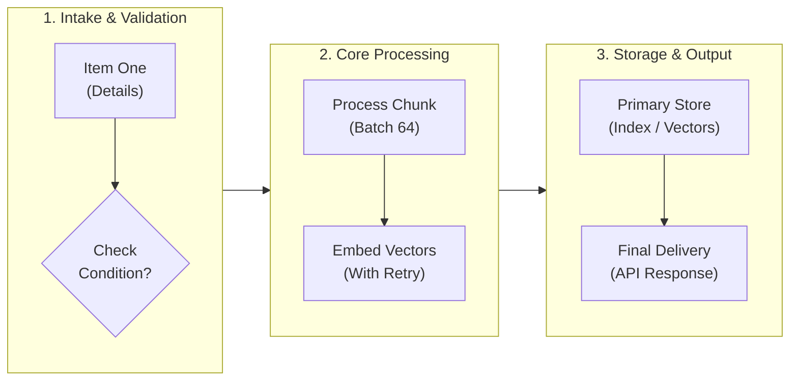

# Mermaid Diagram Optimizer

## Overview

Complex software architecture and workflow diagrams frequently suffer from severe visual defects when rendered in Markdown viewers, document readers, and code platforms (such as MDHero, VS Code Markdown Preview, GitHub, and GitLab):
1. **The Letterbox Squish**: Ultra-wide diagrams (>2,000px) get scaled down uniformly by desktop Webviews (`max-width: 100%`), making fonts and shapes microscopic and unreadable.
2. **Text Truncation & Clipping**: Long text lines inside SVG nodes hit bounding boxes when font-measurement metrics differ between the SVG calculation and the viewer's CSS, cutting off words abruptly (e.g. `compute_file_ha`, `Session Event / F`).
3. **The Infinite Vertical Tower**: Flowcharts set to `flowchart TD` with many sequential nodes create a skinny 250px column that requires multiple page scrolls while wasting 80% of horizontal viewport width.
4. **Lexer Grammar Rejections**: Special shapes like cylinder `[( "..." )]` fail in strict or older Mermaid parsers when quotes or spaces follow `[(`.

This skill provides the end-to-end engineering discipline and refactoring patterns required to produce compact, beautifully proportioned, zero-clipping Mermaid diagrams that render consistently across all viewers.

## When to use

- User asks to "optimize diagram layout", "fit diagram to space", "make diagram compact", or "fix diagram formatting".
- Diagrams exhibit clipped or cut-off text on the right side of nodes or diamonds.
- Diagram is squished horizontally with illegible micro-text in MDHero, VS Code, or web previews.
- Converting tall, skinny single-column flowcharts (`flowchart TD`) into space-efficient multi-stage pipelines.
- Replacing legacy or unstyled `stateDiagram-v2` blocks with clean, color-coded, self-healing workflow flowcharts.
- Debugging Mermaid parser errors (e.g. `Parse error on line X: Expecting 'SQE', got 'STR'`).

## Core concepts

### 1. The Aspect Ratio Golden Rule
Target a canvas aspect ratio between **16:9** and **4:3**. Avoid extreme aspect ratios:
- ❌ **Anti-pattern: Skinny Tower** (`1:6` ratio, e.g. 250px wide × 1,500px tall). Wastes screen width and forces endless scrolling.
- ❌ **Anti-pattern: Ultra-Wide Splay** (`5:1` ratio, e.g. 2,500px wide × 500px tall). Squished into an illegible horizontal ribbon by `max-width: 100%`.
- ✅ **Optimal: Balanced Staged Matrix** (`16:9` ratio, e.g. 900px wide × 500px tall). Fills the document reading pane naturally without horizontal squishing or excessive vertical scrolling.

### 2. Multi-Stage Pipeline Pattern (`flowchart LR` + Subgraphs)
To fit long sequential processes into horizontal space without squishing:
1. Set top-level orientation to `flowchart LR` (Left to Right).
2. Segment the process into 3 to 5 logical subgraphs representing sequential stages (e.g., `1. Intake`, `2. Processing`, `3. Persistence`).
3. Inside each subgraph, set `direction TB` (Top to Bottom) so nodes within a stage stack vertically.
4. Connect stages horizontally (`Stage1 --> Stage2 --> Stage3`).

### 3. Text Boundary & Wrapping Invariants
To prevent font measurement mismatches from truncating text across viewers:
- **Maximum 20-22 characters per line**: Never allow a single line of text in any node to exceed 22 characters.
- **Explicit `<br/>` Line Breaks**: Break phrases manually at logical boundaries.
- **Universal Double Quoting**: Always wrap node text in double quotes: `id["Line 1<br/>Line 2"]` and decision nodes in `id{"Condition<br/>Line 2?"}`.
- **Diamond Node Care**: Diamond decision shapes (`{...}`) lose 50% of their horizontal area to the 45° angled corners. Keep diamond text exceptionally concise (e.g., `{"Inactivity<br/>> 15 min?"}` rather than `{"Has user been idle for more than 15 minutes?"}`).

### 4. Avoiding Dagre Rank Splaying (No Backward Subgraph Edges)
Mermaid's Dagre layout engine calculates subgraph ranks sequentially:
- When a node in downstream `Subgraph B` links *backward* to an upstream `Subgraph A`, Dagre cannot stack them vertically and resolves the cycle by **splaying the subgraphs side-by-side horizontally**.
- **Fix**: Remove backward cross-subgraph edges. Represent responses, completions, or return values either within the downstream subgraph or using isolated annotation nodes.

### 5. Universal Node Shape Compatibility
- Use standard quoted rectangle syntax `id["Text"]` for all general nodes and databases.
- Avoid cylinder `id[( "Text" )]` or `id[("Text")]` which breaks with `got 'STR'` in many parsers. Instead, use `id["Database Name<br/>• Details"]` and style it with distinct fill and stroke colors (`#e0f2fe`, `#0369a1`).

## Practical workflow

### Step 1: Diagnose the Layout Issue
Inspect the existing Mermaid code and identify the root cause:
- If tall and narrow with cut-off text: Unbroken single-line strings in `flowchart TD`.
- If flat and microscopic: Circular or bidirectional links between subgraphs forcing horizontal rank splay.
- If parse error on cylinder: `[( "..." )]` syntax conflict.

### Step 2: Refactor to Staged Subgraphs
Restructure the flow into 3–4 cohesive columns or stages:


### Step 3: Enforce Text Invariants
Review every node label and transition string:
1. Wrap every node label in double quotes `["..."]` or `{"..."}`.
2. Insert `<br/>` tags to keep individual lines under 20–22 characters.
3. Replace verbose edge labels (e.g. `|APPLICATIONINSIGHTS_CONNECTION_STRING|`) with concise tokens (e.g. `|Azure Monitor|`).

### Step 4: Apply Visual Styling Palette
Use consistent, accessible pastel fills with distinct border strokes:
```mermaid
    style Stage1 fill:#f8fafc,stroke:#94a3b8,stroke-width:1.5px
    style Stage2 fill:#f0f9ff,stroke:#0284c7,stroke-width:1.5px
    style Stage3 fill:#fdf4ff,stroke:#c026d3,stroke-width:1.5px
    style ErrorNode fill:#fee2e2,stroke:#ef4444,stroke-width:1.5px
    style SuccessNode fill:#dcfce7,stroke:#22c55e,stroke-width:1.5px
```

## Common pitfalls

- **Unquoted text with punctuation**: Labels like `Node[foo: bar (baz)]` break the lexer. Always write `Node["foo: bar (baz)"]`.
- **Assuming fixed-width font rendering**: Never assume the viewer uses standard-width fonts. MDHero and Electron apps often use wider proportional system fonts that truncate lines over 22 characters.
- **Ignoring mobile/split-pane viewports**: Large monolithic diagrams break on laptop split screens. Modular subgraphs reflow predictably.
- **Over-complicating state machines**: Using `stateDiagram-v2` for workflows with complex branching produces messy overlapping arrows. A structured `flowchart LR` with color-coded success/failure terminal states is clearer and universally supported.
