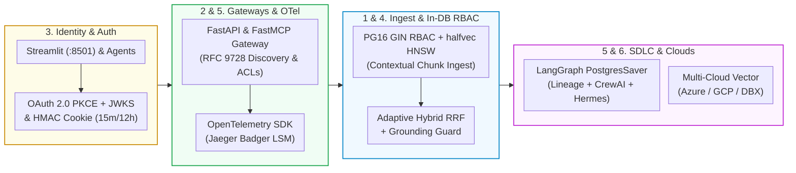
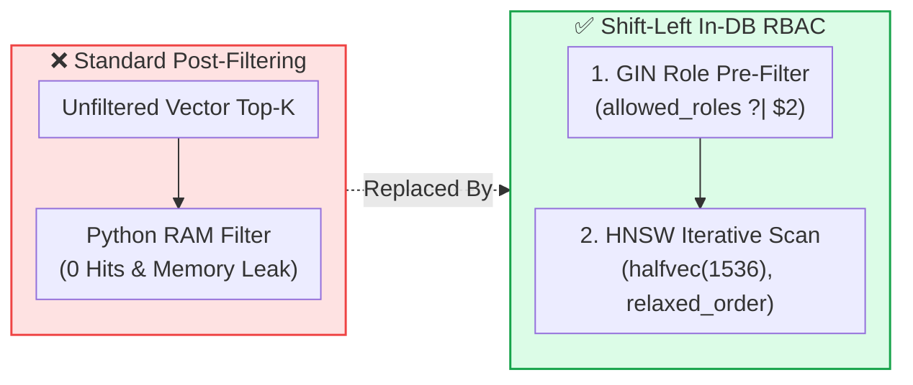
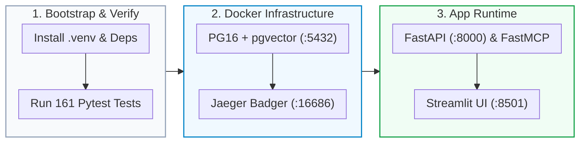
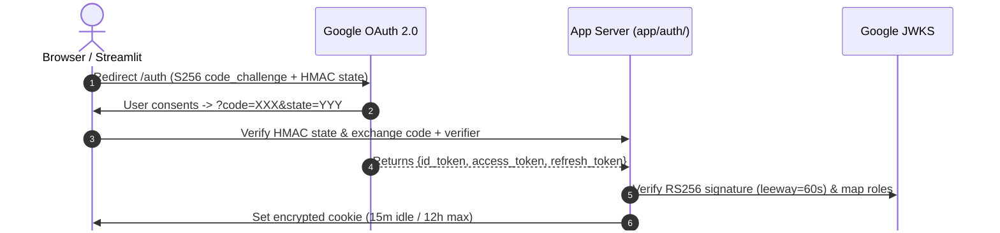
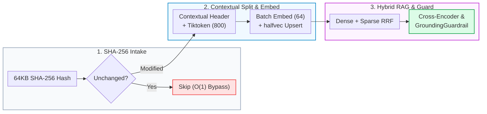
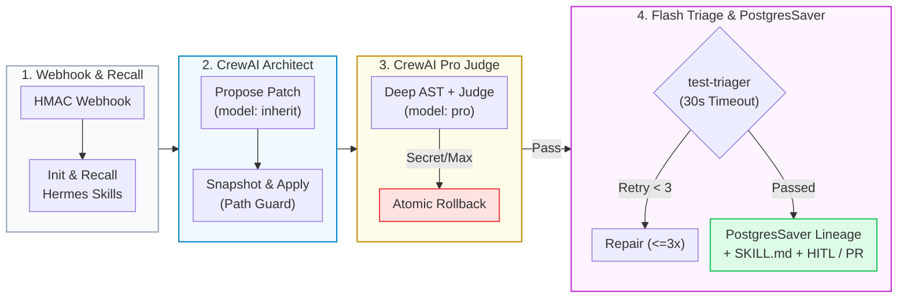
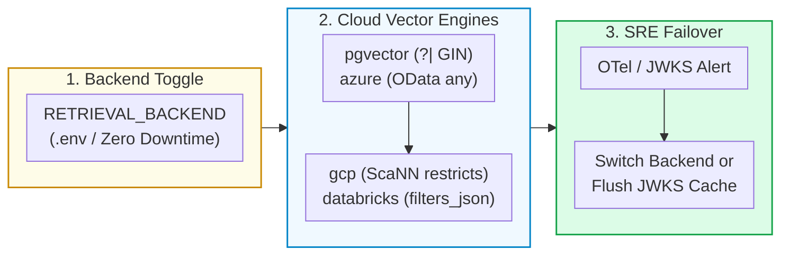
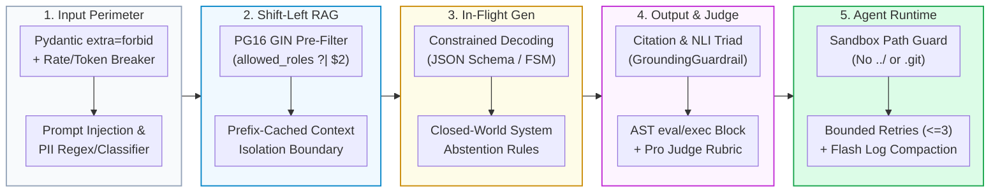

# 🛡️ Enterprise Zero-Trust RAG & Autonomous SDLC
| Live Artifact | Description | Access Link |
| :--- | :--- | :--- |
| **Interactive UI** | Shift-Left In-Database RBAC & Session Monitor | [enterprise-rag-pgvector-rbac.streamlit.app](https://enterprise-rag-pgvector-rbac.streamlit.app) |
| **API Docs** | Live OpenAPI / Interactive Swagger UI | [enterprise-rag-api-ksez.onrender.com/docs](https://enterprise-rag-api-ksez.onrender.com/docs) |
| **Source Code** | Auditable Source Repository & Offline Test Suite | [github.com/Kenono2000/enterprise-rag-pgvector-rbac](https://github.com/Kenono2000/enterprise-rag-pgvector-rbac) |

**Architect:** **[Ken Wong](https://www.linkedin.com/in/kenwong-architect/)** — Shift-left **In-Database Zero-Trust Vector RBAC** & **Autonomous Self-Healing SDLC Agent** (`PostgreSQL 16 + pgvector`, `FastAPI`, `Streamlit`, `OAuth 2.0 PKCE`, `JWKS`, `FastMCP`, `LangGraph`, `CrewAI`, `Hermes Agent`).\
**Quick Navigation:** [1. In-Database RBAC & Storage](#1-in-database-rbac-and-vector-storage-schemasql-appdb) · [2. Quickstart & Runtime Stack](#2-5-minute-quickstart-and-runtime-stack) · [3. Identity & Session Security](#3-identity-oauth-20-pkce-and-session-security-appauth) · [4. Ingestion & Hybrid RAG](#4-ingestion-pipeline-and-hybrid-rag-quality-scriptsingestpy-libs) · [5. Gateways, OTel & SDLC Agent](#5-gateways-observability-and-autonomous-sdlc-agent-app-agent) · [6. Multi-Cloud & Runbook](#6-multi-cloud-strategy-and-runbook)
## Complete System Architecture

| Topic | Architectural Pillar | Core Engineering Pattern | Primary Security & Performance Outcome |
| :-: | :--- | :--- | :--- |
| **1** | **In-DB RBAC & Storage** | Pre-filtered GIN + HNSW iterative scan (`relaxed_order`), 16-bit `halfvec(1536)` & Token Ledger | Zero recall starvation, zero overfiltering, **75% RAM savings**, in-DB token audit & managed shutoff. |
| **2** | **Quickstart & Runtime** | Event-loop-scoped `asyncpg` pools, `SKIP LOCKED` outbox & `/readyz` | Prevents closed-loop crashes; durable worker queue; Kubernetes probe ready (161 tests). |
| **3** | **Identity & Sessions** | Stateless OAuth 2.0 PKCE, HMAC state & encrypted cookies | Survives F5 reloads & multi-worker scale-out with **zero Redis**; SOC-2 15m/12h bounds. |
| **4** | **Ingestion & Hybrid RAG** | Contextual Headers, 64KB SHA-256 de-dup, Adaptive Dense + Sparse RRF (`dense_weight` / `sparse_weight`) | **>0.90 Context Precision**; `O(1)` skip for unchanged files; domain-adaptive fusion. |
| **5** | **Gateways, OTel & SDLC** | Zero-Trust FastMCP (RFC 9728 & RFC 8707 Tool ACLs), `PostgresSaver` & Managed Quota API | Crash-resilient resume; token consumption kill-switch (`enforce_limit`/`is_blocked`); 60 req/min limits. |
| **6** | **Multi-Cloud & Runbook** | Quad-mode strategy (`pgvector`, `azure`, `gcp`, `databricks`) | Zero-downtime `.env` switching with native pre-filtering across all 4 engines. |
## 1. In-Database RBAC and Vector Storage (`schema.sql`, `app/db/`)

```sql
SELECT d.document_id, d.title, c.chunk_index, c.content, d.allowed_roles,
       1 - (c.embedding::halfvec(1536) <=> $1::vector::halfvec(1536)) AS similarity
FROM document_chunks c JOIN documents d ON c.document_id = d.id
WHERE d.allowed_roles ?| $2::text[] AND (c.embedding_model = 'text-embedding-3-large' OR c.embedding_model IS NULL)
ORDER BY c.embedding::halfvec(1536) <=> $1::vector::halfvec(1536) LIMIT $3;
```
* **No Recall Starvation & pgvector 0.8+ Iterative Scans**: PostgreSQL evaluates `WHERE d.allowed_roles ?| $2::text[]` via the **GIN Index** and automatically configures `SET hnsw.iterative_scan = 'relaxed_order'` (`max_scan_tuples = 20000`) per pooled connection—eliminating ANN overfiltering on selective roles while ensuring unauthorized rows never enter Python RAM.
* **SQL Injection & Empty-Role Guards**: Binds roles strictly as a parameterized `$2::text[]` array and returns `[]` immediately before DB execution if `user_roles` is empty.
* **Matryoshka 1536-d + 16-Bit `halfvec(1536)` Compaction**: Truncates `text-embedding-3-large` from `3072` to `1536` dims and quantizes to IEEE 754 16-bit floats (`embedding_halfvec halfvec(1536)`, `idx_chunks_embedding_halfvec_hnsw` with `halfvec_cosine_ops`) for **50% additional HNSW RAM savings** (**75% cumulative reduction**, **>98% recall**) across normalized `documents` + `document_chunks` (`ON DELETE CASCADE`) tables (see [`schema.sql`](file:///c:/src/enterprise-rag-pgvector-rbac/schema.sql)).
* **Persistent Token Consumption Ledger & Managed Budget Controls**: `token_consumption_ledger` records atomic prompt and completion token counts per caller and model, while `token_managed_limits` enforces caller quotas (`max_budget_tokens`), provides administrative toggles to disable enforcement (`enforce_limit`), and trips an emergency kill-switch (`is_blocked`) to turn off token consumption once limits are exceeded.
## 2. 5-Minute Quickstart and Runtime Stack

```powershell
git clone https://github.com/Kenono2000/enterprise-rag-pgvector-rbac.git && cd enterprise-rag-pgvector-rbac
python -m venv .venv && .\.venv\Scripts\Activate.ps1 && python -m pip install -r requirements.txt
python -m pytest -v                                                     # 1. Run full test suite (161 tests; the Docker-gated integration test auto-skips when no daemon)
docker compose up -d && psql -U postgres -d enterprise_rag -f schema.sql # 2. Start PG16 + pgvector & Jaeger Badger
python -m uvicorn app.main:app --host 0.0.0.0 --port 8000 --reload       # 3. Launch FastAPI Backend (:8000)
python -m streamlit run streamlit_app.py --server.port 8501              # 4. Launch Streamlit UI (:8501)
python -m app.mcp --transport http                                       # 5. Launch FastMCP Gateway (Streamable HTTP / stdio)
python -m agent status                                                   # 6. Run Hermes + CrewAI + LangGraph SDLC CLI
python -m agent checkpoints "<thread_id>"                                # 7. Inspect Time-Travel Checkpoint Lineage
```
* **Local Endpoints**: Streamlit UI (`http://localhost:8501`) · Swagger Docs (`http://localhost:8000/docs`) · SSE Stream (`/api/v1/query/stream`) · Document Catalog (`/api/v1/documents`) · Health Probes (`/healthz`, `/readyz`) · Token Budget Controls (`/api/v1/tokens/usage`, `/api/v1/tokens/limit`) · Telemetry (`/api/v1/metrics/observability`) · Jaeger UI (`http://localhost:16686`).
* **Loop-Scoped Async Concurrency**: `DatabaseManager` and `get_openai_client()` scope connection pools to `asyncio.get_running_loop()`, preventing `RuntimeError: Event loop is closed` across Streamlit threads.
* **Hermetic, 100% Offline Tests (`conftest.py`)**: The suite pins a deterministic environment (`OTEL_ENABLED=false`, blank `DATABASE_URL` / `GITHUB_TOKEN`, `SDLC_PUSH=false`, `USE_CREWAI_SDK=false`) *before* any application module is imported, so a developer `.env` (live PostgreSQL, hosted OTLP collector, cloud keys) can never leak into `python -m pytest -v`. All application modules load `.env` with `load_dotenv(..., override=False)`, so real process environment variables always win (12-factor precedence) — this is what lets CI and containers override the dotenv file. The heavyweight **CrewAI** SDK is strictly opt-in: `SDLCCrewOrchestrator.build_crewai_crew()` / `build_crewai_flow()` return the deterministic `native_pydantic` adapter unless `USE_CREWAI_SDK=true` is set, keeping import time and side effects out of default execution.
## 3. Identity, OAuth 2.0 PKCE, and Session Security (`app/auth/`)

* **Stateless HMAC PKCE State**: `encode_pkce_state()` signs `{b64_payload}.{sig}` (300s TTL) with HMAC-SHA256, surviving OAuth redirects and multi-worker restarts without Redis.
* **F5 Reload Resilience**: Compresses (`zlib`) and HMAC-signs session tokens into the `enterprise_rag_session` cookie, rehydrating `st.session_state` and silently rotating expired tokens on browser refresh.
* **Multi-IdP JWKS & SOC-2 Bounds**: Validates RS256 signatures (`leeway=60s`), maps claims across Google, Azure AD, Okta, Cognito, and Keycloak against `KNOWN_ROLES`, and enforces a **15-minute idle timeout** and **12-hour hard ceiling**.
## 4. Ingestion Pipeline and Hybrid RAG Quality (`scripts/ingest.py`, `libs/`)

* **Skip Unchanged Files (SHA-256 Hashing)**: Hashes files in 64KB blocks (`O(1)` lookup) to skip unchanged documents with zero API calls, and automatically replaces old chunks when a file is updated.
* **Contextual Chunk Headers & Table-Safe Splitting**: `split_chunks()` (`libs/utilities.py`) extracts parent document summaries (`summarize_document_context`) and prepends `[Document Context: <id> | Section: <sec> | Summary: <summary>]` headers (`build_contextual_chunk_header`) to 800-token chunks without breaking Markdown tables—elevating **Context Precision > 0.90** while embedding in 64-chunk batches with exponential backoff (`tenacity`).
* **Adaptive Hybrid Search (Semantic + Keyword RRF)**: Combines 16-bit `halfvec(1536)` cosine search with robust full-text search (`plainto_tsquery` + `websearch_to_tsquery` fallback) using parameterized Reciprocal Rank Fusion (`dense_weight / (k + rank) + sparse_weight / (k + rank)`, default `k=60`), pre-filtered by user role in PostgreSQL. Fusion runs as a **single-pass SQL CTE** (`ROW_NUMBER() OVER (...)` dense + sparse ranks, `FULL OUTER JOIN`, in-database RRF score) with automatic Python RRF fallback, and `hnsw.max_scan_tuples` auto-scales per caller via `DatabaseManager.scaled_scan_tuples` (1 role 2x, 2 roles 1x, 3+ roles 0.5x).
* **Re-Ranking & Citation Guardrail (`GroundingGuardrail`)**: Re-ranks top results with a `CrossEncoder` and requires every answer to cite `[Doc: <Title>, Chunk <Index>]`—explicitly refusing to answer when context is missing.
* **Context Engineering Pipeline (`app/rag/context.py`)**: Formalizes the retrieve → assemble → cache → compact context discipline: `ContextAssembler.assemble()` converts authorized chunks into citation-formatted context text, builds a deterministic static-prefix prompt (SHA-256 `prefix_hash`, `static_prefix_tokens`) for cross-turn KV prefix caching, and applies token-bounded deterministic compaction (`DEFAULT_MAX_CONTEXT_TOKENS=4000`) when the authorized context exceeds the budget, keeping highest-similarity chunks. `app/main.py` now routes both `/api/v1/query` and `/api/v1/query/stream` through this pipeline.
## 5. Gateways, Observability, and Autonomous SDLC Agent (`app/`, `agent/`)

* **Zero-Trust FastMCP Gateway (`app/mcp/gateway.py`)**: Exposes `search_sdlc_context`, `list_documents`, `propose_patch`, `run_sdlc_crew`, `recall_hermes_skills`, `get_gateway_metadata`, and `policy://sdlc-budget` over `stdio`, `http` (Streamable HTTP), and legacy `SSE` with `ConfigDict(extra="forbid")` schemas, RFC 9728 Protected Resource Metadata discovery, RFC 8707 tool-level Role-Based Access Control (`check_tool_permission` blocking confused deputy exploits), 60 req/min `SlidingWindowRateLimiter`, and 8K/50K `TokenCircuitBreaker`. The LangGraph SDLC engine supports opt-in concurrent verification (`SDLC_PARALLEL_VERIFY=true` / `parallel_verify=True`): after the deterministic AST/secret gate passes, the Auditor and Triager run in parallel (`parallel_verify` node; `SDLCCrewOrchestrator.build_crewai_flow` exposes the equivalent CrewAI Flow with `@start`/`@listen`/`and_`).
* **Managed Token Budget & Administrative Shutoff API (`app/main.py`)**: Provides endpoints (`/api/v1/tokens/usage`, `/api/v1/tokens/limit`, `/api/v1/tokens/reset`, `/api/v1/tokens/ledger`) backed by PostgreSQL `token_consumption_ledger` and `token_managed_limits`, enabling administrators and callers to monitor token velocity, toggle enforcement (`enforce_limit`), or trigger emergency kill-switches (`is_blocked`) to immediately turn off token consumption.
* **Full-Stack OpenTelemetry (`app/observability.py`)**: Streams OTLP gRPC spans (`:4317`) to **Jaeger** (persistent Badger LSM disk store, 7-day TTL) and **Azure Application Insights**, backed by a 1,000-event ring buffer (`GET /api/v1/metrics/observability`) and non-root `Dockerfile` (`UID 10001`).
* **Tri-Paradigm SDLC Workflow & `PostgresSaver` (`agent/workflow.py`)**: Unites **LangChain/LangGraph** (`LangGraphSDLCWorkflow` cyclic state machine + native `interrupt()` / `Command(resume=...)` HITL approval gating + PostgreSQL checkpoint persistence via `PostgresSaver`/`sdlc_workflow_checkpoints` + `resume_from_checkpoint` multi-worker recovery + `get_execution_history` time-travel lineage auditing + atomic `rollback_patches`), **CrewAI** (`SDLCCrewOrchestrator` role-based crew: `Principal SDLC Architect` [`inherit`], `Lead Security & AST Auditor` [`pro`], and `Site Reliability & Pytest Triager` [`flash`] — upstream SDK adapter enabled with `USE_CREWAI_SDK=true`, otherwise the deterministic `native_pydantic` adapter is used), and **Hermes Agent** (`HermesSkillSynthesizer` closed-loop `recall_relevant_skills`, portable `SKILL.md` distillation, and Atropos GRPO ShareGPT RL trajectory export with step reward rubrics) guarded by `PolicyEngine`.
## 6. Multi-Cloud Strategy and Runbook
* **Zero-Downtime Cutover & Failover**: Switch `RETRIEVAL_BACKEND` in `.env` (`pgvector` | `azure` | `gcp` | `databricks`) or run `python scripts/migrate_multicloud.py --target all`.
* **Incident Runbook**: On DB latency alerts in Jaeger (`http://localhost:16686`), fail over `RETRIEVAL_BACKEND` in `.env`; on JWKS key rotation, restart the auth worker to flush `JWKSClient`; verify Badger LSM persistence via `docker compose restart jaeger`.

| Backend (`RETRIEVAL_BACKEND`) | Vector & Hybrid Engine | In-Database RBAC Pre-Filter | LLM & Observability |
| :--- | :--- | :--- | :--- |
| **`pgvector`** (Local) | PG16 `halfvec(1536)` HNSW + `tsvector` RRF | `WHERE allowed_roles ?| $2::text[]` | OpenAI `gpt-4o` + Jaeger Badger LSM |
| **`azure`** (Microsoft Azure) | Azure AI Search + Semantic Ranker | OData `allowed_roles/any(r: ...)` | Azure OpenAI `gpt-4o` + App Insights |
| **`gcp`** (Google Cloud) | Vertex AI ScaNN + Ranking API | ScaNN `restricts` (`allowList`) | Gemini 1.5 Pro + Cloud Trace |
| **`databricks`** (Databricks) | Mosaic AI Vector Search (Delta Sync) | Unity Catalog `filters_json` (`OR`) | Llama 3.1 70B + MLflow Tables |

---

## 7. Consolidated SDLC Deep-Dive, Terminology Source-Code Map & Interview Knowledge

**Consolidation source**: Multi-turn architectural deep-dive and technical-interview preparation session covering the **Gateways**, **Observability**, and **Autonomous SDLC Agent** (`app/`, `agent/`), the **Managed Token Budget & Administrative Shutoff API**, the **Zero-Trust FastMCP Gateway**, the **Full-Stack OpenTelemetry** stack, and the **Tri-Paradigm SDLC Workflow & `PostgresSaver`**.

### 7.1 Consolidated Session Knowledge

**Zero-Trust FastMCP Gateway (`app/mcp/gateway.py`)**
- Hosts `FastMCP("SDLC-Harness-Gateway")` with tools `search_sdlc_context`, `list_documents`, `propose_patch`, `run_sdlc_crew`, `recall_hermes_skills`, `get_gateway_metadata` and resource `policy://sdlc-budget`.
- Transports: `stdio`, `http` (Streamable HTTP), legacy `sse`; CLI `--transport {stdio,sse,http,streamable-http}`; env `MCP_TRANSPORT`, `MCP_HOST`, `MCP_PORT`.
- Per-tool pipeline: strict `ConfigDict(extra="forbid")` request schemas → `_resolve_tool_roles` (Google JWKS via `app/auth/jwks.py`, roles via `extract_roles`) → `_resolve_caller_attribution` → `check_tool_permission` (fail-closed tool-level RBAC, RFC 8707) → `SlidingWindowRateLimiter` (60 req/60 s) → `TokenCircuitBreaker` (8K tokens/50K issue) → retrieval/LLM → `tracer.record_mcp_tool_execution`.

**Managed Token Budget & Administrative Shutoff API (`app/main.py`, `app/db/*`, `schema.sql`)**
- Endpoints: `GET /api/v1/tokens/usage`, `POST /api/v1/tokens/limit`, `POST /api/v1/tokens/reset`, `GET /api/v1/tokens/ledger`.
- Backed by `token_consumption_ledger` and `token_managed_limits`; admin/engineer or self-service toggles; `enforce_limit` toggle; `is_blocked` kill switch; enforcement order in query: rate limit → token breaker → DB limit check → retrieve → generate → record.

**Full-Stack OpenTelemetry (`app/observability.py`, `docker-compose.yml`, `Dockerfile`)**
- Azure App Insights via connection string OR OTel OTLP gRPC → Jaeger (Badger LSM, 7-day TTL) + Azure App Insights; 1,000-event ring buffer; `GET /api/v1/metrics/observability`; HTTP middleware + MCP tool spans; non-root Dockerfile UID 10001.

**Tri-Paradigm SDLC Workflow & PostgresSaver (`agent/workflow.py`, `agent/guardrails.py`, `agent/parser.py`)**
- LangGraph state machine; CrewAI crew (Architect `inherit`, Auditor `pro`, Triager `flash`); Hermes skill recall/synthesis/RL trajectory.
- Nodes: `initialize → propose_patches → apply_patches → audit_patches → run_tests → synthesize_hermes_skill → finalize`; self-heal via `repair_patches`; atomic `rollback_patches`; HITL via `interrupt()` / `Command(resume=...)` + `PostgresSaver`; opt-in `parallel_verify` (deterministic AST/secret gate → `asyncio.gather(audit, tests)`).

### 7.2 Consolidated Terminology → Source Code → Test Map

| Terminology | Source | Tests |
|---|---|---|
| FastMCP gateway / transports / server | `app/mcp/gateway.py` | `tests/test_mcp_auth.py` (`test_run_server_default_stdio`, `test_run_server_sse_transport`, `test_run_server_http_streamable_transport`, `test_run_server_env_transport`) |
| Tool ACL / RFC 8707 / fail-closed | `app/mcp/gateway.py` | `tests/test_mcp_auth.py::test_tool_permission_acl_blocks_unauthorized_roles` |
| MCP schemas `extra="forbid"` | `app/mcp/gateway.py` | `tests/test_mcp_auth.py::test_mcp_schemas_enforce_extra_forbid` |
| RFC 9728 metadata | `app/mcp/gateway.py` | `tests/test_mcp_auth.py::test_get_gateway_metadata_rfc9728` |
| SlidingWindowRateLimiter | `agent/guardrails.py` | `tests/test_mcp_auth.py::test_mcp_sliding_window_rate_limiter_trips` |
| TokenCircuitBreaker | `agent/guardrails.py` | `tests/test_token_management.py`, `tests/test_mcp_auth.py::test_mcp_token_circuit_breaker_trips` |
| Token ledger / managed limits | `app/db/manager.py`, `schema.sql` | `tests/test_token_management.py`, `tests/test_database_schema.py` |
| Observability tracer / spans / ring buffer | `app/observability.py` | `tests/test_observability_and_health.py`, `tests/test_mcp_auth.py::test_mcp_observability_tracking` |
| LangGraph workflow / HITL / checkpoints | `agent/workflow.py` | `tests/test_agent.py::test_langgraph_workflow_execution`, `test_production_rollback_judge_healing_and_hitl`, `test_langgraph_workflow_parallel_verify` |
| CrewAI / Hermes | `agent/workflow.py` | `tests/test_agent.py::test_crewai_orchestrator_and_hermes_synthesizer`, `test_crewai_flow_builder_plan` |
| PolicyEngine | `agent/guardrails.py` | `tests/test_agent.py::test_secret_scanning`, `test_ast_verification`, `test_schema_drift_guardrail`, `test_evaluate_patch` |
| GroundingGuardrail | `agent/guardrails.py` | `tests/test_hybrid_search.py::test_grounding_guardrail_*` |
| Context Assembler / Context Engineering | `app/rag/context.py` | `tests/test_context_assembly.py` |

### 7.3 Consolidated Interview Cheat Sheet

- **Gateway**: 60 req/min sliding window; 8K tokens/request; 50K tokens/issue; fail-closed ACL; RFC 9728 + RFC 8707; MCP spans; transports stdio/http/streamable-http/sse.
- **Token**: ledger + managed limits + `enforce_limit` + `is_blocked`; endpoints `/api/v1/tokens/*`; enforcement order rate limit → breaker → DB check → retrieve → generate → record.
- **Observability**: OTel OTLP → Jaeger Badger (7-day TTL) / Azure App Insights; 1,000-event ring buffer; `GET /api/v1/metrics/observability`; HTTP + MCP spans.
- **SDLC**: LangGraph + CrewAI + Hermes; PolicyEngine; HITL (`interrupt` / `Command(resume=...)` / `PostgresSaver`); `parallel_verify`; repair loop; rollback; autonomy ladder.

### 7.4 Consolidated Key Source Excerpts

**Fail-closed tool ACL** (`app/mcp/gateway.py`):
```python
def check_tool_permission(tool_name: str, roles: Optional[List[str]]) -> Tuple[bool, Optional[str]]:
    required = TOOL_REQUIRED_ROLES.get(tool_name)
    unrestricted = not required or "*" in required
    if roles is None:
        return True, None
    if not roles:
        if unrestricted:
            return True, None
        return (False, f"Tool authorization error: Tool '{tool_name}' requires one of {required}. Caller token resolved to no application roles.")
    if unrestricted:
        return True, None
    if any(r in required for r in roles):
        return True, None
    return False, f"Tool authorization error: Tool '{tool_name}' requires one of {required}. Current roles: {roles}"
```

**Token circuit breaker** (`agent/guardrails.py`):
```python
@staticmethod
def estimate_tokens(text: str) -> int:
    if not text: return 0
    return max(len(text.split()), (len(text) + 3) // 4)

def check_and_consume(self, caller_key: str, requested_tokens: int) -> Tuple[bool, int, Optional[str]]:
    key = (caller_key or "anonymous").strip() or "anonymous"
    used = self._consumed.get(key, 0)
    should_enforce = self.is_enforce_limit(key)
    if self._blocked.get(key, False):
        return (False, max(0, self.max_tokens_per_issue - used), f"Token consumption turned off for caller '{key}': account is blocked or reached managed limit.")
    if requested_tokens > self.max_tokens_per_request:
        return (False, max(0, self.max_tokens_per_issue - used), f"Token circuit breaker tripped: request tokens ({requested_tokens}) exceed max_tokens_per_request ({self.max_tokens_per_request}).")
    if should_enforce and (used + requested_tokens > self.max_tokens_per_issue):
        self._blocked[key] = True
        return (False, max(0, self.max_tokens_per_issue - used), f"Token circuit breaker tripped: cumulative tokens ({used + requested_tokens}) exceed max_tokens_per_issue ({self.max_tokens_per_issue}).")
    new_total = used + max(0, requested_tokens)
    self._consumed[key] = new_total
    return True, max(0, self.max_tokens_per_issue - new_total), None
```

**Sliding window rate limiter** (`agent/guardrails.py`):
```python
class SlidingWindowRateLimiter:
    def __init__(self, max_requests: int = 60, window_seconds: float = 60.0):
        self.max_requests = max_requests
        self.window_seconds = window_seconds
        self._windows: Dict[str, Deque[float]] = {}

    def allow_request(self, caller_id: str, now: Optional[float] = None) -> Tuple[bool, int, float]:
        ts = now if now is not None else time.monotonic()
        key = (caller_id or "anonymous").strip() or "anonymous"
        bucket = self._windows.setdefault(key, deque())
        cutoff = ts - self.window_seconds
        while bucket and bucket[0] <= cutoff:
            bucket.popleft()
        if len(bucket) >= self.max_requests:
            retry_after = max(0.0, round(self.window_seconds - (ts - bucket[0]), 2))
            return False, 0, retry_after
        bucket.append(ts)
        remaining = max(0, self.max_requests - len(bucket))
        return True, remaining, 0.0
```

**Observability tracer** (`app/observability.py`):
```python
@contextmanager
def trace_span(self, operation: str, attributes: Optional[Dict[str, Any]] = None):
    attrs = attributes.copy() if attributes else {}
    start_time = time.perf_counter()
    span_data = {"operation": operation, "start_time": time.time(), "attributes": attrs, "status": "ok"}
    otel_span = None
    if self._otel_tracer:
        try:
            otel_span = self._otel_tracer.start_span(operation)
            for k, v in attrs.items():
                otel_span.set_attribute(str(k), str(v))
        except Exception:
            otel_span = None
    try:
        yield span_data
    except Exception as exc:
        span_data["status"] = "error"
        span_data["error"] = str(exc)
        if otel_span: otel_span.record_exception(exc)
        logger.error("Span error in operation '%s': %s", operation, exc)
        raise
    finally:
        if otel_span: otel_span.end()
        elapsed_ms = round((time.perf_counter() - start_time) * 1000, 2)
        span_data["duration_ms"] = elapsed_ms
        logger.info("TRACE span='%s' duration=%.2fms status='%s' attrs=%s", operation, elapsed_ms, span_data["status"], span_data["attributes"])
        self._metrics.append(span_data)
        if len(self._metrics) > 1000:
            self._metrics.pop(0)
```

**Agent state** (`agent/workflow.py`):
```python
class AgentState(TypedDict):
    event: SDLCEvent
    payload: Dict[str, Any]
    branch: str
    patches: List[PatchProposal]
    file_snapshots: Dict[str, Optional[str]]
    rolled_back: bool
    recalled_skills: List[str]
    approval_card: Optional[Dict[str, Any]]
    violations: List[str]
    test_result: Optional[Dict[str, Any]]
    triage_summary: Optional[Dict[str, Any]]
    judge_verdict: Optional[Dict[str, Any]]
    crew_trace: List[Dict[str, Any]]
    hermes_skill: Optional[Dict[str, Any]]
    hermes_trajectory: Optional[Dict[str, Any]]
    attempt: int
    max_attempts: int
    error: Optional[str]
    pr_url: Optional[str]
    pushed: bool
```

**Parallel verify** (`agent/workflow.py`):
```python
async def parallel_verify(self, state: AgentState) -> Dict[str, Any]:
    """CrewAI-Flows-style fan-out/join: the Security Auditor and Pytest Triager run concurrently.
    Safety gate: deterministic AST/secret policy runs FIRST; tests only execute when it is clean,
    so unaudited unsafe code is never executed by pytest."""
    static_violations: List[str] = []
    for patch in state["patches"]:
        result = await PolicyEngine.evaluate_patch(patch.file_path, patch.content, [], "pending")
        static_violations.extend(result.violations)
    if static_violations:
        return await self.audit_patches(state)
    base_len = len(state.get("crew_trace") or [])
    audit_out, test_out = await asyncio.gather(self.audit_patches(state), self.run_tests(state))
    merged = dict(test_out)
    merged.update(audit_out)
    merged["crew_trace"] = (
        list(state.get("crew_trace") or [])
        + list(audit_out["crew_trace"][base_len:])
        + list(test_out["crew_trace"][base_len:])
    )
    return merged
```

## 8. Consolidated Deep-Dive: Guardrails and State Management
### 8.1 AI Guardrail Engineering Guide: 5-Layer Defense-in-Depth & Code Patterns
AI Guardrails are deterministic and probabilistic control layers placed around Large Language Models (LLMs), Retrieval-Augmented Generation (RAG) pipelines, and autonomous agents to prevent unauthorized data leakage, prompt injection, hallucinations, unsafe code/tool execution, and Denial-of-Wallet (DoW) token exhaustion.



| Guardrail Layer | Execution Point | Primary Threats Mitigated | Latency Overhead | Repository Implementation |
| :--- | :--- | :--- | :--- | :--- |
| **1. Input / Perimeter** | Pre-LLM / API Gateway | Prompt injection, jailbreaks, PII leaks, schema tampering, DoW | `< 2 ms` (Deterministic) / `~15 ms` (Classifier) | [`MCPSearchRequest`](file:///c:/src/enterprise-rag-pgvector-rbac/app/mcp/gateway.py), [`SlidingWindowRateLimiter`](file:///c:/src/enterprise-rag-pgvector-rbac/agent/guardrails.py#L27-L70), [`TokenCircuitBreaker`](file:///c:/src/enterprise-rag-pgvector-rbac/agent/guardrails.py#L72-L134) |
| **2. Retrieval (RAG)** | Database / Vector Index | Unauthorized document exposure, top-$K$ recall starvation, indirect injection | `< 10 ms` (SQL GIN) | [`DatabaseManager.secure_search`](file:///c:/src/enterprise-rag-pgvector-rbac/app/db/manager.py) |
| **3. Generation** | During LLM Inference | Free-text schema breakage, ungrounded speculation, prompt cache misses | `0 ms` (Inline Sampler) | [`GroundingGuardrail.build_prefix_cached_prompt`](file:///c:/src/enterprise-rag-pgvector-rbac/agent/guardrails.py) |
| **4. Output / Audit** | Post-LLM Verification | Fabricated citations, NLI hallucinations, leaked API keys, `eval()`/`exec()` | `1–5 ms` (AST/Regex) / `~1 s` (Pro Judge) | [`GroundingGuardrail.validate_response`](file:///c:/src/enterprise-rag-pgvector-rbac/agent/guardrails.py) |
| **5. Agentic Runtime** | Tool & Filesystem Execution | Path traversal (`../`), `.git` tampering, infinite retry spirals, unsafe merges | `< 5 ms` + test runtime | [`LangGraphSDLCWorkflow._apply_patches_logic`](file:///C:/src/enterprise-rag-pgvector-rbac/agent/workflow.py) |

### 8.2 AI State Management: LangChain & LangGraph Engineering Guide
AI state management turns stateless LLMs into coherent, stateful agents capable of multi-turn conversations, cyclic tool loops, human-in-the-loop (HITL) approvals, and cross-session learning.

The platform implements four state tiers: ephemeral in-context state (sliding window + deterministic log compaction + prefix caching), session/thread state (LangGraph checkpointers incl. `PostgresSaver`), cross-session long-term memory (`BaseStore` namespaces), and distributed multi-agent state (typed subagent contracts, `SKIP LOCKED` outbox, signed cookies).

The autonomous SDLC workflow maps these directly: `AgentState` TypedDict node deltas, `PostgresSaver` thread checkpoints with native `interrupt()` / `Command(resume=...)` HITL, tiered subagent context isolation (`flash` / `pro`), and bounded self-healing repair loops.

### 8.3 Consolidated Implementation Map
| Concern | Primary Module | Deterministic Primitive |
|---|---|---|
| Context assembly / prefix cache / compaction | `app/rag/context.py` | `ContextAssembler.assemble` |
| Grounding / citation guardrail | `agent/guardrails.py` | `GroundingGuardrail.build_prefix_cached_prompt`, `validate_response` |
| Token accounting / DoW | `agent/guardrails.py` | `TokenCircuitBreaker.check_and_consume` |
| Rate containment | `agent/guardrails.py` | `SlidingWindowRateLimiter.allow_request` |
| Retrieval RBAC / RRF / hybrid | `app/db/manager.py` | `DatabaseManager.secure_search`, `hybrid_search` |
| Agent state / HITL / checkpoints | `agent/workflow.py` | `AgentState`, `LangGraphSDLCWorkflow` |
| Guardrail policy engine | `agent/guardrails.py` | `PolicyEngine.verify_ast`, `evaluate_patch` |
