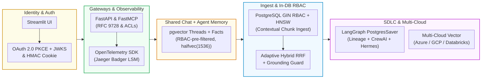
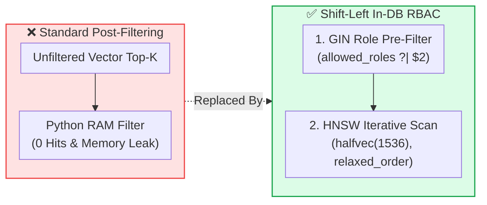
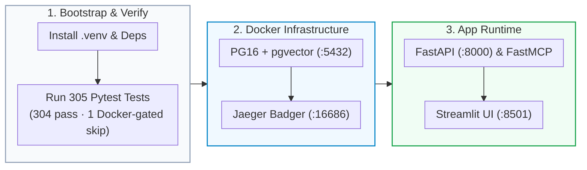
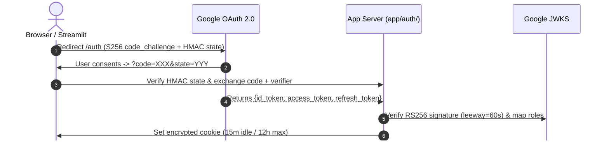
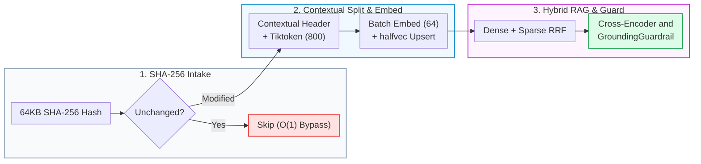
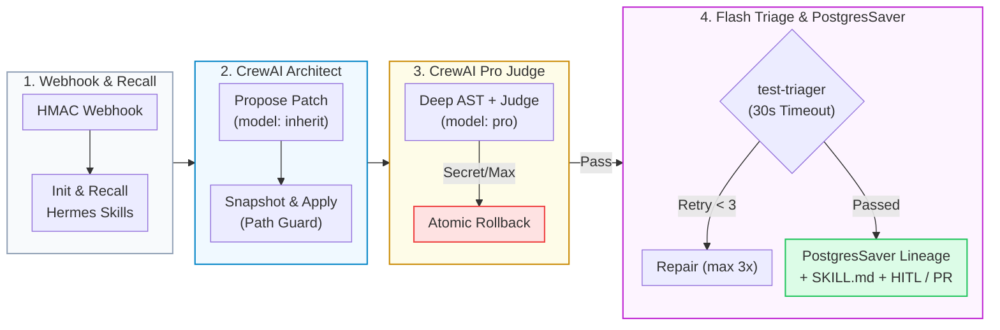
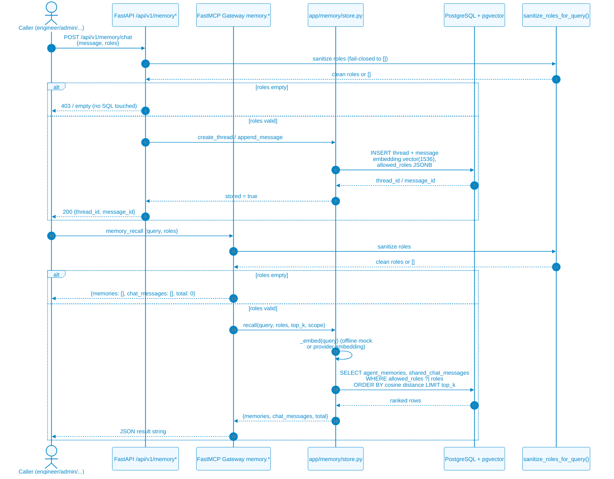
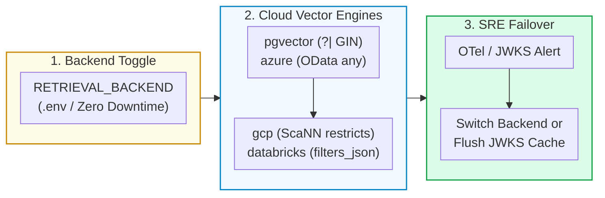
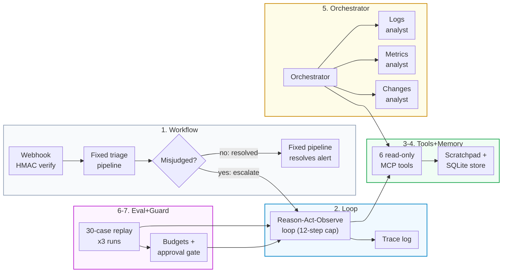

# 🛡️ Enterprise Zero-Trust RAG & Autonomous SDLC
**Navigation**: [1. Arch](#1-system-architecture-overview) | [Pillars](#architectural-pillars-overview) | [2. In-DB RBAC](#2-in-database-rbac-vector-storage-schemasql-appdb) | [3. Quickstart](#3-5-minute-quickstart-runtime-stack) | [4. Identity](#4-identity-oauth-20-pkce-security-appauth) | [5. Ingestion & RAG](#5-ingestion-pipeline-and-hybrid-rag-quality-scriptsingestpy-libs) | [6. Gateways & SDLC](#6-gateways-observability-autonomous-sdlc-app-agent) | [7. Multi-Cloud](#7-multi-cloud-strategy-runbook) | [8. AI Trends](#8-ai-trend-research-extended-thinking-budget) | [9. Incident Investigator](#9-incident-investigator-agent-7-step-agentic-roadmap)

## 1. System Architecture Overview


### 🏗️ Architectural Pillars Overview
| # | Pillar | Core Focus | Key Outcome |
| :-: | :--- | :--- | :--- |
| **1** | **In-DB RBAC & Storage** | Pre-filtered GIN + HNSW iterative scan | **75% RAM savings**, zero recall starvation, in-DB token audit |
| **2** | **Quickstart & Runtime** | Event-loop-scoped async pools, SKIP LOCKED outbox | Kubernetes probe ready, 305 tests collected (304 pass, 1 Docker-gated skip), 0 warnings |
| **3** | **Identity & Sessions** | Stateless OAuth 2.0 PKCE, HMAC state & encrypted cookies | F5 reload resilience, multi-worker scale-out, zero Redis, SOC-2 bounds |
| **4** | **Ingestion & Hybrid RAG** | Contextual headers, 64KB SHA-256 de-dup, Adaptive RRF | **>0.90 Context Precision**, O(1) skip for unchanged files |
| **5** | **Gateways, OTel, SDLC & Deep-Dive** | Zero-Trust FastMCP Gateway, token budgets, OpenTelemetry, SDLC workflow | Rate limits, JWT/TLS auth, token budgets, 60 req/min limits, defense-in-depth |
| **6** | **Multi-Cloud & Runbook** | Quad-mode strategy (pgvector, Azure, GCP, Databricks) | Zero-downtime .env switching, native pre-filtering across 4 engines |

## 2. In-Database RBAC & Vector Storage (`schema.sql`, `app/db/`)

```sql
SELECT d.document_id, d.title, c.chunk_index, c.content, d.allowed_roles,
       1 - (c.embedding::halfvec(1536) <=> $1::vector::halfvec(1536)) AS similarity
FROM document_chunks c JOIN documents d ON c.document_id = d.id
WHERE d.allowed_roles ?| $2::text[] AND (c.embedding_model = 'text-embedding-3-small' OR c.embedding_model IS NULL)
ORDER BY c.embedding::halfvec(1536) <=> $1::vector::halfvec(1536) LIMIT $3;
```
### 🔧 Technical Implementation
* **🎯 Zero Recall Starvation**: GIN Index + `hnsw.iterative_scan = 'relaxed_order'` eliminates ANN overfiltering on selective roles. Dynamic candidate depth scales per role cardinality: **80** for single role, **40** for dual, **20** for broad roles.
### 🔧 Key RBAC & Storage Innovations
* **🎯 Zero Recall Starvation**: GIN Index + `hnsw.iterative_scan = 'relaxed_order'` eliminates ANN overfiltering on selective roles. pgvector 0.8+ iterative scans retain filtered-out HNSW candidates in a `discarded` pairing heap and resume traversal in `hnsw.ef_search` batches until `hnsw.max_scan_tuples` (20000) or memory limits stop the scan — so high-selectivity `WHERE d.allowed_roles ?| $2::text[]` clauses no longer exhaust the top-k candidate list. Dynamic candidate depth scales per role cardinality: **80** for single role, **40** for dual, **20** for broad roles.
* **🔒 SQL Injection Protection**: Parameterized `$2::text[]` array with empty-role guard (returns `[]` before DB execution).
* **🧹 Unified Role Sanitization (single source of truth)**: One canonical `sanitize_roles_for_query()` in `app/auth/role_mapper.py` is delegated to by every retrieval path — pgvector (`DatabaseManager`), the Azure / GCP / Databricks cloud adapters, and the REST `X-User-Roles` legacy-header paths in `app/main.py` and `app/api/rag.py` — so the role grammar cannot drift between engines. Only non-empty strings that are known application roles (`KNOWN_ROLES`) or valid identifiers survive; injection payloads, empty strings, and non-string claims are dropped and fail closed to `[]`. Pinned cross-engine by `tests/test_role_sanitization_contract.py` (24 tests).
* **🗂️ RBAC GIN Operator Class**: `idx_documents_allowed_roles_gin` uses the default `jsonb_ops` GIN class (not `jsonb_path_ops`), because the key-existence operator `?|` is only served by `jsonb_ops` (`jsonb_path_ops` accelerates `@>`, `@?`, `@@` exclusively). The index is therefore genuinely Bitmap-index-accelerated for the role pre-filter.
* **📦 Matryoshka 1536-d + 16-Bit Compaction**: 75% cumulative RAM reduction with >98% recall. IEEE 754 sanitization across normalized tables.
* **💰 Token Budget Controls**: `token_consumption_ledger` tracks usage; `token_managed_limits` provides emergency kill-switch (`is_blocked`).

**Schema Query**: The core retrieval query with RBAC pre-filtering:
```sql
SELECT d.document_id, d.title, c.chunk_index, c.content, d.allowed_roles,
        1 - (c.embedding::halfvec(1536) <=> $1::vector::halfvec(1536)) AS similarity
FROM document_chunks c JOIN documents d ON c.document_id = d.id
WHERE d.allowed_roles ?| $2::text[] AND (c.embedding_model = 'text-embedding-3-small' OR c.embedding_model IS NULL)
ORDER BY c.embedding::halfvec(1536) <=> $1::vector::halfvec(1536) LIMIT $3;
```
## 3. 5-Minute Quickstart & Runtime Stack

```powershell
git clone https://github.com/Kenono2000/enterprise-rag-pgvector-rbac.git && cd enterprise-rag-pgvector-rbac
python -m venv .venv && .\.venv\Scripts\Activate.ps1 && python -m pip install -r requirements.txt
python -m pytest -v                                                     # 1. Run full test suite (305 collected: 304 pass, 1 Docker-gated skip; 0 warnings; testcontainers integration test runs when a Docker daemon is present)
docker compose up -d && psql -U postgres -d enterprise_rag -f schema.sql # 2. Start PG16 + pgvector & Jaeger Badger
python -m uvicorn app.main:app --host 0.0.0.0 --port 8000 --reload       # 3. Launch FastAPI Backend (:8000)
python -m streamlit run streamlit_app.py --server.port 8501              # 4. Launch Streamlit UI (:8501)
python -m app.mcp --transport http                                       # 5. Launch FastMCP Gateway (Streamable HTTP / stdio)
python -m agent status                                                   # 6. Run Hermes + CrewAI + LangGraph SDLC CLI
python -m agent checkpoints "<thread_id>"                                # 7. Inspect Time-Travel Checkpoint Lineage
```
### 🚀 Runtime Environment
**Local Endpoints**:
- Streamlit UI (`http://localhost:8501`) · Swagger Docs (`http://localhost:8000/docs`) · FastMCP 4 Streamable HTTP Gateway (`http://localhost:8000/mcp`) · SSE Stream (`/api/v1/query/stream`) · Document Catalog (`/api/v1/documents`) · Health Probes (`/healthz`, `/readyz`) · Token Budget Controls (`/api/v1/tokens/usage`, `/api/v1/tokens/limit`) · Telemetry (`/api/v1/metrics/observability`) · Jaeger UI (`http://localhost:16686`)

**Key Optimizations**:
- **Loop-Scoped Async Concurrency**: `DatabaseManager` and `get_openai_client()` scope connection pools to `asyncio.get_running_loop()`, preventing `RuntimeError: Event loop is closed` across Streamlit threads.
- **Hermetic Testing**: `conftest.py` pins deterministic environment (`OTEL_ENABLED=false`, blank `DATABASE_URL` / `GITHUB_TOKEN`, `SDLC_PUSH=false`, `USE_CREWAI_SDK=false`) *before* application import, ensuring CI/CI override safety with 12-factor precedence.
- **Strict Warning Gate**: the suite is verified under `python -m pytest -W error` — zero warnings tolerated. The event-loop recreation invariant (`test_pool_is_recreated_across_event_loops`) creates and closes its loops explicitly (never `asyncio.run()`) so no `ProactorEventLoop` is left to garbage-collection finalization, which would leak `ResourceWarning: unclosed event loop` and trip the gate.
- **Opt-in CrewAI**: Heavyweight SDK strictly opt-in via `USE_CREWAI_SDK=true`, maintaining deterministic `native_pydantic` adapter by default.

## 4. Identity & OAuth 2.0 PKCE Security (`app/auth/`)

* **Stateless HMAC PKCE State**: `encode_pkce_state()` signs `{b64_payload}.{sig}` (300s TTL) with HMAC-SHA256, surviving OAuth redirects and multi-worker restarts without Redis.
* **F5 Reload Resilience**: Compresses (`zlib`) and HMAC-signs session tokens into the `enterprise_rag_session` cookie, rehydrating `st.session_state` and silently rotating expired tokens on browser refresh.
* **Multi-IdP JWKS & SOC-2 Bounds**: Validates RS256 signatures (`leeway=60s`), maps claims across Google, Azure AD, Okta, Cognito, and Keycloak against `KNOWN_ROLES`, and enforces a **15-minute idle timeout** and **12-hour hard ceiling**.
## 5. Ingestion Pipeline and Hybrid RAG Quality (`scripts/ingest.py`, `libs/`)

* **Skip Unchanged Files (SHA-256 Hashing)**: Hashes files in 64KB blocks (`O(1)` lookup) to skip unchanged documents with zero API calls, and automatically replaces old chunks when a file is updated.
* **Contextual Chunk Headers & Table-Safe Splitting**: `split_chunks()` (`libs/utilities.py`) extracts parent document summaries (`summarize_document_context`) and prepends `[Document Context: <id> | Section: <sec> | Summary: <summary>]` headers (`build_contextual_chunk_header`) to 800-token chunks without breaking Markdown tables—elevating **Context Precision > 0.90** while embedding in 64-chunk batches with exponential backoff (`tenacity`).
* **Adaptive Hybrid Search (Semantic + Keyword RRF)**: Combines 16-bit `halfvec(1536)` cosine search with robust full-text search (`plainto_tsquery` + `websearch_to_tsquery` fallback) using parameterized Reciprocal Rank Fusion (`dense_weight / (k + rank) + sparse_weight / (k + rank)`, default `k=60`), pre-filtered by user role in PostgreSQL. Fusion runs as a **single-pass SQL CTE** (`ROW_NUMBER() OVER (...)` dense + sparse ranks, `FULL OUTER JOIN`, in-database RRF score) with automatic Python RRF fallback, and `hnsw.max_scan_tuples` auto-scales per caller via `DatabaseManager.scaled_scan_tuples` (1 role 2x, 2 roles 1x, 3+ roles 0.5x).
* **Embedding & Re-Ranking Models (`libs/utilities.py`)**: Uses OpenAI / Azure OpenAI `text-embedding-3-small` (1536-d) for chunk embeddings and optional `CrossEncoder` (`ms-marco-MiniLM-L-6-v2`) for secondary re-ranking; `GroundingGuardrail` verifies source citations (`[Doc: <Title>, Chunk <Index>]`) and gracefully refuses ungrounded responses.
### 📚 Context Engineering Pipeline (`app/rag/context.py`)
Formalizes the **retrieve → assemble → cache → compact** discipline:

* `ContextAssembler.assemble()`: Converts authorized chunks into citation-formatted context text
* Builds deterministic static-prefix prompt (SHA-256 `prefix_hash`, `static_prefix_tokens`) for cross-turn KV prefix caching
* Applies token-bounded deterministic compaction (`DEFAULT_MAX_CONTEXT_TOKENS=4000`) when authorized context exceeds budget, keeping highest-similarity chunks

Both `/api/v1/query` and `/api/v1/query/stream` endpoints route through this optimized pipeline.

### 📐 RAG Triad Evaluation Engine (`app/rag/evaluator.py`)
Deterministic, fully offline quality evaluator for the RAG Triad (no LLM/network calls — keyword-overlap + vector-similarity heuristics), exported from `app/rag/__init__.py` and pinned by `tests/test_deep_eval.py`:

* **Context Relevance** — 70% query-term coverage in retrieved chunks + 30% average vector similarity
* **Faithfulness (Groundedness)** — fraction of answer claims traceable to authorized context citations
* **Answer Relevance** — question/answer keyword alignment against the retrieved context
* **Composite & verdict** — weighted composite (`faithfulness` weighted 1.5× to penalize hallucination), `PASS ≥ 0.70`, `WARNING ≥ 0.45`, else `FAIL` (faithfulness must independently clear the threshold to `PASS`)
* **Observability integration** — `ObservabilityManager.record_rag_triad()` (`app/observability.py`) persists scorecards to the ring buffer and emits `rag_triad_evaluation` OTel spans with `rag.triad.*` attributes

## 6. Gateways, Observability & Autonomous SDLC (`app/`, `agent/`)
### 🔐 Zero-Trust FastMCP Gateway & Observability (`app/mcp/gateway.py`, `app/main.py`)
**Security-First Architecture**:


**Zero-Trust Protections**:
- **🛡️ RFC 9728 & RFC 8707**: Protected Resource Metadata discovery + tool-level RBAC
- **🔒 AST Security**: Blocks `eval`, `exec`, `__import__`, `compile`, dynamic attribute access
- **⚡ Rate Limiting**: 60 req/min per caller via `SlidingWindowRateLimiter`
- **💰 Token Controls**: 8K/50K limits via `TokenCircuitBreaker`

**Tri-Paradigm SDLC Workflow**:
- **LangGraph**: Cyclic state machine with HITL approval gating + `PostgresSaver` checkpoint persistence
- **CrewAI**: Role-based crew (Staff Architect `inherit`, Security Auditor `pro`, SRE Triager `flash`)
- **Hermes**: Skill synthesis, `SKILL.md` distillation, Atropos GRPO trajectory export

**Managed Token Budget API**:
- Usage monitoring: `/api/v1/tokens/usage`
- Limit controls: `/api/v1/tokens/limit`
- Emergency kill-switch: `/api/v1/tokens/reset` / `/api/v1/tokens/ledger`

**Full-Stack Observability** (`app/observability.py`):
- **📊 Dual Exporters**: Jaeger Badger LSM (4317 gRPC) + Azure Application Insights
- **🔄 7-Day Persistence**: Badger LSM with 1,000-event ring buffer fallback
- **🛡️ Non-root**: UID 10001 for security

**Key Innovation**: Opt-in concurrent verification (`SDLC_PARALLEL_VERIFY=true`) enables parallel Auditor/Triager execution after security gate passes.

#### Code Examples & Implementation Details
##### 1. LangGraph Checkpointing & HITL Interrupt (`agent/workflow.py`)
```python
# PostgreSQL checkpointer for crash resilience & human-in-the-loop approval gating
class PostgresCheckpointSaver(MemorySaver):
    async def save_checkpoint(self, thread_id: str, checkpoint_id: str, state: dict, **kwargs) -> bool:
        await DatabaseManager.save_workflow_checkpoint(thread_id, checkpoint_id, checkpoint_payload=state)
        return True

async def finalize_sdlc(state: dict) -> dict:
    if state.get("requires_human_approval"):
        decision = interrupt({"action": "approval_required", "thread": state["thread_id"]})
        if decision not in ("approved", True): return {"status": "rejected"}
    return {"status": "completed"}
```
##### 2. CrewAI Multi-Tier Orchestrator (`agent/workflow.py`)
```python
# Tiered agent topology: frontier reasoning (inherit), AST audit (pro), fast test triage (flash)
ARCHITECT = CrewAgentSpec(name="arch-synthesizer", role="Principal Architect", model_tier="inherit")
AUDITOR = CrewAgentSpec(name="cross-model-judge", role="AST Security Judge", model_tier="pro")
TRIAGER = CrewAgentSpec(name="test-triager", role="Pytest Diagnostician", model_tier="flash")

def get_crew_runtime() -> dict:
    if os.getenv("USE_CREWAI_SDK", "false").lower() == "true":
        return {"runtime": "crewai_sdk", "crew": Crew(agents=[...])}
    return {"runtime": "native_pydantic", "agents": [ARCHITECT, AUDITOR, TRIAGER]} # Zero-overhead default
```
##### 3. Hermes Lifelong Learning & RL Trajectories (`agent/workflow.py`)
```python
# Distills verified patches into reusable SKILL.md files & computes Atropos GRPO reward
def export_rl_trajectory(issue_id: str, patch: str, judge_score: float, repairs: int) -> dict:
    reward = round(max(0.0, judge_score - (repairs * 0.25)), 3) # Penalize repair cycles
    return {"format": "sharegpt", "issue_id": issue_id, "reward": reward, "patch": patch}
```
##### 4. Defense-in-Depth Guardrails (`agent/guardrails.py`)
```python
# Static AST security policy & RAG Triad grounding citation validator
class PolicyEngine:
    @classmethod
    def verify_ast(cls, code: str) -> List[str]:
        tree = ast.parse(code)
        return [f"Blocked: {n.func.id}()" for n in ast.walk(tree)
                if isinstance(n, ast.Call) and isinstance(n.func, ast.Name) and n.func.id in ("exec", "eval", "__import__", "compile")]

class GroundingGuardrail:
    @classmethod
    def verify_grounding(cls, answer: str) -> bool:
        return bool(re.search(r"\[Doc:\s*[^,]+,\s*Chunk\s*\d+\]", answer)) # Enforces source grounding
```

### Deep-Dive: Code Breakdown & Architecture Insights
#### 1. Zero-Trust FastMCP Gateway (`app/mcp/gateway.py`)
- **Blast Radius Controls**: Configures module-level `SlidingWindowRateLimiter` (default 60 req/min per caller) and `TokenCircuitBreaker` (8,000 tokens/request, 50,000 tokens/issue) to protect downstream LLMs.
- **Strict Pydantic Schemas (`extra="forbid"`)**: Every tool request (`MCPSearchRequest`, `MCPPatchRequest`, `MCPSDLCCrewRequest`, `MCPHermesSkillRequest`, `MCPListDocumentsRequest`, `MCPAutonomyMaturityRequest`) explicitly rejects unknown fields.
- **Fail-Closed RBAC (`check_tool_permission`)**: Maps tools to required roles (`TOOL_REQUIRED_ROLES`). If a token is authenticated but has zero claims, it is **denied** for restricted tools, preventing confused deputy attacks.
- **RFC 9728 & RFC 8707**: Exposes Protected Resource Metadata discovery (`get_gateway_metadata`) — including `streamable_http_transport`, `transport_headers_supported` (`Mcp-Method`, `Mcp-Name`), `stateless_mode_supported`, and `rfc_compliance` — and OAuth 2.1 / RFC 8707 tool-level RBAC scope bindings directly within the MCP gateway layer.
- **Centralized Multi-Cloud Dispatch**: `search_sdlc_context` resolves `RETRIEVAL_BACKEND` through `get_vector_search_adapter()` (structural `VectorSearchProvider` subtyping) instead of duplicated per-provider conditional branches; Azure/GCP/Databricks adapters lazy-import their hybrid search functions inside `.search()` to preserve test-mock patching boundaries.
- **FastAPI Co-Hosted Mount (`app/main.py`)**: The gateway is served in-process at `/mcp` via `mcp.http_app(path="/mcp")` mounted at `"/"` **after every REST route** (Starlette matches in registration order, so the catch-all Mount must be last or it shadows `/api/v1/*`). The parent `lifespan` enters `mcp_http_app.router.lifespan_context` so FastMCP's `StreamableHTTPSessionManager` task group initializes — a plain `app.mount("/mcp", http_app())` both mis-routes the endpoint to `/mcp/mcp` (bare `/mcp` 307-redirects to a 404) and skips the sub-app lifespan ("Task group is not initialized", HTTP 500), which MCP hosts surface as a 30s connection timeout. Pinned by `tests/test_mcp_auth.py::TestFastMcpHttpMount`.

#### 2. Managed Token Budget & Administrative Shutoff API (`app/main.py`)
- **Database-Backed Ledgers**: Tracks every token consumption event via `token_consumption_ledger` and enforces limits through `token_managed_limits`.
- **Kill-Switching**: Allows administrators or authorized engineers to toggle `enforce_limit` or trip the emergency `is_blocked` kill-switch instantly via REST endpoints (`/api/v1/tokens/limit`) or the MCP `policy://sdlc-budget` resource.

#### 2a. Architectural Invariant Regression Suite (`tests/test_architectural_invariants.py`)
Pins the six platform invariants so silent regressions fail CI first:
1. **In-DB RBAC pre-filter**: every retrieval SQL contains `allowed_roles ?| $N::text[]` with roles bound as parameters (never inlined); `schema.sql` GIN index uses default `jsonb_ops`.
2. **Empty-role short-circuit**: `secure_search` / `hybrid_search` / `list_documents` / all four adapters return `[]` without touching the pool when roles resolve to nothing.
3. **Structural subtyping**: all adapters satisfy the `runtime_checkable` `VectorSearchProvider` protocol (`isinstance` + coroutine-function contract).
4. **Event-loop-scoped pools**: `DatabaseManager.get_pool()` caches per loop, reuses within a loop, closes stale pools and recreates across loop changes (Streamlit rerun / worker restart).
5. **Strict Pydantic V2**: `extra='forbid'` on all REST request/response models and all five MCP tool request models (422 on unknown fields).
6. **Zero AST dynamic execution**: no builtin `eval`/`exec`/`compile`/`__import__` call sites and no `os.system`/`pickle.loads` attribute calls across `app/`, `agent/`, `libs/`, `sdlc_harness/`.

#### 3. Full-Stack OpenTelemetry (`app/observability.py`)
- **Dual Exporters**: Integrates with Azure Application Insights (`APPLICATIONINSIGHTS_CONNECTION_STRING`) and OTLP gRPC (`http://localhost:4317`) for Jaeger Badger LSM storage.
- **Ring Buffer Fallback**: Maintains a thread-safe 1,000-event in-memory ring buffer for metrics and traces, ensuring observability telemetry works even when external exporters are offline.

#### 4. Tri-Paradigm SDLC Workflow (`agent/workflow.py`)
- **LangGraph Checkpointing**: `PostgresCheckpointSaver` extends LangGraph state persistence, committing graph steps to PostgreSQL (`sdlc_workflow_checkpoints`) with time-travel inspection and multi-worker resume support.
- **CrewAI Role Specialization & Multi-Model Tiering**: Orchestrates specialized agents across tiered LLMs: `arch-synthesizer` (Staff Architect, `inherit` frontier reasoning model), `cross-model-judge` (Lead Security Auditor, Gemini Pro `pro`), and `test-triager` (SRE & Pytest Diagnostician, Gemini Flash `flash`).
- **Hermes Agent Lifelong Learning**: Automatically distills verified successful patches into portable `SKILL.md` files in `.agent/skills/` and exports ShareGPT-formatted RL trajectories weighted by Atropos GRPO step rewards.

#### 5. Defense-in-Depth Guardrails (`agent/guardrails.py`)
- **PolicyEngine AST & STRIDE Threat Modeling**: Detects dangerous Python constructs (`exec`, `eval`, `__import__`, `subprocess` with `shell=True`, unauthorized path traversals) and maps security checks directly to STRIDE categories (Spoofing, Tampering, Repudiation, Information Disclosure, Denial of Service, Elevation of Privilege) as required by Factory.ai Pillar 8.
- **Secret Regex Filtering**: Automatically catches exposed API keys, private keys, and credential patterns.
- **GroundingGuardrail**: Enforces the RAG Triad by requiring explicit source citations (`[Doc: <Title>, Chunk <Index>]`) and verifying that cited chunks exist in authorized context.

#### 6. Factory.ai Autonomy Maturity Model (AMM) Evaluator
- **Eight Technical Pillars Scorecard**: Built-in automated evaluator (`AutonomyMaturityEvaluator.evaluate_repository`) assessing the repository against Style & Validation, Build System, Testing, Documentation, Dev Environment, Code Quality, Observability, and Security & Governance.
- **Autonomous Maturity Level**: Measures repository status against Factory.ai thresholds (L1: Functional 5 pts, L2: Documented 19 pts, L3: Standardized 36 pts minimum production bar, L4: Optimized 60 pts, L5: Software Factory 100 pts). The repository scores **106/100 (Level 5 Software Factory)**, clearing the production floor and meeting agent-readiness standards.

#### 7. Shared Chat + Agent Memory Workflow (`app/memory/store.py`)

Free, self-hosted shared memory on the project's existing PostgreSQL + pgvector. Every message/fact is stored with an `allowed_roles` JSONB tag; every read is pre-filtered through the canonical `sanitize_roles_for_query()` and fails closed to empty when the caller resolves to zero roles.



**Key invariants enforced in this flow:**
1. **No roles → no SQL.** The store returns `[]` before acquiring a connection when `sanitize_roles_for_query` yields an empty list.
2. **Parameterized SQL only.** `allowed_roles ?| $N::text[]` binds roles as parameters; nothing is inlined.
3. **Embeddings offline by default.** `_mock_embedding()` (deterministic SHA-256) runs when no provider key is configured — no billable API calls.
4. **Session GUCs, not persisted.** `hnsw.iterative_scan` / `max_scan_tuples` / `ef_search` are applied per-connection at runtime (`DatabaseManager.configure_iterative_scan`), never in migration `DO` blocks.
5. **Streamlit is opt-in.** The "🧠 Share to team memory" toggle is off by default; when on, exchanges are appended to a role-governed shared thread and recalled into the advisor prompt.
## 7. Multi-Cloud Strategy & Runbook
* **Unified `VectorSearchProvider` Protocol & Factory Pattern**: Decoupled multi-cloud retrieval implementations via structural subtyping protocols ([`app/db/protocols.py`](file:///c:/src/enterprise-rag-pgvector-rbac/app/db/protocols.py)) and concrete adapters ([`app/db/adapters.py`](file:///c:/src/enterprise-rag-pgvector-rbac/app/db/adapters.py): `PgvectorSearchAdapter`, `AzureSearchAdapter`, `GCPSearchAdapter`, `DatabricksSearchAdapter`). The unified `get_vector_search_adapter()` factory is the single resolution path for `RETRIEVAL_BACKEND` in `app/main.py` (`query_rag`, `query_rag_stream`), `app/mcp/gateway.py` (`search_sdlc_context`), and Streamlit — replacing duplicated per-provider if/elif branches — and enforces the invariant that an empty `user_roles` list immediately short-circuits to an empty result set without executing downstream network or database calls.
* **Zero-Downtime Cutover & Failover**: Switch `RETRIEVAL_BACKEND` in `.env` (`pgvector` | `azure` | `gcp` | `databricks`) or run `python scripts/migrate_multicloud.py --target all`.
* **Incident Runbook**: On DB latency alerts in Jaeger (`http://localhost:16686`), fail over `RETRIEVAL_BACKEND` in `.env`; on JWKS key rotation, restart the auth worker to flush `JWKSClient`; verify Badger LSM persistence via `docker compose restart jaeger`. If role-filtered queries regress, confirm `idx_documents_allowed_roles_gin` is a `jsonb_ops` GIN index (serves `?|`) and that EXPLAIN shows a Bitmap Index Scan rather than a sequential scan.

| Backend (`RETRIEVAL_BACKEND`) | Vector & Hybrid Engine | In-Database RBAC Pre-Filter | LLM & Observability |
| :--- | :--- | :--- | :--- |
| **`pgvector`** (Local) | PG16 `halfvec(1536)` HNSW + `tsvector` RRF | `WHERE allowed_roles ?| $2::text[]` (`jsonb_ops` GIN) | OpenAI `gpt-4o` + Jaeger Badger LSM |
| **`azure`** (Microsoft Azure) | Azure AI Search + Semantic Ranker | OData `allowed_roles/any(r: ...)` | Azure OpenAI `gpt-4o` + App Insights |
| **`gcp`** (Google Cloud) | Vertex AI ScaNN + Ranking API | ScaNN `restricts` (`allowList`) | Gemini 1.5 Pro + Cloud Trace |
| **`databricks`** (Databricks) | Mosaic AI Vector Search (Delta Sync) | Unity Catalog `filters_json` (`OR`) | Llama 3.1 70B + MLflow Tables |
## 8. AI Trend Research & Extended Thinking Budget
### 8.1 Frontier Reasoning Model Trends
**Claude 3.7 Sonnet** (Anthropic, 2026) — First hybrid reasoning model on the market. Unifies standard and extended thinking in a single model with API-controlled thinking budget (up to 128K tokens). Achieves SWE-bench Verified SOTA (70.3% with scaffold, 63.7% vanilla) and TAU-bench SOTA for agentic workflows. Introduces Claude Code agentic coding tool for terminal-based software engineering delegation.
**OpenAI o3-mini** (2025) — Cost-effective reasoning model optimized for STEM; now deprecated in the API in favor of newer reasoning variants.
**pgvector 0.8+ Iterative Index Scans** — When a selective `WHERE` clause (e.g. the RBAC GIN pre-filter `allowed_roles ?| $2::text[]`) filters out ANN candidates, the HNSW scan no longer returns an under-filled top-k. Iterative scans retain filtered-out candidates in a discarded pairing heap and resume graph traversal in `hnsw.ef_search`-sized batches until `hnsw.max_scan_tuples` or memory limits stop the scan. Modes: `off` (legacy behavior), `strict_order` (preserve exact ANN ordering), `relaxed_order` (default; accept out-of-order candidates for recall). This project sets `relaxed_order` per connection via the pool `init` hook and per query, scaled by role cardinality (`hnsw.iterative_scan`/`hnsw.max_scan_tuples`/`hnsw.ef_search` are `PGC_USERSET` GUCs and must never be persisted in migration `DO` blocks).
**halfvec 16-bit Quantization** — `halfvec(p)` stores IEEE 754 binary16 components (2 bytes each, `2*p + 8` bytes total) for ~50% RAM/storage savings over `vector(p)`; pgvector ≥ 0.7.0 supports it and HNSW accepts up to 4,000 half-precision dimensions (vs 2,000 float32), so 1536-d `text-embedding-3-small` indexes fit comfortably with headroom. Matryoshka 1536→768→256 truncation composes with it (cumulative ~75% footprint). NaN/Inf components must be sanitized before literal serialization (`DatabaseManager.format_halfvec`).
**Model Context Protocol (MCP)** — Open standard for connecting AI applications to external systems, tools, and data sources. The **Streamable HTTP transport** (spec revision 2025-03-26) replaced the legacy HTTP+SSE pairing: clients POST JSON-RPC to the endpoint and may open a GET SSE stream for server-initiated messages; the spec also defines a **stateless, sessionless mode** (no `Mcp-Session-Id` required) for serverless/proxy-friendly deployments. Reverse-proxy conventions (FastMCP 4/5 and gateway implementations) reflect `Mcp-Method` (JSON-RPC method) and `Mcp-Name` (tool name/URI) HTTP headers to enable zero-DPI routing, rate-limiting, and ACL inspection at the proxy layer. **RFC 9728** (OAuth 2.0 Protected Resource Metadata) and **RFC 8707** (Resource Indicators for OAuth 2.0) underpin dynamic client discovery and token-audience binding. This project's FastMCP 4 gateway implements RFC 9728 Protected Resource Metadata, RFC 8707 tool-level RBAC, stateless Streamable HTTP transport, and `Mcp-Method`/`Mcp-Name` reflection in `app/main.py` middleware.
### 8.1a Daily R&D Research Log (2026-11-18)
* **pgvector 0.8+ iterative index scan** — Re-verified against `app/db/manager.py`: `configure_iterative_scan()` sets `hnsw.iterative_scan='relaxed_order'` + `hnsw.max_scan_tuples` (role-cardinality-scaled via `scaled_scan_tuples`) through the pool `init` hook and per query; `schema.sql` deliberately does **not** persist the GUCs (they are `PGC_USERSET`). Iterative scans retain RBAC-filtered-out HNSW candidates in a discarded pairing heap and resume traversal in `ef_search` batches — the mechanism that keeps selective `allowed_roles ?| $2::text[]` filters from starving top-k recall.
* **halfvec 16-bit quantization** — `embedding_halfvec halfvec(1536)` generated column + `idx_chunks_embedding_halfvec_hnsw` (`halfvec_cosine_ops`) deliver the 50%/75%-cumulative RAM compaction; `format_halfvec()` sanitizes NaN/Inf before literal serialization. HNSW supports up to 4,000 half-precision dims, so 1536-d indexes retain headroom.
* **Stateless Streamable HTTP MCP (2026)** — The gateway (`app/mcp/gateway.py` + co-hosted mount in `app/main.py`) runs stateless/sessionless mode: no `Mcp-Session-Id` required, `Mcp-Method`/`Mcp-Name` header reflection for zero-DPI proxy routing, RFC 9728 Protected Resource Metadata via `get_gateway_metadata`, and forwarded sub-app ASGI lifespan so `StreamableHTTPSessionManager` initializes (pinned by `tests/test_mcp_auth.py::TestFastMcpHttpMount`). Installed FastMCP 4.0.10 (pinned `fastmcp>=4.0.10,<5.0.0` in `requirements.txt`) confirms the FastMCP 4 target.
* **Multi-agent SDLC frameworks** — Tri-paradigm orchestration (LangGraph cyclic state machine + PostgresSaver checkpoints, CrewAI tiered crew `inherit`/`pro`/`flash`, Hermes SKILL.md synthesis + ShareGPT GRPO trajectories) plus the incident-investigator's hand-built reason-act-observe loop (12-step cap, repeat guard, corroborated early-stop at confidence ≥ 0.85).
* **Today's enhancement** — Unified the role-sanitization contract into one canonical `app/auth/role_mapper.sanitize_roles_for_query()` (previously six divergent copies across pgvector/cloud adapters/REST headers); regression-pinned cross-engine by `tests/test_role_sanitization_contract.py` (24 tests, suite now 305 collected / 304 pass / 1 Docker-gated skip, 0 warnings).
### 8.2 Extended Thinking / Reasoning Budget (RAG Pipeline)
Added `thinking_budget` parameter to `RAGQueryRequest` (`app/main.py`): optional integer 0–128000 tokens controlling reasoning depth for complex queries.
- **`thinking_budget=0`** (default): Fast mode, default 4K context token budget.
- **`thinking_budget>0`**: Extended reasoning mode scales context budget linearly (`4000 + budget/4`, capped at 32K tokens) so the Context Assembler retains more high-similarity chunks for deep reasoning.
- **Observability**: Thinking budget is recorded in OpenTelemetry/Jaeger spans as `mode=<mode>:thinking-<budget>` and retrieval span queries are tagged with `[thinking_budget=N]`.
### 8.3 Actionable Innovations for This Project
| Innovation | Relevance | Implementation Status |
| :--- | :--- | :--- |
| pgvector 0.8+ iterative index scans (`hnsw.iterative_scan='relaxed_order'`, `hnsw.max_scan_tuples=20000`) | Eliminates top-k recall starvation / ANN overfiltering when selective RBAC GIN pre-filters shrink the HNSW candidate pool; resumed traversal from a discarded-candidate heap | ✅ `app/db/manager.py` `configure_iterative_scan()` (pool init + per-query, role-cardinality-scaled) + `schema.sql` HNSW indexes |
| 16-bit halfvec(1536) quantization | ~50% vector RAM/storage savings (2 bytes/component vs 4), 75% cumulative with Matryoshka; HNSW max dim doubles to 4,000 | ✅ `embedding_halfvec` generated column + `idx_chunks_embedding_halfvec_hnsw` + `format_halfvec()` NaN/Inf sanitization |
| Hybrid reasoning with thinking budget | Complex multi-hop RAG queries benefit from extended reasoning | ✅ Implemented in `app/main.py` + `app/rag/context.py` |
| MCP Streamable HTTP transport & stateless mode (MCP 2025-03-26 spec) | Sessionless proxy-friendly agent tool access; `Mcp-Method`/`Mcp-Name` reflection headers enable zero-DPI reverse-proxy routing, rate-limiting, ACL inspection | ✅ FastMCP 4 gateway co-hosted on FastAPI at `/mcp` (catch-all Mount registered last + forwarded ASGI lifespan so `StreamableHTTPSessionManager` initializes); header reflection in `trace_http_requests` middleware; RFC 9728 metadata declares `stateless_mode_supported` |
| Decoupled VectorSearchProvider protocols | Multi-cloud engine abstraction adhering to PEP 544/695 subtyping | ✅ Implemented in `app/db/protocols.py`, `app/db/adapters.py`, & `app/main.py` |
| Shared fail-closed role sanitization | One strict `sanitize_roles_for_query()` contract (KNOWN_ROLES ∪ identifiers) as the single source of truth in `app/auth/role_mapper.py`, delegated to by pgvector + all 3 cloud adapters + both REST header paths; kills the latent `re`-import NameError and the six divergent per-path copies | ✅ `app/auth/role_mapper.py` (canonical), `app/db/manager.py` (delegation), cloud adapters, REST paths; regression-pinned in `tests/test_role_sanitization_contract.py` (24 tests) + `tests/test_architectural_invariants.py` + `tests/test_database_schema.py` |
| Shared chat + agent memory (pgvector, zero new deps) | Free, self-hosted shared memory: threads + messages + agent facts with halfvec(1536) embeddings, RBAC-pre-filtered GIN/HNSW recall, exposed via FastMCP `memory.*` tools + `/api/v1/memory/*` REST + opt-in Streamlit sharing | ✅ `app/memory/store.py` + `app/memory/__init__.py`, `schema.sql` §5.10, `app/mcp/gateway.py` (`memory_chat`/`memory_recall`/`memory_store_fact`/`memory_list_threads`), `app/main.py` REST, `streamlit_app.py` opt-in share; hermetic suite `tests/test_shared_memory.py` (21 tests) |
| LangGraph checkpointer resilience (UUIDv6 checkpoint chains, pending-write replay, `parent_checkpoint_id` time-travel) | Crash-resilient agent state-machine recovery and time-travel debugging | ✅ `PostgresCheckpointSaver` on `sdlc_workflow_checkpoints`; `PostgresSaver`/`BadgerSaver`/`BadgerLSMCheckpointSaver` aliases in `agent/workflow.py` (Badger names are compatibility aliases — no upstream LangGraph Badger checkpointer exists; Badger LSM is used for Jaeger OTel storage) |
| RAG Triad observability (context relevance, faithfulness, answer relevance) | Detects hallucinations and retrieval drift | ✅ `app/rag/evaluator.py` `RAGTriadEvaluator` (offline deterministic scoring, PASS ≥ 0.70 / faithfulness 1.5× weight) + `GroundingGuardrail` + `ObservabilityManager.record_rag_triad()` OTel spans |
| Agentic SDLC coding (Claude Code pattern) | Autonomous patch proposal, test, and repair | ✅ LangGraph + CrewAI + Hermes workflow in `agent/workflow.py` |
| Incident investigator agent (KDnuggets 7-step roadmap) | Hand-built reason-act-observe loop, six read-only MCP tools, layered memory, orchestrator-workers, replay eval, deployment guardrails | ✅ `incident_agent/` package; 53-test suite in `tests/test_incident_investigator.py`; 30-case replay at 100% pass |

### 8.4 Daily Automation (Unattended SDLC Refinement)
A recurring DSH scheduled task runs the full refinement loop **daily at 6:00 AM America/Chicago** (host timezone), delivering the Principal AI Platform Architect prompt into a fresh session rooted at this repository:

* **Task**: `Daily Enterprise RAG Refinement & R&D` — id `schedule-b4134923-9750-46d3-a3ec-5476b2b8e252`, status `active`.
* **Timing**: `DTSTART;TZID=America/Chicago:20261117T060000` + `RRULE:FREQ=DAILY;BYHOUR=6;BYMINUTE=0` (first occurrence 2026-11-17 06:00 CDT). Equivalent five-field Cron: `0 6 * * *` with explicit `America/Chicago` zone.
* **Delivery**: native DSH scheduler (`schedule_create`/`schedule_list`/`schedule_edit`/`schedule_view`); each occurrence opens a **new session** (target `new`) with working directory `C:\src\enterprise-rag-pgvector-rbac` and the standard agent preset. Restart preserves committed occurrences; the task ends after its final delivery if the rule is ever bounded.
* **Scope**: daily AI R&D research (pgvector iterative scans/halfvec, stateless Streamable HTTP MCP, multi-agent SDLC frameworks), architectural audit, zero-regression enhancements, `python -m pytest -q` (305 collected: 304 pass, 1 Docker-gated skip; 0 warnings), README synchronization with abyssium-studio lint/build verification, and fast-forward merge of clean changes into `main`.
* **Manage**: view/edit/cancel from the DSH Automations dashboard or the `schedule_view` / `schedule_edit` / `schedule_list` tools.

## 9. Incident Investigator Agent (7-Step Agentic Roadmap)
A self-study implementation of the KDnuggets 7-step agentic-system-design roadmap (Bala Priya C): build an **incident investigator agent** that finds the root cause of production alerts, learning how agents fail before designing controls for those failures. The whole project lives in `incident_agent/` and is graded by `tests/test_incident_investigator.py` (53 tests) plus a 30-case replay suite.

### 9.1 The Seven Steps Mapped to Code
| Step | Roadmap Concept | Project Addition | Where |
| :---: | :--- | :--- | :--- |
| 1 | Workflow vs. agent (autonomy spectrum) | 10 synthetic incidents + fixed triage pipeline that notes where it misjudges | `incident_agent/loop.py::fixed_triage_pipeline` |
| 2 | Reasoning-action loop | Hand-built reason-act-observe loop, 12-step cap, trace logging | `incident_agent/loop.py::ReasonActLoop` |
| 3 | Tool design as contracts | Six read-only tools behind a FastMCP server | `incident_agent/tools.py`, `incident_agent/mcp_server.py` |
| 4 | Memory (working/session/long-term) | Scratchpad, output compaction, SQLite solved-incident store | `incident_agent/memory.py` |
| 5 | Multi-agent coordination | Orchestrator + 3 parallel analysts (logs/metrics/changes) with explicit briefs | `incident_agent/orchestrator.py` |
| 6 | Evaluation | 30-incident replay suite x3 runs, 4-dimension grading, scoreboard + failure taxonomy | `incident_agent/eval.py` |
| 7 | Deployment guardrails | Step/time/token budgets, least-privilege read-only tools, approval-gated remediation, webhook runs | `incident_agent/guardrails.py`, `incident_agent/runner.py` |

### 9.2 Key Design Decisions
* **Failure modes controlled before the first run**: malformed arguments get actionable errors (registry names the expected parameters); repeated calls trip a per-tool repeat guard; early answers are impossible (the loop only stops on corroborated confidence ≥ 0.85); runaway loops are bounded by the 12-step cap and a token budget.
* **Simplest shape that works**: a fixed deterministic triage pipeline runs first; only when it misjudges (deploy correlation needed, or multi-change disambiguation) does the run escalate to the costlier orchestrator-workers path — mirroring the autonomy spectrum.
* **Temporal deploy/config correlation**: change candidates are scored by proximity to alert onset (≤15 min → 0.9), so the flag toggle minutes before the break outranks a deploy hours old. This is the core incident-investigation reasoning, encoded deterministically.
* **Least privilege**: the deployed toolset is read-only; remediation (rollback/flag-flip/scale) is a separate approval-gated action requiring an `oncall-lead` sign-off, never a default tool.
* **Hermetic by construction**: the synthetic corpus is anchored to a fixed base time (`BASE_TIME`), the SQLite store defaults to `data/` (gitignored, env-overridable via `INCIDENT_MEMORY_DB`), and no network or LLM calls are made — mirroring the repository's offline-test convention.

### 9.3 Replay Evaluation Scoreboard
The 30-case replay suite (10 seeded incidents x 3 deterministic permutations) runs 3 times per case and grades four dimensions. Current results (pinned by `test_replay_evaluator_full_suite_passes`):
| Dimension | Pass Rate |
| :--- | :---: |
| Tool selection (changes + logs queried) | 1.000 |
| Arguments (all dispatches valid) | 1.000 |
| Final answer (named change == ground truth) | 1.000 |
| Trajectory (within step cap, no stuck loops) | 1.000 |
| **Overall** | **1.000** |

### 9.4 Running It
```powershell
python -m incident_agent.mcp_server --transport streamable-http --port 8001   # Six read-only incident tools over FastMCP
python -m pytest tests/test_incident_investigator.py -v                       # 53 hermetic tests
```
* **Webhook shadow mode**: `handle_alert_webhook()` verifies the HMAC signature, parses the alert, and runs the investigation alongside on-call engineers; remediation stays approval-gated until the rollout reaches assist mode.
* **Rollout path**: shadow mode (observe alongside on-call) → assist mode (suggest root cause + gated remediation) → wider use, with the replay suite as the CI eval gate.

