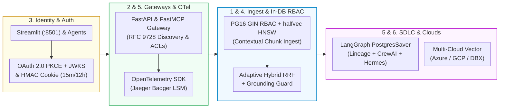
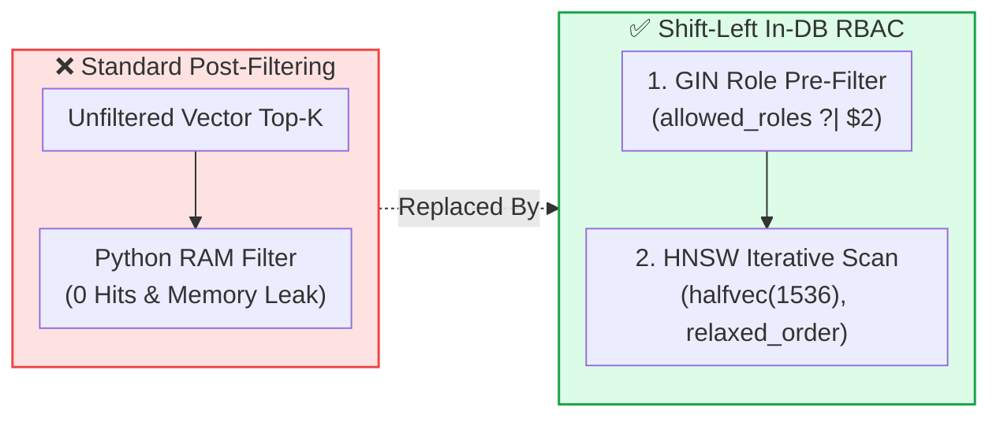
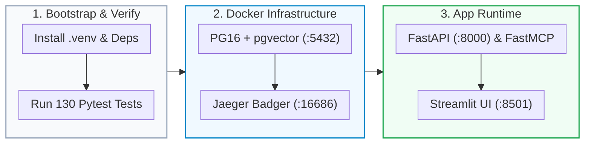
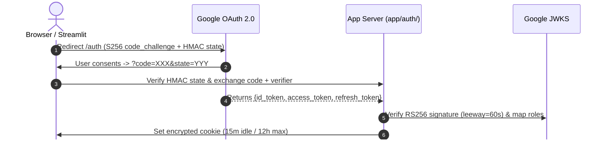
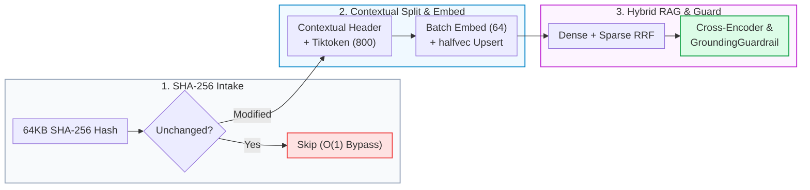
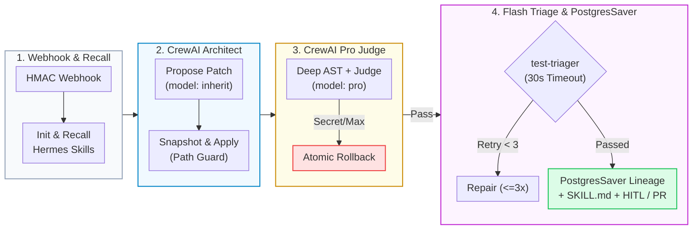
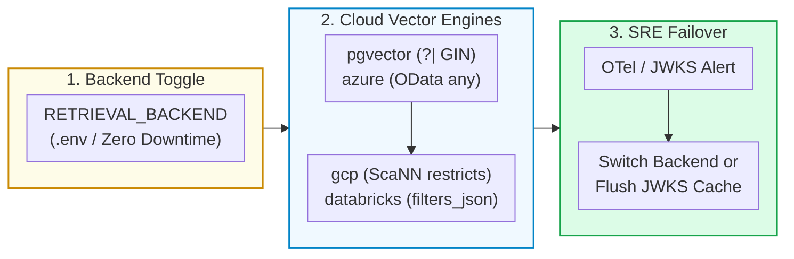

# 🛡️ Enterprise Zero-Trust RAG & Autonomous SDLC
| Live Artifact | Description | Access Link |
| :--- | :--- | :--- |
| **Interactive UI** | Shift-Left In-Database RBAC & Session Monitor | [enterprise-rag-pgvector-rbac.streamlit.app](https://enterprise-rag-pgvector-rbac.streamlit.app) |
| **API Docs** | Live OpenAPI / Interactive Swagger UI | [enterprise-rag-api-ksez.onrender.com/docs](https://enterprise-rag-api-ksez.onrender.com/docs) |
| **Source Code** | Auditable Source Repository & Offline Test Suite | [github.com/Kenono2000/enterprise-rag-pgvector-rbac](https://github.com/Kenono2000/enterprise-rag-pgvector-rbac) |

**Architect:** **[Ken Wong](https://www.linkedin.com/in/kenwong-architect/)** — Shift-left **In-Database Zero-Trust Vector RBAC** & **Autonomous Self-Healing SDLC Agent** (`PostgreSQL 16 + pgvector`, `FastAPI`, `Streamlit`, `OAuth 2.0 PKCE`, `JWKS`, `FastMCP`, `LangGraph`, `CrewAI`, `Hermes Agent`).\
**Quick Navigation:** [1. In-Database RBAC & Storage](#1-in-database-rbac-and-vector-storage-schemasql-appdb) · [2. Quickstart & Runtime Stack](#2-5-minute-quickstart-and-runtime-stack) · [3. Identity & Session Security](#3-identity-oauth-20-pkce-and-session-security-appauth) · [4. Ingestion & Hybrid RAG](#4-ingestion-pipeline-and-hybrid-rag-quality-scriptsingestpy-libs) · [5. Gateways, OTel & SDLC Agent](#5-gateways-observability-and-autonomous-sdlc-agent-app-agent) · [6. Multi-Cloud & Runbook](#6-multi-cloud-strategy-and-runbook)
## Complete System Architecture

| Topic | Architectural Pillar | Core Engineering Pattern | Primary Security & Performance Outcome |
| :-: | :--- | :--- | :--- |
| **1** | **In-DB RBAC & Storage** | Pre-filtered GIN + HNSW iterative scan (`relaxed_order`) & 16-bit `halfvec(1536)` | Zero recall starvation, zero overfiltering, **75% cumulative RAM savings** (>98% recall). |
| **2** | **Quickstart & Runtime** | Event-loop-scoped `asyncpg` pools, `SKIP LOCKED` outbox & `/readyz` | Prevents closed-loop crashes; durable worker queue; Kubernetes probe ready. |
| **3** | **Identity & Sessions** | Stateless OAuth 2.0 PKCE, HMAC state & encrypted cookies | Survives F5 reloads & multi-worker scale-out with **zero Redis**; SOC-2 15m/12h bounds. |
| **4** | **Ingestion & Hybrid RAG** | Contextual Headers, 64KB SHA-256 de-dup, Adaptive Dense + Sparse RRF (`dense_weight` / `sparse_weight`) | **>0.90 Context Precision**; `O(1)` skip for unchanged files; domain-adaptive fusion. |
| **5** | **Gateways, OTel & SDLC** | Zero-Trust FastMCP (RFC 9728 Discovery & RFC 8707 Tool ACLs), `PostgresSaver` & Time-Travel Lineage | Crash-resilient resume & time-travel auditing; confused deputy prevention; 60 req/min + 8K/50K breakers. |
| **6** | **Multi-Cloud & Runbook** | Quad-mode strategy (`pgvector`, `azure`, `gcp`, `databricks`) | Zero-downtime `.env` switching with native pre-filtering across all 4 engines. |
## 1. In-Database RBAC and Vector Storage (`schema.sql`, `app/db/`)

```sql
SELECT d.document_id, d.title, c.chunk_index, c.content, d.allowed_roles,
       1 - (c.embedding::halfvec(1536) <=> $1::vector::halfvec(1536)) AS similarity
FROM document_chunks c JOIN documents d ON c.document_id = d.id
WHERE d.allowed_roles ?| $2::text[] AND (c.embedding_model = 'text-embedding-3-large' OR c.embedding_model IS NULL)
ORDER BY c.embedding::halfvec(1536) <=> $1::vector::halfvec(1536) LIMIT $3;
```
* **No Recall Starvation & pgvector 0.8+ Iterative Scans**: PostgreSQL evaluates `WHERE d.allowed_roles ?| $2::text[]` via the **GIN Index** and automatically configures `SET hnsw.iterative_scan = 'relaxed_order'` (`max_scan_tuples = 20000`) per pooled connection—eliminating ANN overfiltering on selective roles while ensuring unauthorized rows never enter Python RAM.
* **SQL Injection & Empty-Role Guards**: Binds roles strictly as a parameterized `$2::text[]` array and returns `[]` immediately before DB execution if `user_roles` is empty.
* **Matryoshka 1536-d + 16-Bit `halfvec(1536)` Compaction**: Truncates `text-embedding-3-large` from `3072` to `1536` dims and quantizes to IEEE 754 16-bit floats (`embedding_halfvec halfvec(1536)`, `idx_chunks_embedding_halfvec_hnsw` with `halfvec_cosine_ops`) for **50% additional HNSW RAM savings** (**75% cumulative reduction**, **>98% recall**) across normalized `documents` + `document_chunks` (`ON DELETE CASCADE`) tables (see [`schema.sql`](file:///c:/src/enterprise-rag-pgvector-rbac/schema.sql)).
## 2. 5-Minute Quickstart and Runtime Stack

```powershell
git clone https://github.com/Kenono2000/enterprise-rag-pgvector-rbac.git && cd enterprise-rag-pgvector-rbac
python -m venv .venv && .\.venv\Scripts\Activate.ps1 && python -m pip install -r requirements.txt
python -m pytest -v                                                     # 1. Run full test suite (130 tests)
docker compose up -d && psql -U postgres -d enterprise_rag -f schema.sql # 2. Start PG16 + pgvector & Jaeger Badger
python -m uvicorn app.main:app --host 0.0.0.0 --port 8000 --reload       # 3. Launch FastAPI Backend (:8000)
python -m streamlit run streamlit_app.py --server.port 8501              # 4. Launch Streamlit UI (:8501)
python -m app.mcp                                                        # 5. Launch FastMCP Gateway (stdio/SSE)
python -m agent status                                                   # 6. Run Hermes + CrewAI + LangGraph SDLC CLI
python -m agent checkpoints "<thread_id>"                                # 7. Inspect Time-Travel Checkpoint Lineage
```
* **Local Endpoints**: Streamlit UI (`http://localhost:8501`) · Swagger Docs (`http://localhost:8000/docs`) · Health Probes (`/healthz`, `/readyz`) · Telemetry (`/api/v1/metrics/observability`) · Jaeger UI (`http://localhost:16686`).
* **Loop-Scoped Async Concurrency**: `DatabaseManager` and `get_openai_client()` scope connection pools to `asyncio.get_running_loop()`, preventing `RuntimeError: Event loop is closed` across Streamlit threads.
## 3. Identity, OAuth 2.0 PKCE, and Session Security (`app/auth/`)

* **Stateless HMAC PKCE State**: `encode_pkce_state()` signs `{b64_payload}.{sig}` (300s TTL) with HMAC-SHA256, surviving OAuth redirects and multi-worker restarts without Redis.
* **F5 Reload Resilience**: Compresses (`zlib`) and HMAC-signs session tokens into the `enterprise_rag_session` cookie, rehydrating `st.session_state` and silently rotating expired tokens on browser refresh.
* **Multi-IdP JWKS & SOC-2 Bounds**: Validates RS256 signatures (`leeway=60s`), maps claims across Google, Azure AD, Okta, Cognito, and Keycloak against `KNOWN_ROLES`, and enforces a **15-minute idle timeout** and **12-hour hard ceiling**.
## 4. Ingestion Pipeline and Hybrid RAG Quality (`scripts/ingest.py`, `libs/`)

* **Skip Unchanged Files (SHA-256 Hashing)**: Hashes files in 64KB blocks (`O(1)` lookup) to skip unchanged documents with zero API calls, and automatically replaces old chunks when a file is updated.
* **Contextual Chunk Headers & Table-Safe Splitting**: `split_chunks()` (`libs/utilities.py`) extracts parent document summaries (`summarize_document_context`) and prepends `[Document Context: <id> | Section: <sec> | Summary: <summary>]` headers (`build_contextual_chunk_header`) to 800-token chunks without breaking Markdown tables—elevating **Context Precision > 0.90** while embedding in 64-chunk batches with exponential backoff (`tenacity`).
* **Adaptive Hybrid Search (Semantic + Keyword RRF)**: Combines 16-bit `halfvec(1536)` cosine search with robust full-text search (`plainto_tsquery` + `websearch_to_tsquery` fallback) using parameterized Reciprocal Rank Fusion (`dense_weight / (k + rank) + sparse_weight / (k + rank)`, default `k=60`), pre-filtered by user role in PostgreSQL.
* **Re-Ranking & Citation Guardrail (`GroundingGuardrail`)**: Re-ranks top results with a `CrossEncoder` and requires every answer to cite `[Doc: <Title>, Chunk <Index>]`—explicitly refusing to answer when context is missing.
## 5. Gateways, Observability, and Autonomous SDLC Agent (`app/`, `agent/`)

* **Zero-Trust FastMCP Gateway (`app/mcp/gateway.py`)**: Exposes `search_sdlc_context`, `propose_patch`, `run_sdlc_crew`, `recall_hermes_skills`, `get_gateway_metadata`, and `policy://sdlc-budget` over `stdio`/`SSE` with `ConfigDict(extra="forbid")` schemas, RFC 9728 Protected Resource Metadata discovery, RFC 8707 tool-level Role-Based Access Control (`check_tool_permission` blocking confused deputy exploits), 60 req/min `SlidingWindowRateLimiter`, and 8K/50K `TokenCircuitBreaker`.
* **Full-Stack OpenTelemetry (`app/observability.py`)**: Streams OTLP gRPC spans (`:4317`) to **Jaeger** (persistent Badger LSM disk store, 7-day TTL) and **Azure Application Insights**, backed by a 1,000-event ring buffer (`GET /api/v1/metrics/observability`) and non-root `Dockerfile` (`UID 10001`).
* **Tri-Paradigm SDLC Workflow & `PostgresSaver` (`agent/workflow.py`)**: Unites **LangChain/LangGraph** (`LangGraphSDLCWorkflow` cyclic state machine + PostgreSQL checkpoint persistence via `PostgresSaver`/`sdlc_workflow_checkpoints` + `resume_from_checkpoint` multi-worker recovery + `get_execution_history` time-travel lineage auditing + atomic `rollback_patches`), **CrewAI** (`SDLCCrewOrchestrator` role-based crew: `Principal SDLC Architect` [`inherit`], `Lead Security & AST Auditor` [`pro`], and `Site Reliability & Pytest Triager` [`flash`]), and **Hermes Agent** (`HermesSkillSynthesizer` closed-loop `recall_relevant_skills`, portable `SKILL.md` distillation, and ShareGPT RL export) guarded by `PolicyEngine`.
## 6. Multi-Cloud Strategy and Runbook
* **Zero-Downtime Cutover & Failover**: Switch `RETRIEVAL_BACKEND` in `.env` (`pgvector` | `azure` | `gcp` | `databricks`) or run `python scripts/migrate_multicloud.py --target all`.
* **Incident Runbook**: On DB latency alerts in Jaeger (`http://localhost:16686`), fail over `RETRIEVAL_BACKEND` in `.env`; on JWKS key rotation, restart the auth worker to flush `JWKSClient`; verify Badger LSM persistence via `docker compose restart jaeger`.

| Backend (`RETRIEVAL_BACKEND`) | Vector & Hybrid Engine | In-Database RBAC Pre-Filter | LLM & Observability |
| :--- | :--- | :--- | :--- |
| **`pgvector`** (Local) | PG16 `halfvec(1536)` HNSW + `tsvector` RRF | `WHERE allowed_roles ?| $2::text[]` | OpenAI `gpt-4o` + Jaeger Badger LSM |
| **`azure`** (Microsoft Azure) | Azure AI Search + Semantic Ranker | OData `allowed_roles/any(r: ...)` | Azure OpenAI `gpt-4o` + App Insights |
| **`gcp`** (Google Cloud) | Vertex AI ScaNN + Ranking API | ScaNN `restricts` (`allowList`) | Gemini 1.5 Pro + Cloud Trace |
| **`databricks`** (Databricks) | Mosaic AI Vector Search (Delta Sync) | Unity Catalog `filters_json` (`OR`) | Llama 3.1 70B + MLflow Tables |
