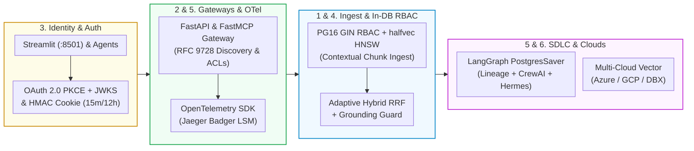
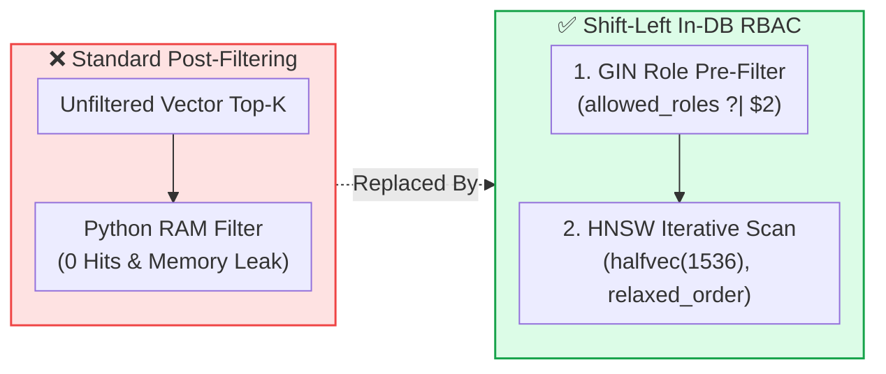
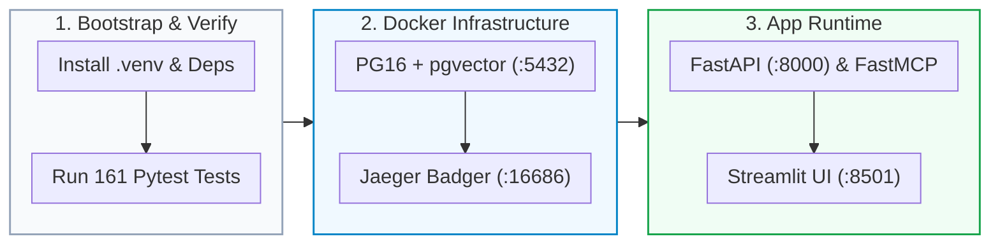
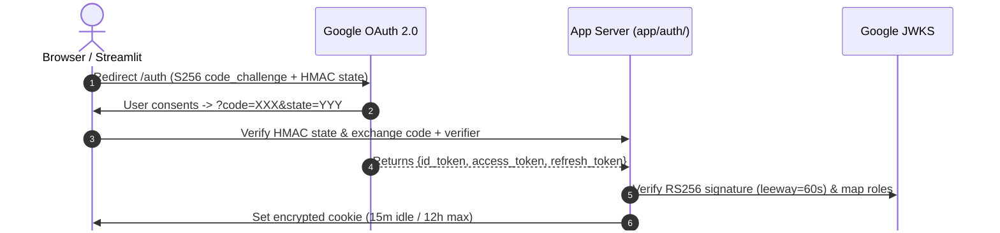
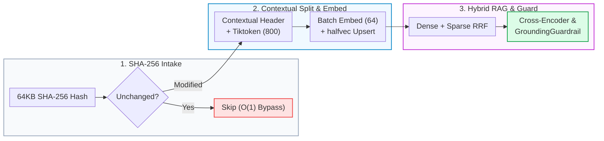
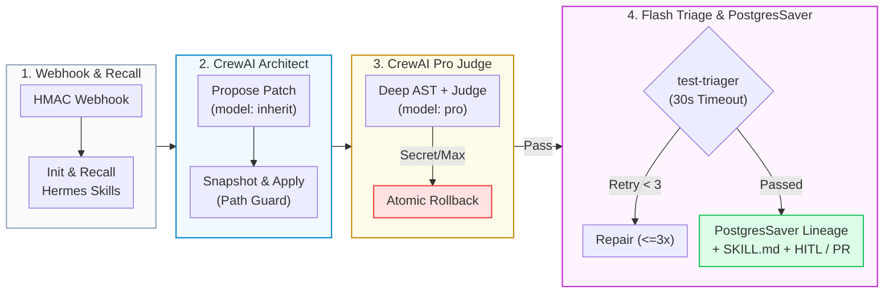
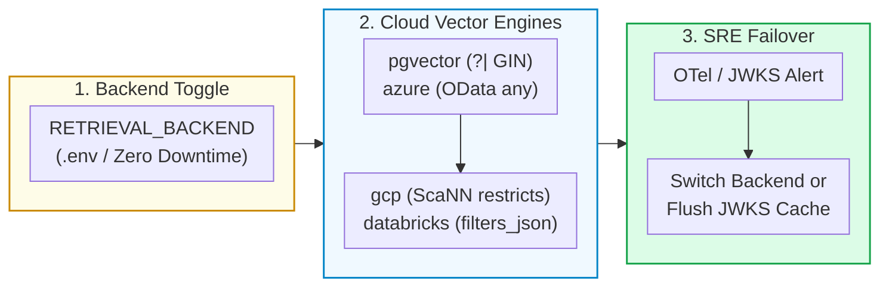

# 🛡️ Enterprise Zero-Trust RAG & Autonomous SDLC
| Live Artifact | Description | Access Link |
| :--- | :--- | :--- |
| **Interactive UI** | Shift-Left In-Database RBAC & Session Monitor | [enterprise-rag-pgvector-rbac.streamlit.app](https://enterprise-rag-pgvector-rbac.streamlit.app) |
| **API Docs** | Live OpenAPI / Interactive Swagger UI | [enterprise-rag-api-ksez.onrender.com/docs](https://enterprise-rag-api-ksez.onrender.com/docs) |
| **Source Code** | Auditable Source Repository & Offline Test Suite | [github.com/Kenono2000/enterprise-rag-pgvector-rbac](https://github.com/Kenono2000/enterprise-rag-pgvector-rbac) |

**Architect:** **[Ken Wong](https://www.linkedin.com/in/kenwong-architect/)** — Shift-left **In-Database Zero-Trust Vector RBAC** & **Autonomous Self-Healing SDLC Agent** (`PostgreSQL 16 + pgvector`, `FastAPI`, `Streamlit`, `OAuth 2.0 PKCE`, `JWKS`, `FastMCP`, `LangGraph`, `CrewAI`, `Hermes Agent`).\
**Quick Navigation:** [1. In-Database RBAC & Storage](#1-in-database-rbac-and-vector-storage-schemasql-appdb) · [2. Quickstart & Runtime Stack](#2-5-minute-quickstart-and-runtime-stack) · [3. Identity & Session Security](#3-identity-oauth-20-pkce-and-session-security-appauth) · [4. Ingestion & Hybrid RAG](#4-ingestion-pipeline-and-hybrid-rag-quality-scriptsingestpy-libs) · [5. Gateways, OTel, SDLC & Consolidated Deep-Dive](#5-gateways-observability-and-autonomous-sdlc-agent-app-agent) · [6. Multi-Cloud & Runbook](#6-multi-cloud-strategy-and-runbook)
## Complete System Architecture

| Topic | Architectural Pillar | Core Engineering Pattern | Primary Security & Performance Outcome |
| :-: | :--- | :--- | :--- |
| **1** | **In-DB RBAC & Storage** | Pre-filtered GIN + HNSW iterative scan (`relaxed_order`), 16-bit `halfvec(1536)` & Token Ledger | Zero recall starvation, zero overfiltering, **75% RAM savings**, in-DB token audit & managed shutoff. |
| **2** | **Quickstart & Runtime** | Event-loop-scoped `asyncpg` pools, `SKIP LOCKED` outbox & `/readyz` | Prevents closed-loop crashes; durable worker queue; Kubernetes probe ready (161 tests). |
| **3** | **Identity & Sessions** | Stateless OAuth 2.0 PKCE, HMAC state & encrypted cookies | Survives F5 reloads & multi-worker scale-out with **zero Redis**; SOC-2 15m/12h bounds. |
| **4** | **Ingestion & Hybrid RAG** | Contextual Headers, 64KB SHA-256 de-dup, Adaptive Dense + Sparse RRF (`dense_weight` / `sparse_weight`) | **>0.90 Context Precision**; `O(1)` skip for unchanged files; domain-adaptive fusion. |
| **5** | **Gateways, OTel, SDLC & Consolidated Deep-Dive** | 1) Zero‑Trust FastMCP Gateway (RFC 9728 / RFC 8707) • 2) Managed Token Budget & Admin Shut‑off (policy://sdlc‑budget) • 3) Full‑Stack OpenTelemetry (OTLP → Jaeger Badger LSM / Azure App Insights) • 4) Tri‑Paradigm SDLC Workflow (LangGraph + CrewAI + Hermes Agent) | Gateways enforce rate limits, JWT/TLS auth, and per‑caller token budgets; observability spans to Jaeger and Azure; SDLC workflow auto‑generates patches, audits, tests, repairs, and distills reusable SKILL.md artifacts.), `PostgresSaver`, Managed Quota API + Consolidated SDLC Deep-Dive, Terminology Source-Code Map & Interview Cheat Sheet + 5-Layer Defense-in-Depth AI Guardrails & LangChain/LangGraph State Management | Crash-resilient resume; token consumption kill-switch (`enforce_limit`/`is_blocked`); 60 req/min limits; LangGraph HITL checkpoints; CrewAI/Hermes subagents; MCP fail-closed ACL; token budget; observability ring buffer; 5-layer defense-in-depth; deterministic AST/secret gating; RAG triad enforcement. |
| **6** | **Multi-Cloud & Runbook** | Quad-mode strategy (`pgvector`, `azure`, `gcp`, `databricks`) | Zero-downtime `.env` switching with native pre-filtering across all 4 engines. |
## 1. In-Database RBAC and Vector Storage (`schema.sql`, `app/db/`)

```sql
SELECT d.document_id, d.title, c.chunk_index, c.content, d.allowed_roles,
       1 - (c.embedding::halfvec(1536) <=> $1::vector::halfvec(1536)) AS similarity
FROM document_chunks c JOIN documents d ON c.document_id = d.id
WHERE d.allowed_roles ?| $2::text[] AND (c.embedding_model = 'text-embedding-3-large' OR c.embedding_model IS NULL)
ORDER BY c.embedding::halfvec(1536) <=> $1::vector::halfvec(1536) LIMIT $3;
```
* **No Recall Starvation & pgvector 0.8+ Iterative Scans**: PostgreSQL evaluates `WHERE d.allowed_roles ?| $2::text[]` via the **GIN Index** and automatically configures `SET hnsw.iterative_scan = 'relaxed_order'` (`max_scan_tuples = 20000`) per pooled connection—eliminating ANN overfiltering on selective roles while ensuring unauthorized rows never enter Python RAM.
* **SQL Injection & Empty-Role Guards**: Binds roles strictly as a parameterized `$2::text[]` array and returns `[]` immediately before DB execution if `user_roles` is empty.
* **Matryoshka 1536-d + 16-Bit `halfvec(1536)` Compaction**: Truncates `text-embedding-3-large` from `3072` to `1536` dims and quantizes to IEEE 754 16-bit floats (`embedding_halfvec halfvec(1536)`, `idx_chunks_embedding_halfvec_hnsw` with `halfvec_cosine_ops`) for **50% additional HNSW RAM savings** (**75% cumulative reduction**, **>98% recall**) across normalized `documents` + `document_chunks` (`ON DELETE CASCADE`) tables (see [`schema.sql`](file:///c:/src/enterprise-rag-pgvector-rbac/schema.sql)).
* **Persistent Token Consumption Ledger & Managed Budget Controls**: `token_consumption_ledger` records atomic prompt and completion token counts per caller and model, while `token_managed_limits` enforces caller quotas (`max_budget_tokens`), provides administrative toggles to disable enforcement (`enforce_limit`), and trips an emergency kill-switch (`is_blocked`) to turn off token consumption once limits are exceeded.
## 2. 5-Minute Quickstart and Runtime Stack

```powershell
git clone https://github.com/Kenono2000/enterprise-rag-pgvector-rbac.git && cd enterprise-rag-pgvector-rbac
python -m venv .venv && .\.venv\Scripts\Activate.ps1 && python -m pip install -r requirements.txt
python -m pytest -v                                                     # 1. Run full test suite (161 tests; the Docker-gated integration test auto-skips when no daemon)
docker compose up -d && psql -U postgres -d enterprise_rag -f schema.sql # 2. Start PG16 + pgvector & Jaeger Badger
python -m uvicorn app.main:app --host 0.0.0.0 --port 8000 --reload       # 3. Launch FastAPI Backend (:8000)
python -m streamlit run streamlit_app.py --server.port 8501              # 4. Launch Streamlit UI (:8501)
python -m app.mcp --transport http                                       # 5. Launch FastMCP Gateway (Streamable HTTP / stdio)
python -m agent status                                                   # 6. Run Hermes + CrewAI + LangGraph SDLC CLI
python -m agent checkpoints "<thread_id>"                                # 7. Inspect Time-Travel Checkpoint Lineage
```
* **Local Endpoints**: Streamlit UI (`http://localhost:8501`) · Swagger Docs (`http://localhost:8000/docs`) · SSE Stream (`/api/v1/query/stream`) · Document Catalog (`/api/v1/documents`) · Health Probes (`/healthz`, `/readyz`) · Token Budget Controls (`/api/v1/tokens/usage`, `/api/v1/tokens/limit`) · Telemetry (`/api/v1/metrics/observability`) · Jaeger UI (`http://localhost:16686`).
* **Loop-Scoped Async Concurrency**: `DatabaseManager` and `get_openai_client()` scope connection pools to `asyncio.get_running_loop()`, preventing `RuntimeError: Event loop is closed` across Streamlit threads.
* **Hermetic, 100% Offline Tests (`conftest.py`)**: The suite pins a deterministic environment (`OTEL_ENABLED=false`, blank `DATABASE_URL` / `GITHUB_TOKEN`, `SDLC_PUSH=false`, `USE_CREWAI_SDK=false`) *before* any application module is imported, so a developer `.env` (live PostgreSQL, hosted OTLP collector, cloud keys) can never leak into `python -m pytest -v`. All application modules load `.env` with `load_dotenv(..., override=False)`, so real process environment variables always win (12-factor precedence) — this is what lets CI and containers override the dotenv file. The heavyweight **CrewAI** SDK is strictly opt-in: `SDLCCrewOrchestrator.build_crewai_crew()` / `build_crewai_flow()` return the deterministic `native_pydantic` adapter unless `USE_CREWAI_SDK=true` is set, keeping import time and side effects out of default execution.
## 3. Identity, OAuth 2.0 PKCE, and Session Security (`app/auth/`)

* **Stateless HMAC PKCE State**: `encode_pkce_state()` signs `{b64_payload}.{sig}` (300s TTL) with HMAC-SHA256, surviving OAuth redirects and multi-worker restarts without Redis.
* **F5 Reload Resilience**: Compresses (`zlib`) and HMAC-signs session tokens into the `enterprise_rag_session` cookie, rehydrating `st.session_state` and silently rotating expired tokens on browser refresh.
* **Multi-IdP JWKS & SOC-2 Bounds**: Validates RS256 signatures (`leeway=60s`), maps claims across Google, Azure AD, Okta, Cognito, and Keycloak against `KNOWN_ROLES`, and enforces a **15-minute idle timeout** and **12-hour hard ceiling**.
## 4. Ingestion Pipeline and Hybrid RAG Quality (`scripts/ingest.py`, `libs/`)

* **Skip Unchanged Files (SHA-256 Hashing)**: Hashes files in 64KB blocks (`O(1)` lookup) to skip unchanged documents with zero API calls, and automatically replaces old chunks when a file is updated.
* **Contextual Chunk Headers & Table-Safe Splitting**: `split_chunks()` (`libs/utilities.py`) extracts parent document summaries (`summarize_document_context`) and prepends `[Document Context: <id> | Section: <sec> | Summary: <summary>]` headers (`build_contextual_chunk_header`) to 800-token chunks without breaking Markdown tables—elevating **Context Precision > 0.90** while embedding in 64-chunk batches with exponential backoff (`tenacity`).
* **Adaptive Hybrid Search (Semantic + Keyword RRF)**: Combines 16-bit `halfvec(1536)` cosine search with robust full-text search (`plainto_tsquery` + `websearch_to_tsquery` fallback) using parameterized Reciprocal Rank Fusion (`dense_weight / (k + rank) + sparse_weight / (k + rank)`, default `k=60`), pre-filtered by user role in PostgreSQL. Fusion runs as a **single-pass SQL CTE** (`ROW_NUMBER() OVER (...)` dense + sparse ranks, `FULL OUTER JOIN`, in-database RRF score) with automatic Python RRF fallback, and `hnsw.max_scan_tuples` auto-scales per caller via `DatabaseManager.scaled_scan_tuples` (1 role 2x, 2 roles 1x, 3+ roles 0.5x).
* **Re-Ranking & Citation Guardrail (`GroundingGuardrail`)**: Re-ranks top results with a `CrossEncoder` and requires every answer to cite `[Doc: <Title>, Chunk <Index>]`—explicitly refusing to answer when context is missing.
* **Context Engineering Pipeline (`app/rag/context.py`)**: Formalizes the retrieve → assemble → cache → compact context discipline: `ContextAssembler.assemble()` converts authorized chunks into citation-formatted context text, builds a deterministic static-prefix prompt (SHA-256 `prefix_hash`, `static_prefix_tokens`) for cross-turn KV prefix caching, and applies token-bounded deterministic compaction (`DEFAULT_MAX_CONTEXT_TOKENS=4000`) when the authorized context exceeds the budget, keeping highest-similarity chunks. `app/main.py` now routes both `/api/v1/query` and `/api/v1/query/stream` through this pipeline.
## 5. Gateways, Observability, and Autonomous SDLC Agent (`app/`, `agent/`)

* **Zero-Trust FastMCP Gateway (`app/mcp/gateway.py`)**: Exposes `search_sdlc_context`, `list_documents`, `propose_patch`, `run_sdlc_crew`, `recall_hermes_skills`, `get_gateway_metadata`, and `policy://sdlc-budget` over `stdio`, `http` (Streamable HTTP), and legacy `SSE` with `ConfigDict(extra="forbid")` schemas, [RFC 9728](https://github.com/Kenono2000/enterprise-rag-pgvector-rbac/blob/main/app/mcp/gateway.py) Protected Resource Metadata discovery, [RFC 8707](https://github.com/Kenono2000/enterprise-rag-pgvector-rbac/blob/main/app/mcp/gateway.py) tool-level Role-Based Access Control (`check_tool_permission` blocking confused deputy exploits), 60 req/min [SlidingWindowRateLimiter](https://github.com/Kenono2000/enterprise-rag-pgvector-rbac/blob/main/agent/guardrails.py#L27), and 8K/50K [TokenCircuitBreaker](https://github.com/Kenono2000/enterprise-rag-pgvector-rbac/blob/main/agent/guardrails.py#L72). The LangGraph SDLC engine supports opt-in concurrent verification (`SDLC_PARALLEL_VERIFY=true` / `parallel_verify=True`): after the deterministic AST/secret gate passes, the Auditor and Triager run in parallel [`parallel_verify` node](https://github.com/Kenono2000/enterprise-rag-pgvector-rbac/blob/main/agent/workflow.py#L1144); [SDLCCrewOrchestrator.build_crewai_flow](https://github.com/Kenono2000/enterprise-rag-pgvector-rbac/blob/main/agent/workflow.py#L540) exposes the equivalent CrewAI Flow with `@start`/`@listen`/`and_`.
* **Managed Token Budget & Administrative Shutoff API (`app/main.py`)**: Provides endpoints [/api/v1/tokens/usage](https://github.com/Kenono2000/enterprise-rag-pgvector-rbac/blob/main/app/main.py#L728), [/api/v1/tokens/limit](https://github.com/Kenono2000/enterprise-rag-pgvector-rbac/blob/main/app/main.py#L781), [/api/v1/tokens/reset](https://github.com/Kenono2000/enterprise-rag-pgvector-rbac/blob/main/app/main.py#L823), and [/api/v1/tokens/ledger](https://github.com/Kenono2000/enterprise-rag-pgvector-rbac/blob/main/app/main.py#L838) backed by PostgreSQL [token_consumption_ledger](https://github.com/Kenono2000/enterprise-rag-pgvector-rbac/blob/main/schema.sql#L165) and [token_managed_limits](https://github.com/Kenono2000/enterprise-rag-pgvector-rbac/blob/main/schema.sql#L183), enabling administrators and callers to monitor token velocity, toggle enforcement (`enforce_limit`), or trigger emergency kill-switches (`is_blocked`) to immediately turn off token consumption.
* **Full-Stack OpenTelemetry (`app/observability.py`)**: Streams OTLP gRPC spans (`:4317`) to **Jaeger** (persistent Badger LSM disk store, 7-day TTL) and **Azure Application Insights**, backed by a 1,000-event ring buffer (`GET /api/v1/metrics/observability`) and non-root `Dockerfile` (`UID 10001`).
* **Tri-Paradigm SDLC Workflow & `PostgresSaver` (`agent/workflow.py`)**: Unites **LangChain/LangGraph** (`LangGraphSDLCWorkflow` cyclic state machine + native `interrupt()` / `Command(resume=...)` HITL approval gating + PostgreSQL checkpoint persistence via `PostgresSaver`/`sdlc_workflow_checkpoints` + `resume_from_checkpoint` multi-worker recovery + `get_execution_history` time-travel lineage auditing + atomic `rollback_patches`), **CrewAI** (`SDLCCrewOrchestrator` role-based crew: `Principal SDLC Architect` [`inherit`], `Lead Security & AST Auditor` [`pro`], and `Site Reliability & Pytest Triager` [`flash`] — upstream SDK adapter enabled with `USE_CREWAI_SDK=true`, otherwise the deterministic `native_pydantic` adapter is used), and **Hermes Agent** (`HermesSkillSynthesizer` closed-loop `recall_relevant_skills`, portable `SKILL.md` distillation, and Atropos GRPO ShareGPT RL trajectory export with step reward rubrics) guarded by `PolicyEngine`.

---

### Deep-Dive: Code Breakdown & Architecture Insights

#### 1. Zero-Trust FastMCP Gateway (`app/mcp/gateway.py`)
- **Blast Radius Controls**: Configures module-level `SlidingWindowRateLimiter` (default 60 req/min per caller) and `TokenCircuitBreaker` (8,000 tokens/request, 50,000 tokens/issue) to protect downstream LLMs.
- **Strict Pydantic Schemas (`extra="forbid"`)**: Every tool request (`MCPSearchRequest`, `MCPPatchRequest`, `MCPSDLCCrewRequest`, `MCPHermesSkillRequest`, `MCPListDocumentsRequest`) explicitly rejects unknown fields.
- **Fail-Closed RBAC (`check_tool_permission`)**: Maps tools to required roles (`TOOL_REQUIRED_ROLES`). If a token is authenticated but has zero claims, it is **denied** for restricted tools, preventing confused deputy attacks.
- **RFC 9728 & RFC 8707**: Exposes Protected Resource Metadata discovery and OAuth scope bindings directly within the MCP gateway layer.

#### 2. Managed Token Budget & Administrative Shutoff API (`app/main.py`)
- **Database-Backed Ledgers**: Tracks every token consumption event via `token_consumption_ledger` and enforces limits through `token_managed_limits`.
- **Kill-Switching**: Allows administrators or authorized engineers to toggle `enforce_limit` or trip the emergency `is_blocked` kill-switch instantly via REST endpoints (`/api/v1/tokens/limit`) or the MCP `policy://sdlc-budget` resource.

#### 3. Full-Stack OpenTelemetry (`app/observability.py`)
- **Dual Exporters**: Integrates with Azure Application Insights (`APPLICATIONINSIGHTS_CONNECTION_STRING`) and OTLP gRPC (`http://localhost:4317`) for Jaeger Badger LSM storage.
- **Ring Buffer Fallback**: Maintains a thread-safe 1,000-event in-memory ring buffer for metrics and traces, ensuring observability telemetry works even when external exporters are offline.

#### 4. Tri-Paradigm SDLC Workflow (`agent/workflow.py`)
- **LangGraph Checkpointing**: `PostgresCheckpointSaver` extends LangGraph state persistence, committing graph steps to PostgreSQL (`sdlc_workflow_checkpoints`) with time-travel inspection and multi-worker resume support.
- **CrewAI Role Specialization**: Orchestrates specialized agents (`arch-synthesizer`, `cross-model-judge`, `test-triager`) with tiered model routing (`inherit`, `pro`, `flash`).
- **Hermes Agent Lifelong Learning**: Automatically distills verified successful patches into portable `SKILL.md` files in `.agent/skills/` and exports ShareGPT-formatted RL trajectories weighted by Atropos GRPO step rewards.

#### 5. Defense-in-Depth Guardrails (`agent/guardrails.py`)
- **PolicyEngine AST Scanning**: Detects dangerous Python constructs (`exec`, `eval`, `__import__`, `subprocess` with `shell=True`, unauthorized path traversals) before code application.
- **Secret Regex Filtering**: Automatically catches exposed API keys, private keys, and credential patterns.
- **GroundingGuardrail**: Enforces the RAG Triad by requiring explicit source citations (`[Doc: <Title>, Chunk <Index>]`) and verifying that cited chunks exist in authorized context.
## 6. Multi-Cloud Strategy and Runbook
* **Zero-Downtime Cutover & Failover**: Switch `RETRIEVAL_BACKEND` in `.env` (`pgvector` | `azure` | `gcp` | `databricks`) or run `python scripts/migrate_multicloud.py --target all`.
* **Incident Runbook**: On DB latency alerts in Jaeger (`http://localhost:16686`), fail over `RETRIEVAL_BACKEND` in `.env`; on JWKS key rotation, restart the auth worker to flush `JWKSClient`; verify Badger LSM persistence via `docker compose restart jaeger`.

| Backend (`RETRIEVAL_BACKEND`) | Vector & Hybrid Engine | In-Database RBAC Pre-Filter | LLM & Observability |
| :--- | :--- | :--- | :--- |
| **`pgvector`** (Local) | PG16 `halfvec(1536)` HNSW + `tsvector` RRF | `WHERE allowed_roles ?| $2::text[]` | OpenAI `gpt-4o` + Jaeger Badger LSM |
| **`azure`** (Microsoft Azure) | Azure AI Search + Semantic Ranker | OData `allowed_roles/any(r: ...)` | Azure OpenAI `gpt-4o` + App Insights |
| **`gcp`** (Google Cloud) | Vertex AI ScaNN + Ranking API | ScaNN `restricts` (`allowList`) | Gemini 1.5 Pro + Cloud Trace |
| **`databricks`** (Databricks) | Mosaic AI Vector Search (Delta Sync) | Unity Catalog `filters_json` (`OR`) | Llama 3.1 70B + MLflow Tables |


