# 🛡️ Enterprise Zero-Trust RAG & Autonomous SDLC
**Navigation**: [1. Arch](#1-system-architecture-overview) | [Pillars](#1a-architectural-pillars-overview) | [2. In-DB RBAC](#2-in-database-rbac-vector-storage-schemasql-appdb) | [3. Identity](#3-identity-oauth-20-pkce-security-appauth) | [4. Ingestion & RAG](#4-ingestion-pipeline-and-hybrid-rag-quality-scriptsingestpy-libs) | [5. Gateways & SDLC](#5-gateways-observability-autonomous-sdlc-app-agent)
**Diagrams**: [1. High-Level RAG & SDLC](#diagram-1-high-level-rag-sdlc-architecture) | [2. In-DB RBAC & Compaction](#diagram-2-in-db-rbac-vector-compaction) | [3. OAuth 2.0 PKCE](#diagram-3-oauth-20-pkce-jwks-flow) | [4. Hybrid RAG & Triad](#diagram-4-end-to-end-hybrid-rag-triad-pipeline) | [5. FastMCP Gateway & OTel](#diagram-5-zero-trust-fastmcp-gateway-otel) | [6. Token Budget & Shutoff](#5c-managed-token-budget-administrative-shutoff-api-appmainpy) | [7. Invariant Suite](#5d-architectural-invariant-regression-suite-teststest_architectural_invariantspy) | [8. Autonomous SDLC & Resume](#diagram-6-autonomous-sdlc-crash-resume) | [9. Shared Memory](#diagram-7-shared-chat-agent-memory)

## 1. System Architecture Overview
#### Diagram 1: High-Level RAG & SDLC Architecture
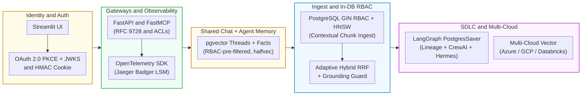

### 1.a 🏗️ Architectural Pillars Overview
| # | Pillar | Core Focus | Key Outcome |
| :-: | :--- | :--- | :--- |
| **1** | **In-DB RBAC & Storage** | Pre-filtered GIN + HNSW iterative scan | **75% RAM savings**, zero recall starvation, in-DB token audit |
| **2** | **Quickstart & Runtime** | Event-loop-scoped async pools, SKIP LOCKED outbox, centralized pool sizing under Settings | Kubernetes probe ready, 316 tests collected (315 passed, 1 skipped, 0 failures), 0 warnings |
| **3** | **Identity & Sessions** | Stateless OAuth 2.0 PKCE, HMAC state & encrypted cookies | F5 reload resilience, multi-worker scale-out, zero Redis, SOC-2 bounds |
| **4** | **Ingestion & Hybrid RAG** | Contextual headers, 64KB SHA-256 de-dup, Adaptive RRF | **>0.90 Context Precision**, O(1) skip for unchanged files |
| **5** | **Gateways, OTel, SDLC & Deep-Dive** | Zero-Trust FastMCP Gateway, token budgets, OpenTelemetry, SDLC workflow | Rate limits, JWT/TLS auth, token budgets, 60 req/min limits, defense-in-depth |
| **6** | **Multi-Cloud & Runbook** | Quad-mode strategy (pgvector, Azure, GCP, Databricks) | Zero-downtime .env switching, native pre-filtering across 4 engines |

## 2. In-Database RBAC & Vector Storage (`schema.sql`, `app/db/`)
#### Diagram 2: In-DB RBAC & Vector Compaction
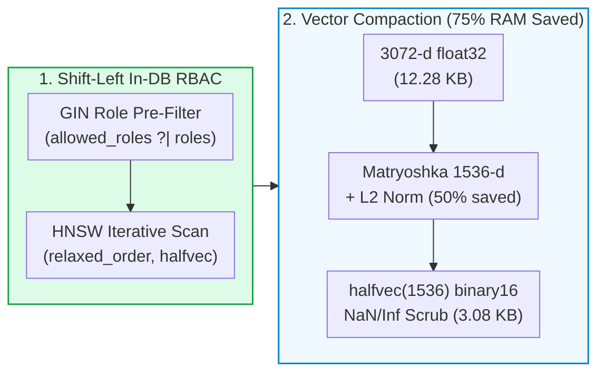
```sql
SELECT d.document_id, d.title, c.chunk_index, c.content, d.allowed_roles,
       1 - (c.embedding::halfvec(1536) <=> $1::vector::halfvec(1536)) AS similarity
FROM document_chunks c JOIN documents d ON c.document_id = d.id
WHERE d.allowed_roles ?| $2::text[] AND (c.embedding_model = 'text-embedding-3-small' OR c.embedding_model IS NULL)
ORDER BY c.embedding::halfvec(1536) <=> $1::vector::halfvec(1536) LIMIT $3;
```
### 2.a 🔧 Key RBAC & Storage Innovations
* **2.a.1 🎯 Zero Recall Starvation**: GIN Index + `hnsw.iterative_scan = 'relaxed_order'` eliminates ANN overfiltering on selective roles. pgvector 0.8+ iterative scans retain filtered-out HNSW candidates in a `discarded` pairing heap and resume traversal in `hnsw.ef_search` batches until `hnsw.max_scan_tuples` (20000) or memory limits stop the scan — so high-selectivity `WHERE d.allowed_roles ?| $2::text[]` clauses no longer exhaust the top-k candidate list. Dynamic candidate depth scales per role cardinality: **80** for single role, **40** for dual, **20** for broad roles, configured per connection in `DatabaseManager.configure_iterative_scan()`.
* **2.a.2 🔒 SQL Injection Protection**: Parameterized `$2::text[]` array with empty-role guard (returns `[]` before DB execution).
* **2.a.3 🧹 Unified Role Sanitization (single source of truth)**: One canonical `sanitize_roles_for_query()` in `app/auth/role_mapper.py` is delegated to by every retrieval path — pgvector (`DatabaseManager`), the Azure / GCP / Databricks cloud adapters, and the REST `X-User-Roles` legacy-header paths in `app/main.py` and `app/api/rag.py` — so the role grammar cannot drift between engines. Only non-empty strings that are known application roles (`KNOWN_ROLES`) or valid identifiers survive; injection payloads, empty strings, and non-string claims are dropped and fail closed to `[]`. Pinned cross-engine by `tests/test_role_sanitization_contract.py` (24 tests).
* **2.a.4 🗂️ RBAC GIN Operator Class**: `idx_documents_allowed_roles_gin` uses the default `jsonb_ops` GIN class (not `jsonb_path_ops`), because the key-existence operator `?|` is only served by `jsonb_ops` (`jsonb_path_ops` accelerates `@>`, `@?`, `@@` exclusively). The index is therefore genuinely Bitmap-index-accelerated for the role pre-filter.
* **2.a.5 📦 Matryoshka 1536-d + 16-Bit Compaction**: 75% cumulative RAM reduction with >98% recall. Matryoshka Representation Learning (MRL) truncates 3072-d vectors to 1536-d with L2 re-normalization (50% RAM reduction), composed with pgvector `halfvec(1536)` IEEE 754 binary16 quantization (additional 50% savings; max HNSW dimension doubles to 4,000). Numerical integrity is enforced by `DatabaseManager.format_halfvec()`, scrubbing `NaN`, `+Inf`, and `-Inf` to `0.0` before writing literal strings to prevent corrupted distance calculations and SQL parser failures.
* **2.a.1 💰 Token Budget Controls**: `token_consumption_ledger` tracks usage; `token_managed_limits` provides emergency kill-switch (`is_blocked`).

**Schema Query**: The core retrieval query with RBAC pre-filtering:
```sql
SELECT d.document_id, d.title, c.chunk_index, c.content, d.allowed_roles,
        1 - (c.embedding::halfvec(1536) <=> $1::vector::halfvec(1536)) AS similarity
FROM document_chunks c JOIN documents d ON c.document_id = d.id
WHERE d.allowed_roles ?| $2::text[] AND (c.embedding_model = 'text-embedding-3-small' OR c.embedding_model IS NULL)
ORDER BY c.embedding::halfvec(1536) <=> $1::vector::halfvec(1536) LIMIT $3;
```

## 3. Identity & OAuth 2.0 PKCE Security (`app/auth/`)
#### Diagram 3: OAuth 2.0 PKCE & JWKS Flow
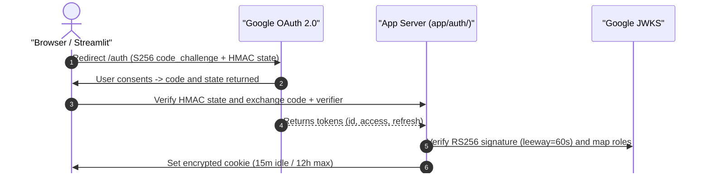
* **3.1 Stateless HMAC PKCE State**: `encode_pkce_state()` signs `{b64_payload}.{sig}` (300s TTL) with HMAC-SHA256, surviving OAuth redirects and multi-worker restarts without Redis.
* **3.2 Strict Pydantic v2 User Claims**: `UserClaims` model (`app/auth/claims.py`) enforces strict validation (`extra="forbid"`, `str_strip_whitespace=True`) on verified JWT payloads — required `sub`, normalized lowercased `email`/`roles`, rejection of unknown fields — so malformed or over-privileged claims cannot reach RBAC retrieval paths. `claims_from_payload()` builds validated claims from token payloads.
* **3.3 F5 Reload Resilience**: Compresses (`zlib`) and HMAC-signs session tokens into the `enterprise_rag_session` cookie, rehydrating `st.session_state` and silently rotating expired tokens on browser refresh.
* **3.4 Multi-IdP JWKS & SOC-2 Bounds**: Validates RS256 signatures (`leeway=60s`), maps claims across Google, Azure AD, Okta, Cognito, and Keycloak against `KNOWN_ROLES`, and enforces a **15-minute idle timeout** and **12-hour hard ceiling**.

## 4. Ingestion Pipeline and Hybrid RAG Quality (`scripts/ingest.py`, `libs/`)
#### Diagram 4: End-to-End Hybrid RAG & Triad Pipeline
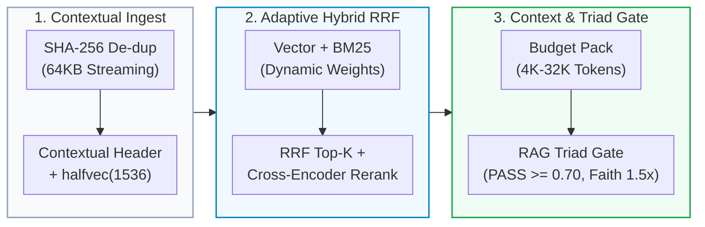
* **4.1 Skip Unchanged Files (SHA-256 Hashing)**: Hashes files in 64KB blocks (`O(1)` lookup) to skip unchanged documents with zero API calls, and automatically replaces old chunks when a file is updated.
* **4.2 Contextual Chunk Headers & Table-Safe Splitting**: `split_chunks()` (`libs/utilities.py`) extracts parent document summaries (`summarize_document_context`) and prepends `[Document Context: <id> | Section: <sec> | Summary: <summary>]` headers (`build_contextual_chunk_header`) to 800-token chunks without breaking Markdown tables—elevating **Context Precision > 0.90** while embedding in 64-chunk batches with exponential backoff (`tenacity`).
* **4.3 Adaptive Hybrid Search (Semantic + Keyword RRF)**: Combines 16-bit `halfvec(1536)` cosine search with robust full-text search (`plainto_tsquery` + `websearch_to_tsquery` fallback) using parameterized Reciprocal Rank Fusion (`dense_weight / (k + rank) + sparse_weight / (k + rank)`, default `k=60`), pre-filtered by user role in PostgreSQL. Fusion runs as a **single-pass SQL CTE** (`ROW_NUMBER() OVER (...)` dense + sparse ranks, `FULL OUTER JOIN`, in-database RRF score) with automatic Python RRF fallback, and `hnsw.max_scan_tuples` auto-scales per caller via `DatabaseManager.scaled_scan_tuples` (1 role 2x, 2 roles 1x, 3+ roles 0.5x).
* **4.4 Embedding & Re-Ranking Models (`libs/utilities.py`)**: Uses OpenAI / Azure OpenAI `text-embedding-3-small` (1536-d) for chunk embeddings and optional `CrossEncoder` (`ms-marco-MiniLM-L-6-v2`) for secondary re-ranking; `GroundingGuardrail` verifies source citations (`[Doc: <Title>, Chunk <Index>]`) and gracefully refuses ungrounded responses.
* **4.5 Adaptive Hybrid RRF + Grounding Guard**: Couples in-database single-pass RRF with post-generation deterministic citation verification (`GroundingGuardrail`). Formats context into deterministic prefix-cached structures with SHA-256 hashes to accelerate KV cache hits across multi-turn queries, enforcing that every answer claims traceable references to authorized chunks and mandating explicit admissions of unknown information when context is silent.
### 4.a 📚 Context Engineering Pipeline (`app/rag/context.py`)
Formalizes the retrieve → assemble → compact → reorder → cache discipline:
* **4.a.1 ContextAssembler.assemble()**: Converts authorized chunks into citation-formatted context text (`[Doc: <Title>, Chunk <N>]`).
* **4.a.2 Canonical Header Normalization**: Enforces strict title/content whitespace stripping and canonical header formatting across all chunks to stabilize byte-level SHA-256 `prefix_hash` across multi-turn queries.
* **4.a.3 Token-Bounded Compaction (`_compact`)**: Evaluates `DEFAULT_MAX_CONTEXT_TOKENS=4000`. When context exceeds budget, chunks are sorted by similarity and accumulated greedily until budget is saturated, dropping low-confidence tail chunks and setting `compacted: True`.
* **4.a.4 Attention-Aware Context Placement**: `ContextAssembler.reorder_chunks_extremities` places highest-similarity chunks at prompt extremities (`[rank_1, rank_3, ..., rank_4, rank_2]`) to mitigate LLM attention decay ("lost in the middle").
* **4.a.5 Static-Prefix Prompt Caching**: Builds deterministic static-prefix prompt (`[STATIC SYSTEM + CONTEXT] -> [DYNAMIC QUESTION]`) with `prefix_hash` and `static_prefix_tokens` for cross-turn KV prefix caching on OpenAI and Gemini APIs (reducing latency up to 80%).
Both `/api/v1/query` and `/api/v1/query/stream` endpoints route through this optimized pipeline.

### 4.b 📐 RAG Triad Evaluation Engine (`app/rag/evaluator.py`)
Deterministic, fully offline quality evaluator for the RAG Triad (no LLM/network calls — sub-millisecond keyword-overlap + vector-similarity heuristics), aligning with AWS Vector DB Evaluation Criteria (2026) and Mindstream AI Playbook standards, exported from `app/rag/__init__.py` and pinned by `tests/test_deep_eval.py`:
* **4.b.1 Context Relevance** — 70% query-term coverage in retrieved chunks + 30% average vector similarity. Measures signal-to-noise ratio in retrieval and verifies pre-filtering eliminates irrelevant noise.
* **4.b.2 Faithfulness (Groundedness)** — 40% valid citation index matching (`[Doc: <Title>, Chunk <Index>]`) + 60% sentence-level keyword claim support in context. Graceful refusal on unanswerable or silent context automatically receives 1.0 (anti-hallucination guarantee).
* **4.b.3 Answer Relevance** — 80% question/answer keyword overlap + 20% conciseness penalty against prompt drift.
* **4.b.4 Asymmetric Composite & Strict Gate** — Weighted composite gives `faithfulness` a 1.5× multiplier (`composite = (1.0*CR + 1.5*Faith + 1.0*AR)/3.5`) to penalize hallucination. Verdict is `PASS` (composite ≥ 0.70 AND faithfulness ≥ 0.70), `WARNING` (≥ 0.45), else `FAIL`.
* **4.b.5 Precision-Tiered Task Routing** — Evaluates task risk against the 2026 Low vs. High Precision framework (`PolicyEngine.evaluate_task_precision_routing`): Low-Precision tasks (documentation, test triage, draft compilation) execute autonomously (≥90% accuracy target); High-Precision tasks (schema modifications, RBAC policy changes, auth credentials) enforce HITL approval gates, AST policy passes, and test rollback protection (≥99.9% accuracy target).
* **4.b.6 Observability Integration** — `ObservabilityManager.record_rag_triad()` (`app/observability.py`) persists scorecards to the thread-safe ring buffer and emits `rag_triad_evaluation` OTel spans with `rag.triad.*` attributes.

## 5. Gateways, Observability & Autonomous SDLC (`app/`, `agent/`)
### 5.a 🔐 Zero-Trust FastMCP Gateway & Observability (`app/mcp/gateway.py`, `app/main.py`)
**Security-First Architecture**:
#### Diagram 5: Zero-Trust FastMCP Gateway & OTel
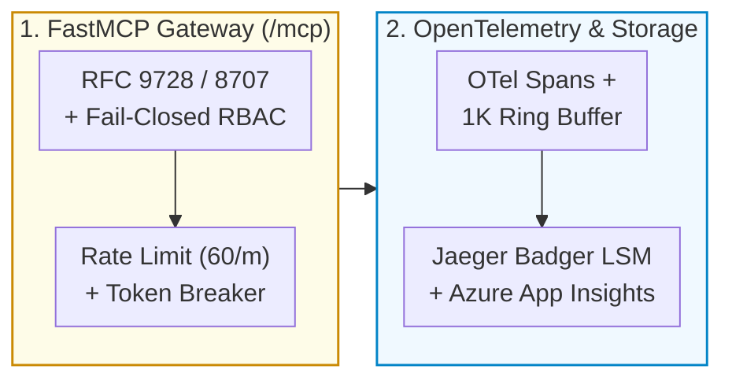

**Zero-Trust Protections**:
- **5.a.1 🛡️ RFC 9728 & RFC 8707**: Machine-readable Protected Resource Metadata discovery (`get_gateway_metadata`) declaring OAuth authorities, supported transports (`streamable-http`), reverse-proxy reflection headers (`Mcp-Method`, `Mcp-Name`), and fail-closed tool-level RBAC (`check_tool_permission`).
- **5.a.2 🔒 AST Security**: Inspects syntax trees via `PolicyEngine.verify_ast` to block `eval()`, `exec()`, `compile()`, `__import__()`, dynamic reflection (`getattr` on `system`/`popen`), directory-traversal in `open()`, and `subprocess(shell=True)`.
- **5.a.3 ⚡ Rate Limiting**: In-memory `SlidingWindowRateLimiter` enforces 60 req/min per caller identity via deque eviction, preventing automated scraping and agent loop storms with zero database roundtrips.
- **5.a.4 💰 Token Controls**: Two-tiered budget limits via `TokenCircuitBreaker` (8,000 tokens/request, 50,000 tokens/issue) with an administrative emergency shutoff kill-switch (`is_blocked`).

**Tri-Paradigm SDLC Workflow**:
- **5.a.5 LangGraph**: Cyclic state machine (`initialize` -> `synthesize` -> `audit` -> `test` -> `repair`) with crash-resilient `PostgresSaver` checkpoint persistence (`sdlc_workflow_checkpoints`), enabling seamless container restart resumption and parent-checkpoint time-travel recovery.
- **5.a.6 CrewAI**: Role-based agent crew with multi-model tiering: `arch-synthesizer` (Staff Architect, `inherit` frontier reasoning model), `cross-model-judge` (Lead Security Auditor, Gemini Pro `pro`), and `test-triager` (SRE & Pytest Diagnostician, Gemini Flash `flash`), lowering inference costs by ~65%.
- **5.a.7 Hermes**: Lifelong learning loop: distills verified successful patches into reusable `.agent/skills/hermes-*/SKILL.md` playbooks for instant future recall, and exports ShareGPT RL training trajectories with Atropos GRPO step rewards.
- **5.a.8 Policy**: `never_ask_approval` - Workflow operates autonomously without human-in-the-loop approval gates; auto-times out via `asyncio.wait_for` (bounded by `SDLC_WEBHOOK_TIMEOUT_SECONDS`) with full audit logs.
#### Diagram 6: Autonomous SDLC & Crash-Resume
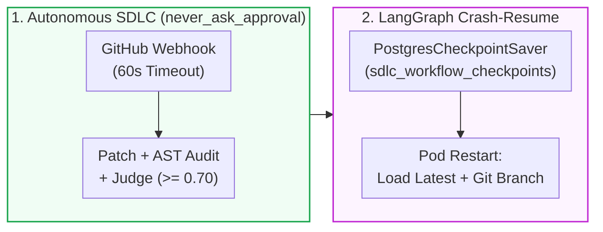

**Managed Token Budget API**:
- Usage monitoring: `/api/v1/tokens/usage`
- Limit controls: `/api/v1/tokens/limit`
- Emergency kill-switch: `/api/v1/tokens/reset` / `/api/v1/tokens/ledger`

**Policy**: `never_ask_approval` - Workflow operates in autonomous mode without human-in-the-loop approval gates

**Full-Stack Observability** (`app/observability.py`):
- **5.a.9 📊 Dual Exporters**: Jaeger Badger LSM (4317 gRPC) + Azure Application Insights
- **5.a.10 🔄 7-Day Persistence**: Badger LSM with 1,000-event ring buffer fallback
- **5.a.11 🛡️ Non-root**: UID 10001 for security

**Key Innovation**: Opt-in concurrent verification (`SDLC_PARALLEL_VERIFY=true`) enables parallel Auditor/Triager execution after security gate passes.

### 5.b Zero-Trust FastMCP Gateway (`app/mcp/gateway.py`)
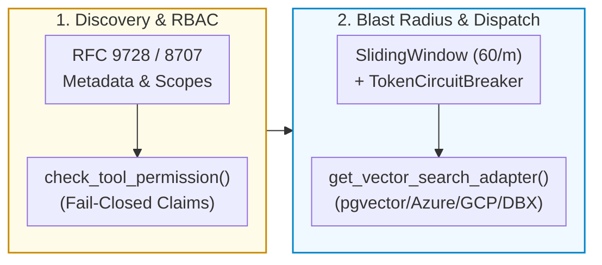
- **5.b.1 Blast Radius Controls**: Configures module-level `SlidingWindowRateLimiter` (default 60 req/min per caller) and `TokenCircuitBreaker` (8,000 tokens/request, 50,000 tokens/issue) to protect downstream LLMs.
- **5.b.2 Strict Pydantic Schemas (`extra="forbid"`)**: Every tool request (`MCPSearchRequest`, `MCPPatchRequest`, `MCPSDLCCrewRequest`, `MCPHermesSkillRequest`, `MCPListDocumentsRequest`, `MCPAutonomyMaturityRequest`) explicitly rejects unknown fields.
- **5.b.3 Fail-Closed RBAC (`check_tool_permission`)**: Maps tools to required roles (`TOOL_REQUIRED_ROLES`). If a token is authenticated but has zero claims, it is **denied** for restricted tools, preventing confused deputy attacks.
- **5.b.4 RFC 9728 & RFC 8707**: Exposes Protected Resource Metadata discovery (`get_gateway_metadata`) — including `streamable_http_transport`, `transport_headers_supported` (`Mcp-Method`, `Mcp-Name`), `stateless_mode_supported`, and `rfc_compliance` — and OAuth 2.1 / RFC 8707 tool-level RBAC scope bindings directly within the MCP gateway layer.
- **5.b.5 Centralized Multi-Cloud Dispatch**: `search_sdlc_context` resolves `RETRIEVAL_BACKEND` through `get_vector_search_adapter()` (structural `VectorSearchProvider` subtyping) instead of duplicated per-provider conditional branches; Azure/GCP/Databricks adapters lazy-import their hybrid search functions inside `.search()` to preserve test-mock patching boundaries.
- **5.b.6 FastAPI Co-Hosted Mount (`app/main.py`)**: The main app still mounts the shared MCP gateway at `/mcp` for local co-hosted development via `mcp.http_app(path="/mcp")` mounted at `"/"` **after every REST route** (Starlette matches in registration order, so the catch-all Mount must be last or it shadows `/api/v1/*`). The parent `lifespan` enters `mcp_http_app.router.lifespan_context` so FastMCP's `StreamableHTTPSessionManager` task group initializes — a plain `app.mount("/mcp", http_app())` both mis-routes the endpoint to `/mcp/mcp` (bare `/mcp` 307-redirects to a 404) and skips the sub-app lifespan ("Task group is not initialized", HTTP 500), which MCP hosts surface as a 30s connection timeout. Pinned by `tests/test_mcp_auth.py::TestFastMcpHttpMount`. The gateway is installed separately via `requirements-gateway.txt` so the CrewAI app install path stays free of the FastMCP dependency surface.

### 5.c Managed Token Budget & Administrative Shutoff API (`app/main.py`)
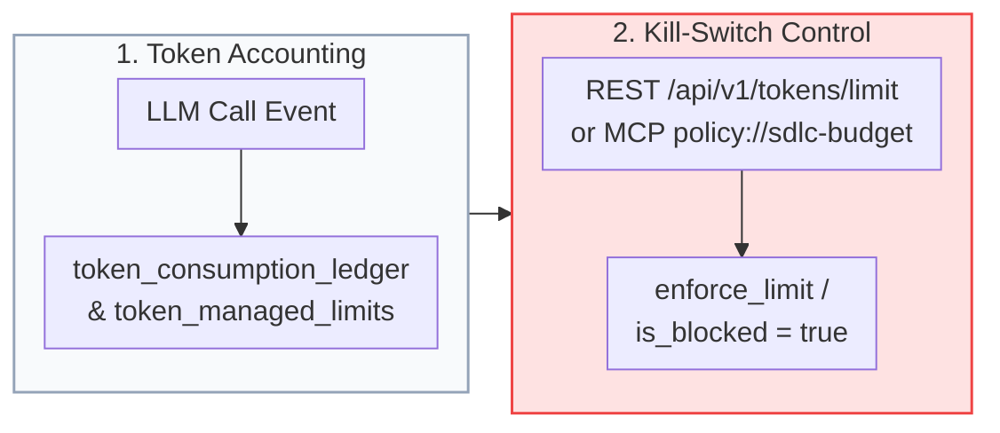
- **5.c.1 Database-Backed Ledgers**: Tracks every token consumption event via `token_consumption_ledger` and enforces limits through `token_managed_limits`.
- **5.c.2 Kill-Switching**: Allows administrators or authorized engineers to toggle `enforce_limit` or trip the emergency `is_blocked` kill-switch instantly via REST endpoints (`/api/v1/tokens/limit`) or the MCP `policy://sdlc-budget` resource.

### 5.d Architectural Invariant Regression Suite (`tests/test_architectural_invariants.py`)
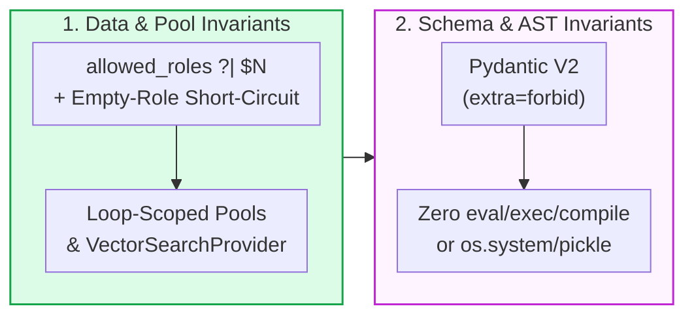
Pins the six platform invariants so silent regressions fail CI first:
1. **In-DB RBAC pre-filter**: every retrieval SQL contains `allowed_roles ?| $N::text[]` with roles bound as parameters (never inlined); `schema.sql` GIN index uses default `jsonb_ops`.
2. **Empty-role short-circuit**: `secure_search` / `hybrid_search` / `list_documents` / all four adapters return `[]` without touching the pool when roles resolve to nothing.
3. **Structural subtyping**: all adapters satisfy the `runtime_checkable` `VectorSearchProvider` protocol (`isinstance` + coroutine-function contract).
4. **Event-loop-scoped pools**: `DatabaseManager.get_pool()` caches per loop, reuses within a loop, closes stale pools and recreates across loop changes (Streamlit rerun / worker restart).
5. **Strict Pydantic V2**: `extra='forbid'` on all REST request/response models and all five MCP tool request models (422 on unknown fields).
6. **Zero AST dynamic execution**: no builtin `eval`/`exec`/`compile`/`__import__` call sites and no `os.system`/`pickle.loads` attribute calls across `app/`, `agent/`, `libs/`, `sdlc_harness/`.

### 5.e Full-Stack OpenTelemetry (`app/observability.py`)
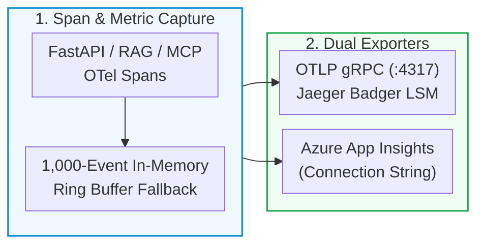
- **5.e.1 Dual Exporters**: Integrates with Azure Application Insights (`APPLICATIONINSIGHTS_CONNECTION_STRING`) and OTLP gRPC (`http://localhost:4317`) for Jaeger Badger LSM storage.
- **5.e.2 Ring Buffer Fallback**: Maintains a thread-safe 1,000-event in-memory ring buffer for metrics and traces, ensuring observability telemetry works even when external exporters are offline.

### 5.f Tri-Paradigm SDLC Workflow (`agent/workflow.py`)
- **5.f.1 LangGraph Checkpointing & Container Restart Resilience**: `PostgresCheckpointSaver` extends LangGraph state persistence, committing graph steps to PostgreSQL (`sdlc_workflow_checkpoints`) with time-travel inspection and multi-worker resume support. If a container or worker restarts mid-investigation, `load_workflow_checkpoint()` restores `AgentState` without conversation loss, while Git feature branches (`feature/AGENT-<ID>-<slug>`) and in-memory `file_snapshots` reconnect file state seamlessly.
- **5.f.2 CrewAI Role Specialization & Multi-Model Tiering**: Orchestrates specialized agents across tiered LLMs: `arch-synthesizer` (Staff Architect, `inherit` frontier reasoning model), `cross-model-judge` (Lead Security Auditor, Gemini Pro `pro`), and `test-triager` (SRE & Pytest Diagnostician, Gemini Flash `flash`). Operates via zero-overhead `native_pydantic` models by default, with `USE_CREWAI_SDK=true` dynamically activating upstream `crewai.Crew` orchestration.
- **5.f.3 Hermes Agent Lifelong Learning & GRPO Trajectories**: Automatically distills verified successful patches into portable `SKILL.md` files in `.agent/skills/hermes-*/` for single-shot retrieval on future runs (`recall_relevant_skills`). Exports ShareGPT-formatted RL trajectories with Atropos GRPO step rewards calculated from judge scores penalized by repair attempts (`reward = max(0.0, score - 0.25 * repairs)`).
- **5.f.4 Autonomous Governance (`never_ask_approval`)**: Executes unattended without blocking at interrupt approval cards; execution is constrained by `asyncio.wait_for()` timeouts with deterministic error classification.

### 5.g Defense-in-Depth Guardrails (`agent/guardrails.py`)
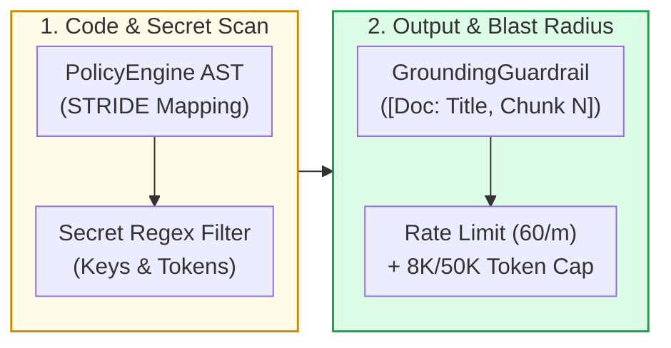
### 5.h AI Code Agent Quality Control & Manual Commit Proving (`agent/quality_control.py`, `scripts/agent_quality_gate.py`)
- **5.h.1 Pre-Write & Pre-Commit Gates**: `QualityControlPipeline` (`ASTPolicyGate`, `SecretScanner`, `PromptInjectionSanitizer`, `ScopeGuard`, `RuffStandardsGate`) and `python -m scripts.agent_quality_gate --staged --prove quality_proof.json` enforce fail-closed quality proving via `.pre-commit-config.yaml` (`tests/test_quality_control.py`, 9 tests). See [SAFEGUARD_CODE_AGENT.md](SAFEGUARD_CODE_AGENT.md) for full details.

### 5.i Shared Chat + Agent Memory Workflow (`app/memory/store.py`)

Free, self-hosted shared memory on the project's existing PostgreSQL + pgvector. Every message/fact is stored with an `allowed_roles` JSONB tag; every read is pre-filtered through the canonical `sanitize_roles_for_query()` and fails closed to empty when the caller resolves to zero roles.

#### Diagram 7: Shared Chat & Agent Memory
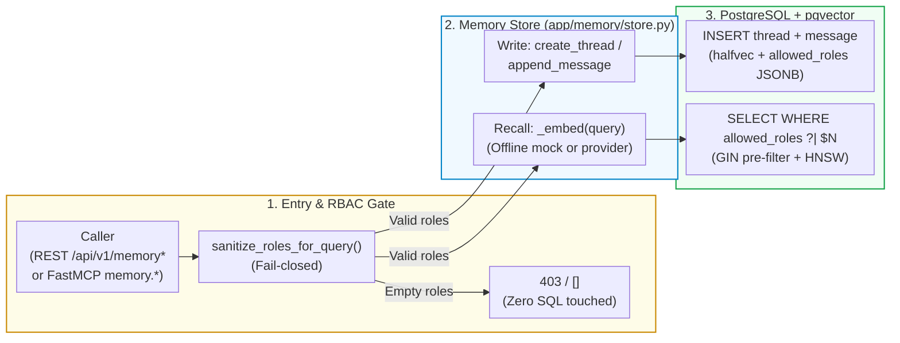

**Key invariants enforced in this flow:**
1. **No roles → no SQL.** The store returns `[]` before acquiring a connection when `sanitize_roles_for_query` yields an empty list.
2. **Parameterized SQL only.** `allowed_roles ?| $N::text[]` binds roles as parameters; nothing is inlined.
3. **Embeddings offline by default.** `_mock_embedding()` (deterministic SHA-256) runs when no provider key is configured — no billable API calls.
4. **Session GUCs, not persisted.** `hnsw.iterative_scan` / `max_scan_tuples` / `ef_search` are applied per-connection at runtime (`DatabaseManager.configure_iterative_scan`), never in migration `DO` blocks.
5. **Streamlit is opt-in.** The "🧠 Share to team memory" toggle is off by default; when on, exchanges are appended to a role-governed shared thread and recalled into the advisor prompt.
