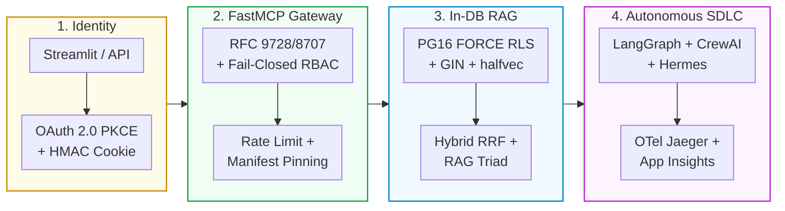
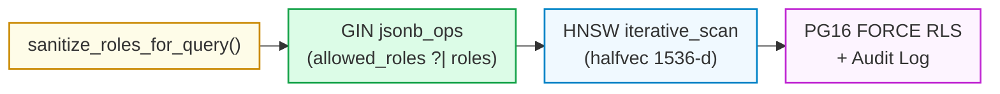
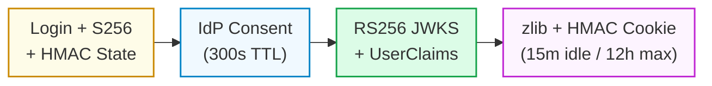
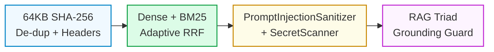
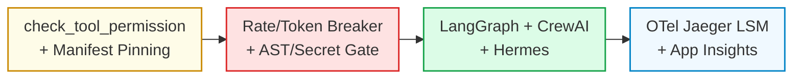

# 🛡️ Enterprise Zero-Trust RAG & Autonomous SDLC — Interview Cheatsheet
**Deep-dive**: [SAFEGUARD.md](SAFEGUARD.md)
## 1. 30-Second Elevator Pitch
Production-grade **Zero-Trust Enterprise RAG & Autonomous SDLC** platform. Enforces **shift-left in-database RBAC** (`pgvector` + PostgreSQL 16 `FORCE RLS` + GIN pre-filtering), **stateless OAuth 2.0 PKCE**, **Hybrid RRF + RAG Triad** evaluation, and a **Fail-Closed FastMCP Gateway** with SHA-256 manifest pinning and LangGraph self-healing SDLC workflows.

## 2. Instant-Recall Numbers & SLAs
| Metric / Bound | Value | Why It Matters |
| :--- | :--- | :--- |
| **Vector RAM Savings** | **75%** (`3.08 KB` vs `12.28 KB`) | Matryoshka 3072-d → 1536-d (50%) + `halfvec(1536)` binary16 (50%) with **>98% recall** |
| **RAG Quality** | **>0.90 Context Precision** | Contextual headers + Adaptive Hybrid RRF + RAG Triad grounding guard |
| **Test Suite** | **343 tests passed** (0 failures) | Includes 24 cross-engine `sanitize_roles_for_query()` contract tests |
| **Session Bounds** | **15m idle / 12h max** | SOC-2 compliant stateless `zlib` + HMAC-SHA256 cookie (300s PKCE state TTL) |
| **Gateway Limits** | **60 req/min**, **8k/req**, **50k/issue** | `SlidingWindowRateLimiter` + `TokenCircuitBreaker` + `is_blocked` kill-switch |
| **SDLC Cost Cut** | **~65% lower inference cost** | CrewAI tiered routing (`inherit` architect, `pro` auditor, `flash` triager) |
## 3. Component Selection & Trade-Offs ("When & Why")
| Component | Why We Picked It | Trade-Off / Failure Mode Mitigated |
| :--- | :--- | :--- |
| **PG16 `FORCE RLS` + GIN `jsonb_ops`** | Shift-left in-DB RBAC; `?|` operator uses GIN bitmap | `hnsw.iterative_scan = 'relaxed_order'` prevents ANN recall starvation on selective roles |
| **MRL 1536-d + `halfvec(1536)`** | 75% RAM reduction; doubles HNSW max dims to 4,000 | `format_halfvec()` scrubs `NaN`/`±Inf` to `0.0` before SQL write |
| **Stateless HMAC PKCE + Cookie** | Zero Redis dependency; survives F5 & multi-worker scale | 300s state TTL + 15m idle / 12h max bounds limit replay window |
| **Adaptive Hybrid RRF + Triad** | Combines dense (`pgvector`) + sparse (BM25/FTS) + rerank | `PromptInjectionSanitizer` (NFKC/zero-width) + `SecretScanner.redact_secrets()` |
| **FastMCP + Manifest Pinning** | Standardized tool gateway (`/mcp` mounted *last* in FastAPI) | `check_tool_permission()` fails closed on `[]`; SHA-256 pinning blocks ASI04 rug pulls |
| **LangGraph + CrewAI + Hermes** | Autonomous `never_ask_approval` SDLC loop | `PostgresSaver` crash-resume + `PolicyEngine.verify_ast()` blocks `eval`/`exec`/`shell=True` |
## 4. Architecture & Topic-by-Topic Deep Dive
### 4.a In-DB RBAC & Vector Storage (`schema.sql`, `app/db/`)

- **Zero Recall Starvation**: `GIN (jsonb_ops)` pre-filters `d.allowed_roles ?| $2::text[]` *before* HNSW traversal. `hnsw.iterative_scan = 'relaxed_order'` resumes discarded candidates in `ef_search` batches (**80** single role, **40** dual, **20** broad).
- **Unified Role Sanitization**: `sanitize_roles_for_query()` (`app/auth/role_mapper.py`) is the single source of truth across pgvector, Azure, GCP, Databricks, and REST headers—fails closed to `[]`.
- **Kernel RLS & Audit**: PG16 `FORCE ROW LEVEL SECURITY` (`app.current_user_roles`) + `rag_access_audit_log` (caller, roles, SHA-256 query hash, doc IDs, Triad verdict).
### 4.b Stateless Identity & OAuth 2.0 PKCE (`app/auth/`)

- **PKCE & JWKS**: `encode_pkce_state()` signs `{b64_payload}.{sig}` (300s TTL, HMAC-SHA256). Verifies RS256 JWKS (`leeway=60s`) across Google, Azure AD, Okta, Cognito, and Keycloak.
- **Strict Claims & Reloads**: `UserClaims` (Pydantic v2 `extra="forbid"`) rejects unknown fields; `enterprise_rag_session` cookie (`zlib` + HMAC) rehydrates `st.session_state` on F5.
### 4.c Ingestion & Hybrid RAG (`scripts/ingest.py`, `libs/`)

- **Ingest De-dup**: 64KB SHA-256 content hashing gives O(1) skip for unchanged files; contextual headers preserve document/section lineage.
- **Defense-in-Depth**: `PromptInjectionSanitizer` (NFKC normalization + zero-width strip) + `SecretScanner.redact_secrets()` + RAG Triad (Context Relevance, Faithfulness, Answer Relevance).
### 4.d Gateways, Observability & Autonomous SDLC (`app/mcp/gateway.py`, `agent/`)

1. **Gateway & Auth**: RFC 9728/8707 discovery (`get_gateway_metadata`) → Fail-closed `check_tool_permission()` (zero claims = denied) → `extra="forbid"` schemas → `verify_tool_manifest_integrity()` (SHA-256 pinning against ASI04 tool poisoning) → Co-hosted `/mcp` mount (registered *last* in FastAPI).
2. **Blast Radius & Code Gates**: `SlidingWindowRateLimiter` (60/min) + `TokenCircuitBreaker` (8k/req, 50k/issue, `is_blocked` kill-switch) + `PolicyEngine.verify_ast()` (blocks `eval`/`exec`/`compile`/`__import__`/`shell=True`) + `SecretScanner` + protected-path checks in `propose_patch`.
3. **Tri-Paradigm SDLC**: **LangGraph** (`initialize` → `synthesize` → `audit` → `test` → `repair` with `PostgresSaver` crash-resume) + **CrewAI** (tiered `inherit`/`pro`/`flash`) + **Hermes** (distills `.agent/skills/` + ShareGPT RL trajectories); `never_ask_approval` + `SDLC_PARALLEL_VERIFY=true`.
4. **Observability & Invariants**: OTel → Jaeger Badger LSM (7-day, 1K ring buffer) + Azure App Insights; `tests/test_architectural_invariants.py` pins all rules.
### 4.e Multi-Cloud Vector Switching

- **Quad-Mode Adapter**: `get_vector_search_adapter()` switches between `pgvector`, Azure AI Search, GCP Vertex AI, and Databricks Vector Search via `.env` with native RBAC pre-filtering.
## 5. Deep-Dive Interview Q&A Toolkit
- *"How do you prevent ANN recall starvation with RBAC?"* → `GIN (jsonb_ops)` pre-filters `allowed_roles ?| $2::text[]`, and pgvector 0.8+ `hnsw.iterative_scan = 'relaxed_order'` resumes discarded candidates in `ef_search` batches (80/40/20 by role cardinality).
- *"How do you stop confused deputy / tool poisoning in MCP?"* → `check_tool_permission()` fails closed on empty claims (`roles == []`), `verify_tool_manifest_integrity()` pins a canonical SHA-256 over tool names/roles/docstrings/schemas, and `propose_patch` runs `PromptInjectionSanitizer` + `SecretScanner` + `PolicyEngine.verify_ast`.
- *"Why `jsonb_ops` instead of `jsonb_path_ops`?"* → The key-existence operator `?|` is only accelerated by `jsonb_ops` (`jsonb_path_ops` only supports `@>`, `@?`, `@@`).
- *"How does the autonomous SDLC recover from crashes?"* → LangGraph `PostgresSaver` (`sdlc_workflow_checkpoints`) checkpoints every node for pod-restart resume and time-travel recovery.
