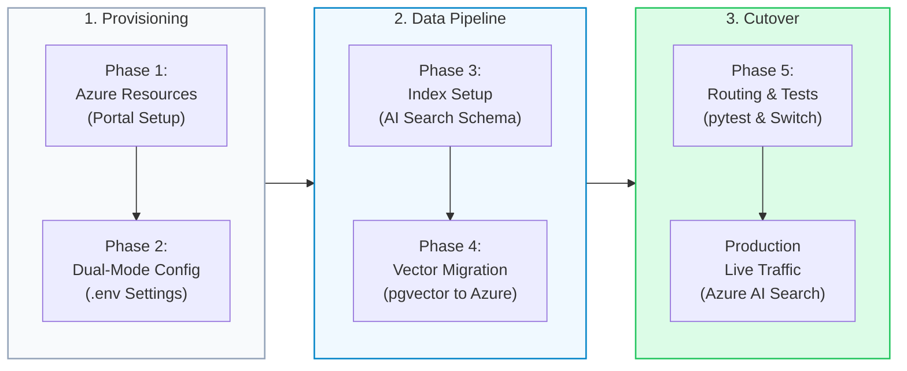

# Azure AI RAG Migration Plan & Execution Playbook

This consolidated playbook outlines the end-to-end plan, architectural mapping, portal provisioning steps, data migration, and production validation for migrating the **Zero-Trust Enterprise RAG platform (`enterprise-rag-pgvector-rbac`)** from PostgreSQL (`pgvector`) to **Microsoft Azure AI**.

---

## 1. Architecture & Component Mapping

| Platform Component | Current (Python / Local Env) | Target (Azure Cloud Env) | Enterprise Benefit |
| :--- | :--- | :--- | :--- |
| **Vector Engine & Index** | PostgreSQL 16 + `pgvector` (HNSW) | **Azure AI Search** (HNSW Vector Profile) | Managed scaling, 99.9% SLA, zero infrastructure maintenance. |
| **Lexical Search** | PostgreSQL Full-Text Search (`tsv`, `ts_rank`) | **Azure AI Search BM25** Engine | Built-in inverted index optimized for multilingual documents. |
| **Re-Ranking** | Reciprocal Rank Fusion (RRF) | **Bing Semantic Ranker** (`semantic-config`) | Deep transformer re-ranking with semantic relevance scoring. |
| **Zero-Trust RBAC** | SQL `WHERE allowed_roles ?| $roles::text[]` | **OData Collection Filter**: `allowed_roles/any(r: r eq '...')` | In-engine pre-filtering: unauthorized data is never loaded into RAM. |
| **Embeddings** | Public OpenAI `text-embedding-3-large` (1536-d) | **Azure OpenAI** `text-embedding-3-large` (3072-d) | Private Azure VNet isolation, data is never used to train models. |
| **Chat Generation** | Public OpenAI `gpt-4o` | **Azure OpenAI** `gpt-4o` (Deployments) | Private enterprise tenant hosting, SOC2 & HIPAA compliance. |
| **Observability** | Jaeger All-In-One (Persistent Badger LSM-tree) | **Azure Application Insights** (Azure Monitor OTel) | Serverless telemetry dashboard with zero storage administration. |

---

## 2. Phase-by-Phase Migration Plan



---

## Phase 1: Azure Portal Resource Provisioning

### Step 1.1: Create a Resource Group

1. Sign in to the [Azure Portal](https://portal.azure.com/).
2. Search for **Resource groups** and click **+ Create**.
3. Configure:
   - **Subscription**: Your active Azure subscription.
   - **Resource group name**: `rg-enterprise-rag-dev` (or `rg-enterprise-rag-prod`).
   - **Region**: Select a region with high model availability (e.g., `East US 2` or `Sweden Central`).
4. Click **Review + create** → **Create**.

---

### Step 1.2: Create and Deploy Azure OpenAI Models

1. Search for **Azure OpenAI** and click **+ Create**.
2. Select your resource group (`rg-enterprise-rag-dev`), set a unique name (e.g., `oai-enterprise-rag`), and choose Pricing Tier **Standard S0**.
3. Click **Review + create** → **Create**.
4. Once deployed, open the resource:
   - Go to **Keys and Endpoint** in the left sidebar.
   - Copy **Endpoint** (`https://<name>.openai.azure.com/`) and **Key 1**.
5. Click **Go to Azure AI Foundry portal** (or Azure OpenAI Studio):
   - Under **Deployments**, click **+ Deploy model** → **Deploy base model**.
   - Select **`text-embedding-3-large`** → Name deployment: `text-embedding-3-large`.
   - Click **+ Deploy model** → Select **`gpt-4o`** → Name deployment: `gpt-4o`.

---

### Step 1.3: Create Azure AI Search with Semantic Ranker

1. Search for **AI Search** and click **+ Create**.
2. Select resource group `rg-enterprise-rag-dev` and set a service name (e.g., `search-enterprise-rag`).
3. Pricing tier: Select **Standard** (Standard is required for the Semantic Ranker).
4. Click **Review + create** → **Create**.
5. Once created:
   - In **Settings** → **Keys**, copy the **URL** (`https://<name>.search.windows.net`) and **Primary admin key**.
   - In **Settings** → **Semantic ranker**, select the **Free** (or Standard) plan.

> [!IMPORTANT]
> The **Standard** pricing tier is mandatory for Azure AI Search to enable the **Bing Semantic Ranker** feature (`semantic-config`). The Free tier of AI Search does not support vector search and semantic re-ranking.

---

### Step 1.4: Set up Azure Application Insights

1. Search for **Application Insights** and click **+ Create**.
2. Select resource group `rg-enterprise-rag-dev`, Name: `appi-enterprise-rag`.
3. Click **Review + create** → **Create**.
4. In the Overview blade, copy the **Connection String** (`InstrumentationKey=...`).

---

## Phase 2: Environment Configuration

Install official Azure SDK client packages:

```powershell
pip install azure-search-documents azure-identity azure-monitor-opentelemetry openai
```

Configure [`.env`](file:///c:/src/enterprise-rag-pgvector-rbac/.env) for **Dual-Mode** (allows instant rollback between `pgvector` and `azure`):

```ini
# ==============================================================================
# Backend Provider Switcher: 'pgvector' (default) OR 'azure'
# ==============================================================================
RETRIEVAL_BACKEND="azure"

# ==============================================================================
# Azure OpenAI Configuration
# ==============================================================================
AZURE_OPENAI_ENDPOINT="https://oai-enterprise-rag.openai.azure.com/"
AZURE_OPENAI_API_KEY="<your-azure-openai-key-1>"
AZURE_OPENAI_API_VERSION="2024-06-01"
AZURE_OPENAI_CHAT_DEPLOYMENT="gpt-4o"
AZURE_OPENAI_EMBEDDING_DEPLOYMENT="text-embedding-3-large"

# ==============================================================================
# Azure AI Search Configuration
# ==============================================================================
AZURE_SEARCH_ENDPOINT="https://search-enterprise-rag.search.windows.net"
AZURE_SEARCH_API_KEY="<your-azure-search-primary-admin-key>"
AZURE_SEARCH_INDEX_NAME="enterprise-documents-index"

# ==============================================================================
# Azure Application Insights (Telemetry)
# ==============================================================================
APPLICATIONINSIGHTS_CONNECTION_STRING="InstrumentationKey=...;IngestionEndpoint=..."
```

> [!NOTE]
> The platform supports zero-downtime cutover and fallback. Setting `RETRIEVAL_BACKEND="pgvector"` immediately routes all queries back to PostgreSQL and local Jaeger tracing without requiring code modifications.

---

## Phase 3: Index Provisioning with Vector Profiles & RBAC

The index schema is defined in [`setup_azure_search.py`](file:///c:/src/enterprise-rag-pgvector-rbac/scripts/setup_azure_search.py):

- **Vector Profile**: HNSW algorithm with 3072 dimensions matching `text-embedding-3-large`.
- **Semantic Ranker**: Prioritized `title` and `content` fields.
- **RBAC Filter Field**: `allowed_roles` typed as `Collection(SearchFieldDataType.String)` and marked `filterable=True`.

Run the setup script:

```powershell
python scripts/setup_azure_search.py
# Output: ✅ Successfully created / updated Azure AI Search index: enterprise-documents-index
```

---

## Phase 4: Data & Vector Migration (PostgreSQL → Azure Search)

The data pipeline in [`migrate_pg_to_azure.py`](file:///c:/src/enterprise-rag-pgvector-rbac/scripts/migrate_pg_to_azure.py):

1. Connects to PostgreSQL using loop-aware `asyncpg`.
2. Queries normalized master `documents` joined with `document_chunks`.
3. Normalizes vector embeddings and JSONB role arrays into typed Azure Search documents.
4. Executes atomic batch upload via `SearchClient.upload_documents(...)`.

Run the migration script:

```powershell
python scripts/migrate_pg_to_azure.py
# Output: ✅ Successfully uploaded documents to Azure AI Search!
```

---

## Phase 5: Code Adaptations & Dual-Backend Routing

### 5.1 Azure AI Search Client ([`azure_search.py`](file:///c:/src/enterprise-rag-pgvector-rbac/app/db/azure_search.py))

Enforces in-engine Zero-Trust filtering via OData collection queries:

```python
# Build OData filter: allowed_roles contains ANY of user_roles
role_clauses = " or ".join([f"r eq '{role}'" for role in sanitized_roles])
role_filter = f"allowed_roles/any(r: {role_clauses})"

results = await client.search(
    search_text=query_text,
    vector_queries=[vector_query],
    filter=role_filter,
    query_type="semantic",
    semantic_configuration_name="semantic-config",
    top=limit,
)
```

> [!NOTE]
> **Zero-Trust Invariant**: If `user_roles` is empty or invalid, `azure_hybrid_search` returns `[]` immediately without querying the search engine.

### 5.2 Dual-Model LLM Abstraction ([`llm.py`](file:///c:/src/enterprise-rag-pgvector-rbac/app/db/llm.py))

- Dynamically resolves either `AsyncAzureOpenAI` or `AsyncOpenAI` based on `RETRIEVAL_BACKEND` and endpoint availability.
- **Critical Guard**: Includes `if not chunk.choices: continue` across all streaming generators to gracefully handle Azure OpenAI trailing filter/metadata chunks without `IndexError`.

### 5.3 Gateway Dynamic Routing

- **FastAPI ([`main.py`](file:///c:/src/enterprise-rag-pgvector-rbac/app/main.py))**: Dispatches to `azure_hybrid_search` when `RETRIEVAL_BACKEND="azure"`, falling back to `DatabaseManager.hybrid_search` for `pgvector`.
- **FastMCP Gateway ([`gateway.py`](file:///c:/src/enterprise-rag-pgvector-rbac/app/mcp/gateway.py))**: Tool `search_sdlc_context` routes to Azure AI Search, preventing `[WinError 1225]` connection refused errors when local PostgreSQL is offline.
- **Streamlit UI ([`streamlit_app.py`](file:///c:/src/enterprise-rag-pgvector-rbac/streamlit_app.py))**: Routes queries and displays executed Azure OData queries directly in the UI inspector expander.

---

## Phase 6: Verification & Quality Assurance Runbook

### 1. Automated Test Suites

Run the test suite verifying Azure AI Search, RBAC filters, FastMCP tool routing, and regression suites:

```powershell
# 1. Run Azure AI Search specialized tests (RBAC filter, empty role guard, routing)
python -m pytest tests/test_azure_search.py -v

# 2. Run FastMCP tool authorization and dual-mode routing tests
python -m pytest tests/test_mcp_auth.py -v

# 3. Run full regression test suite
python -m pytest -q
# Target: 101 passed, 1 skipped
```

Related test files:
- [`test_azure_search.py`](file:///c:/src/enterprise-rag-pgvector-rbac/tests/test_azure_search.py)
- [`test_mcp_auth.py`](file:///c:/src/enterprise-rag-pgvector-rbac/tests/test_mcp_auth.py)

### 2. Manual Verification Checklist

1. **Azure Search Explorer**:
   - In Azure Portal → AI Search → `enterprise-documents-index` → **Search explorer**.
   - Search `*` and confirm documents, embeddings, and `allowed_roles` are present.
2. **Interactive Streamlit UI**:
   - Launch app: `python -m streamlit run streamlit_app.py`.
   - Test queries under different roles (`engineer` vs. `finance_executive`).
   - Confirm unprivileged roles receive: *"No authorized documentation found matching your security credentials."*
   - Verify token streaming streams smoothly without `IndexError`.
3. **FastMCP Server**:
   - Launch server: `python -m app.mcp`.
   - Call tool `search_sdlc_context` from Cursor / Claude Desktop / agent; confirm successful execution over HTTPS without local PostgreSQL dependency.
