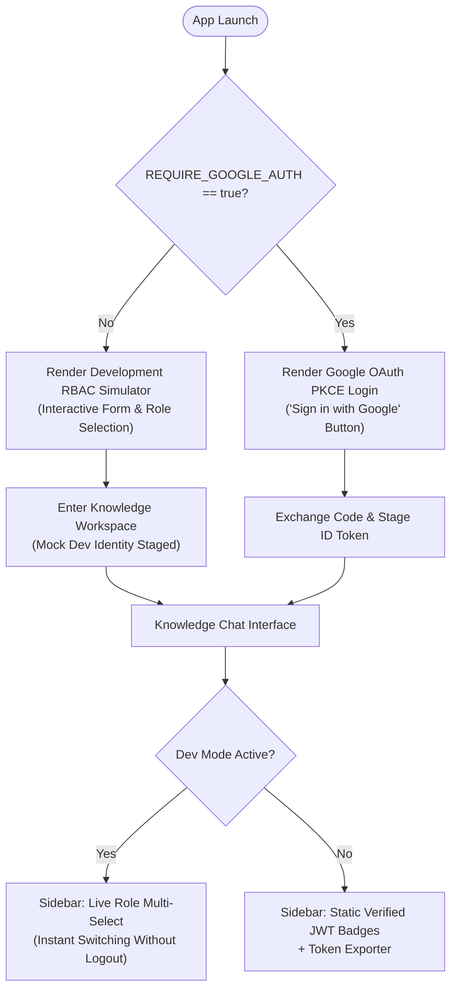

# Enterprise RAG & Multi-Cloud Architecture Master Playbook

Comprehensive operational guide, configuration reference, and architecture evolution roadmap for the **Zero-Trust Enterprise RAG (`enterprise-rag-pgvector-rbac`)** platform.

---

## Table of Contents
1. [Executive Summary & System Baseline](#1-executive-summary--system-baseline)
2. [Agent Skills Standard & Discovered Catalog](#2-agent-skills-standard--discovered-catalog)
3. [Zero-Trust Authentication & RBAC Simulation](#3-zero-trust-authentication--rbac-simulation)
4. [Dependency & Lockfile Troubleshooting Playbook](#4-dependency--lockfile-troubleshooting-playbook)
5. [Google Cloud Platform (GCP) & Databricks Migration Roadmap](#5-google-cloud-platform-gcp--databricks-migration-roadmap)
6. [Azure AI Migration Playbook (Zero-to-One Implementation)](#6-azure-ai-migration-playbook-zero-to-one-implementation)
7. [Enterprise Verification & Quality Assurance Runbook](#7-enterprise-verification--quality-assurance-runbook)

---

## 1. Executive Summary & System Baseline

### Repository Metadata
- **Repository Root**: `C:\src\enterprise-rag-pgvector-rbac`
- **Active Git Branch**: `feature/issues-15-16-17-hardening`
- **Core Technology Stack**: Python 3.11, PostgreSQL with `pgvector`, FastAPI, FastMCP, Streamlit, OpenTelemetry.
- **Verification Baseline**: 102 tests (101 passed, 1 skipped) via `pytest`.

### Architectural Pillars
- **Zero-Trust Retrieval**: Vector cosine distance and BM25 full-text queries strictly bound inside PostgreSQL SQL statements with in-database array checks (`allowed_roles ?| $user_roles`).
- **Cryptographic Security**: Google OAuth 2.0 PKCE with stateless HMAC session tokens and regulatory session bounds (15-min idle timeout, 12-hour ceiling for SOC-2/HIPAA compliance).
- **Full-Stack Telemetry**: OpenTelemetry spans traversing Streamlit UI (`chat_interaction`), FastAPI REST endpoints (`http_request`), and MCP tool executions (`mcp_tool`) exported to Jaeger Badger storage or Honeycomb.

---

## 2. Agent Skills Standard & Discovered Catalog

All 10 required skills from the `aicodedecode/awesome-muse-skills` catalog have been created and permanently enforced in the repository under `.agent/skills/`.

### Permanent Policy Enforcement
- **Root Policy**: [`AGENTS.md`](file:///C:/src/enterprise-rag-pgvector-rbac/AGENTS.md)
- **Contextual Rules**: [`.agent/rules/skills_enforcement.md`](file:///C:/src/enterprise-rag-pgvector-rbac/.agent/rules/skills_enforcement.md)

### Skills Inventory
| # | Skill Directory & File | Category | Operational Purpose |
| :- | :--- | :--- | :--- |
| 1 | [`getting-started-with-muse-skills`](file:///C:/src/enterprise-rag-pgvector-rbac/.agent/skills/getting-started-with-muse-skills/SKILL.md) | `muse` | Baseline onboarding for skill frontmatter anatomy and clipboard activation. |
| 2 | [`code-reviewer`](file:///C:/src/enterprise-rag-pgvector-rbac/.agent/skills/code-reviewer/SKILL.md) | `development` | Layered code audits (`correctness` → `design` → `readability` → `security` → `performance`) with standardized comment taxonomy (`blocking:`, `nit:`). |
| 3 | [`skill-creator`](file:///C:/src/enterprise-rag-pgvector-rbac/.agent/skills/skill-creator/SKILL.md) | `workflow-automation` | Meta-skill to design, trigger-optimize, and validate production-grade agent skills. |
| 4 | [`viral-animation-prompting`](file:///C:/src/enterprise-rag-pgvector-rbac/.agent/skills/viral-animation-prompting/SKILL.md) | `creative-design` | 5-layer video and motion prompting (camera kinematics, volumetric lighting, motion vectors). |
| 5 | [`personal-research-assistant`](file:///C:/src/enterprise-rag-pgvector-rbac/.agent/skills/personal-research-assistant/SKILL.md) | `ai-research` | High-rigor investigative procedures, dated primary source primacy, and comparison matrices. |
| 6 | [`briefing-and-inbox-triage`](file:///C:/src/enterprise-rag-pgvector-rbac/.agent/skills/briefing-and-inbox-triage/SKILL.md) | `productivity` | 4-bucket triage model (Act Today / Delegate / Defer / Archive) and action item extraction. |
| 7 | [`rag-evaluator`](file:///C:/src/enterprise-rag-pgvector-rbac/.agent/skills/rag-evaluator/SKILL.md) | `ai-research` | RAG Triad evaluation (Context Relevance, Faithfulness, Answer Relevance). |
| 8 | [`fleet-planner`](file:///C:/src/enterprise-rag-pgvector-rbac/.agent/skills/fleet-planner/SKILL.md) | `ai-maestro` | Multi-agent coordination: Orchestrator vs. Worker subagents, context isolation. |
| 9 | [`content-brief-and-calendar-generator`](file:///C:/src/enterprise-rag-pgvector-rbac/.agent/skills/content-brief-and-calendar-generator/SKILL.md) | `business-marketing` | Technical content briefs, search intent targeting, and multi-week editorial roadmaps. |
| 10 | [`regex-and-cron-utility`](file:///C:/src/enterprise-rag-pgvector-rbac/.agent/skills/regex-and-cron-utility/SKILL.md) | `utilities` | Regex and cron parsing, ReDoS safety, and next-execution time calculation. |

---

## 3. Zero-Trust Authentication & RBAC Simulation

### What `REQUIRE_GOOGLE_AUTH=false` Means
- **When `true` (Production)**: Enforces strict Google ID token verification via JWKS (`Authorization: Bearer <token>`). Unauthenticated requests are rejected with `HTTP 401`.
- **When `false` (Dev/Test)**: Disables compulsory Google OAuth. Allows local development, test automation, and UI-driven role simulation without external Google Cloud credentials.

### Streamlit UI Implementation ([`streamlit_app.py`](file:///C:/src/enterprise-rag-pgvector-rbac/streamlit_app.py))
The Streamlit application dynamically inspects the environment and renders one of two distinct flows:



#### Key Capabilities Added:
1. **Dynamic Login Form**: In dev mode, hides the Google link button and presents a role multi-select containing all [`KNOWN_ROLES`](file:///C:/src/enterprise-rag-pgvector-rbac/app/auth/role_mapper.py#L39-L41) (`engineer`, `finance_executive`, `compliance_auditor`, `hr_manager`, `executive`) plus custom role inputs.
2. **Live Sidebar Role Switching**: Developers can change active roles directly in the sidebar during an active session to test row-level access controls in real-time.
3. **Contextual Identity Badges**: Displays simulated identity metadata while hiding Google-specific token refresh buttons.

---

## 4. Dependency & Lockfile Troubleshooting Playbook

### PNPM Duplicate Mapping Key Error
When running `pnpm install --frozen-lockfile` produces:
```text
ERROR duplicated mapping key (618:7)
 615 | '@suntiq/experience':
 618 | '@suntiq/fleet':
```

#### Diagnostic
In YAML, declaring the exact same key (`'@suntiq/fleet':`) twice within a single mapping block is invalid. The strict parser in PNPM fails during lockfile validation.

#### Resolution Options
- **Option 1 (Fastest / Recommended)**: Regenerate the lockfile from clean workspace dependencies:
  ```bash
  rm pnpm-lock.yaml
  pnpm install
  pnpm install --frozen-lockfile
  ```
- **Option 2 (Surgical)**: Open `pnpm-lock.yaml`, navigate to line 618, and delete the redundant 3-line block for `@suntiq/fleet`.
- **Option 3 (Root-Cause Check)**: Inspect the target project's `package.json` to ensure the package isn't duplicated in both `dependencies` and `devDependencies`.

---

## 5. Google Cloud Platform (GCP) & Databricks Migration Roadmap

### Architecture Mapping
- **Vector Search**: Databricks Vector Search (Delta Sync Index) or Vertex AI Vector Search.
- **Data Governance & RBAC**: Databricks Unity Catalog Row Filters (`is_account_group_member(...)`) replacing custom PostgreSQL array filters.
- **LLM & Embeddings**: Google Vertex AI (`gemini-1.5-pro`, `gemini-1.5-flash`, `text-embedding-004`) or Databricks Mosaic AI Model Serving.
- **Pipelines**: Delta Live Tables (DLT) or Cloud Dataflow (Apache Beam) for streaming document chunking.
- **Observability**: MLflow Tracing combined with Google Cloud Trace (Operations Suite).

---

## 6. Azure AI Migration Playbook (Zero-to-One Implementation)

For teams transitioning from self-hosted PostgreSQL + public OpenAI to **Microsoft Azure AI**:

### 6.1 Service Equivalencies
- **Azure OpenAI Service**: Private enterprise deployments of `gpt-4o` and `text-embedding-3-large`.
- **Azure AI Search**: Serverless managed hybrid search (Vector HNSW + BM25 Lexical + Bing Semantic Re-ranker) with native role filtering.
- **Azure Application Insights**: Managed OpenTelemetry APM without container storage overhead.

### 6.2 Implementation Checklist
1. **Azure Portal Setup**:
   - Create Resource Group `rg-enterprise-rag-dev`.
   - Deploy Azure OpenAI (`gpt-4o`, `text-embedding-3-large`).
   - Deploy Azure AI Search (Standard tier for Semantic Ranker).
   - Deploy Application Insights and capture connection strings.
2. **Configuration Updates ([`.env`](file:///C:/src/enterprise-rag-pgvector-rbac/.env))**:
   ```ini
   RETRIEVAL_BACKEND="azure"
   AZURE_OPENAI_ENDPOINT="https://<your-instance>.openai.azure.com/"
   AZURE_OPENAI_API_KEY="<your-key>"
   AZURE_OPENAI_CHAT_DEPLOYMENT="gpt-4o"
   AZURE_OPENAI_EMBEDDING_DEPLOYMENT="text-embedding-3-large"
   AZURE_SEARCH_ENDPOINT="https://<your-search>.search.windows.net"
   AZURE_SEARCH_API_KEY="<your-search-key>"
   AZURE_SEARCH_INDEX_NAME="enterprise-documents-index"
   APPLICATIONINSIGHTS_CONNECTION_STRING="InstrumentationKey=..."
   ```
3. **Execution Scripts**:
   - Run index provisioning script to configure the 3072-dimension HNSW profile and `allowed_roles` collection.
   - Run migration script to transfer existing chunks and embeddings from PostgreSQL directly into Azure AI Search.
   - Activate dual-provider routing in the FastAPI and Streamlit search execution paths.

---

## 7. Enterprise Verification & Quality Assurance Runbook

### Local Development Commands
```powershell
# 1. Run full test suite with coverage
python -m pytest -q

# 2. Run Streamlit in RBAC Simulation Mode
$env:REQUIRE_GOOGLE_AUTH="false"
python -m streamlit run streamlit_app.py

# 3. Run FastAPI Gateway with OpenAPI documentation
uvicorn app.main:app --host 0.0.0.0 --port 8000 --reload
# Access Swagger UI at http://localhost:8000/docs
```

### Production Verification Rules
- Prior to production deployment, guarantee `REQUIRE_GOOGLE_AUTH=true`.
- Validate that all Jaeger badger volumes or Application Insights connection strings are mapped.
- Ensure all pull requests follow the [`code-reviewer`](file:///C:/src/enterprise-rag-pgvector-rbac/.agent/skills/code-reviewer/SKILL.md) and [`rag-evaluator`](file:///C:/src/enterprise-rag-pgvector-rbac/.agent/skills/rag-evaluator/SKILL.md) standards.
