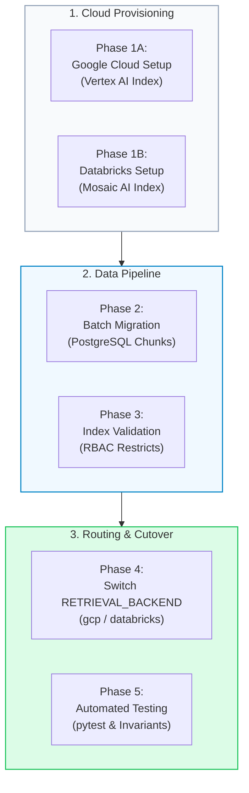

# Google Cloud & Databricks Multi-Cloud RAG Migration Plan & Execution Playbook

This consolidated playbook outlines the end-to-end plan, architectural mapping, cloud provisioning steps, data migration, and production validation for expanding the **Zero-Trust Enterprise RAG platform (`enterprise-rag-pgvector-rbac`)** to **Google Cloud (Vertex AI / BigQuery)** and **Databricks (Mosaic AI Vector Search / Unity Catalog)**.

---

## 1. Multi-Cloud Architecture & Component Mapping

| Platform Layer | PostgreSQL + Local Stack (`pgvector`) | Microsoft Azure AI Cloud (`azure`) | Google Cloud Platform (`gcp`) | Databricks Lakehouse (`databricks`) |
| :--- | :--- | :--- | :--- | :--- |
| **Vector Engine** | PostgreSQL 16 + `pgvector` (HNSW) | **Azure AI Search** (HNSW Profile) | **Vertex AI Vector Search** (ScaNN / Tree-AH) | **Databricks Mosaic AI Vector Search** (Direct Index) |
| **Lexical Engine** | PostgreSQL Full-Text (`tsvector`) | **Azure AI Search BM25** Engine | **BigQuery Text Search** / BM25 | **Databricks Full-Text Search** |
| **Re-Ranking** | Reciprocal Rank Fusion (RRF) | **Bing Semantic Ranker** | **Vertex AI Search Ranking API** | **Mosaic AI Cross-Encoder Ranker** |
| **Zero-Trust RBAC** | SQL `d.allowed_roles ?| $roles` | OData `allowed_roles/any(...)` | **Vertex Restricts** (`allowed_roles`) | **filters_json** (`allowed_roles`) + Unity Catalog |
| **Embeddings** | Public OpenAI `text-embedding-3-large` | Azure OpenAI `text-embedding-3-large` | **Vertex AI / Gemini** `text-embedding-004` | **Databricks Serving** `bge-large-en` |
| **Chat LLM** | Public OpenAI `gpt-4o` | Azure OpenAI `gpt-4o` | **Gemini 1.5 Pro / Flash** | **Databricks DBRX / Llama 3.1 70B** |
| **Observability** | Jaeger All-In-One (Badger LSM) | Azure Application Insights | **Google Cloud Trace / Cloud Logging** | **Databricks MLflow System Tables** |

---

## 2. Phase-by-Phase Migration Plan



---

## Phase 1: Cloud Resource Provisioning

### 1.1 Google Cloud (Vertex AI Vector Search)

1. **Create Index & Endpoint**:
   - In Google Cloud Console, navigate to **Vertex AI** → **Vector Search**.
   - Create an index with **1536 dimensions**, metric **COSINE**, and algorithm **Tree-AH (ScaNN)**.
   - Deploy the index to an **Index Endpoint** (enable public or private endpoint).
   - Configure restricts namespace: `allowed_roles` for Zero-Trust filtering.
2. **Declarative Provisioning**:
   ```powershell
   python scripts/setup_gcp_vector_search.py --mode vertex
   # Or for BigQuery Vector Search:
   python scripts/setup_gcp_vector_search.py --mode bigquery
   ```

### 1.2 Databricks (Mosaic AI Vector Search)

1. **Unity Catalog Delta Table**:
   - Create schema `main.enterprise_rag` and table `document_chunks`.
   - Enable Change Data Feed (`TBLPROPERTIES (delta.enableChangeDataFeed = true)`).
2. **Create Vector Search Endpoint**:
   - In Databricks Workspace, navigate to **Compute** → **Vector Search**.
   - Create endpoint `enterprise_vs_endpoint`.
   - Create index `main.enterprise_rag.document_chunks_index` with primary key `id`, embedding dimension `1536`, and metadata column `allowed_roles`.
3. **Declarative Validation**:
   ```powershell
   python scripts/setup_databricks_vector_search.py
   ```

---

## Phase 2: Environment Configuration

Update [`.env`](file:///c:/src/enterprise-rag-pgvector-rbac/.env) to configure Google Cloud or Databricks:

```ini
# ==============================================================================
# Backend Provider Switcher: 'pgvector', 'azure', 'gcp', 'databricks'
# ==============================================================================
RETRIEVAL_BACKEND="gcp"         # or "databricks", "azure", "pgvector"

# ==============================================================================
# Google Cloud Vertex AI Vector Search
# ==============================================================================
GCP_PROJECT_ID="your-gcp-project-id"
GCP_REGION="us-central1"
GCP_INDEX_ENDPOINT_ID="1234567890123456789"
GCP_DEPLOYED_INDEX_ID="enterprise_rag_index"
GCP_VECTOR_STORE="vertex_ai"

# ==============================================================================
# Databricks Mosaic AI Vector Search
# ==============================================================================
DATABRICKS_HOST="dbc-xxxx.cloud.databricks.com"
DATABRICKS_TOKEN="dapi_xxxxxxxxxxxxxxxx"
DATABRICKS_VECTOR_SEARCH_ENDPOINT_NAME="enterprise_vs_endpoint"
DATABRICKS_INDEX_NAME="main.enterprise_rag.document_chunks_index"
```

---

## Phase 3: Data Migration Pipelines

Run the specialized migration scripts or the unified migration orchestrator:

```powershell
# Option A: Migrate to Google Cloud Vertex AI
python scripts/migrate_pg_to_gcp.py

# Option B: Migrate to Databricks Mosaic AI
python scripts/migrate_pg_to_databricks.py

# Option C: Unified multi-cloud execution across all platforms
python scripts/migrate_multicloud.py --target all
```

---

## Phase 4: Zero-Trust Invariant Implementations

### Google Cloud Restricts ([`app/db/gcp_search.py`](file:///c:/src/enterprise-rag-pgvector-rbac/app/db/gcp_search.py))
```python
# Vertex AI Vector Search Restricts ensure unprivileged vectors are never traversed
restricts = [
    {
        "namespace": "allowed_roles",
        "allowList": sanitized_roles,
    }
]
results = await client.find_neighbors(
    query_vector=query_vector,
    restricts=restricts,
    limit=limit,
)
```

### Databricks Mosaic AI Filters ([`app/db/databricks_search.py`](file:///c:/src/enterprise-rag-pgvector-rbac/app/db/databricks_search.py))
```python
# In-engine Unity Catalog JSON filter
filters_dict = {"OR": [{"allowed_roles": role} for role in sanitized_roles]}
results = await client.query_index(
    query_vector=query_vector,
    filters_json=json.dumps(filters_dict),
    limit=limit,
)
```

> [!IMPORTANT]
> **Zero-Trust Rule**: If `user_roles` is empty or invalid, both `gcp_hybrid_search` and `databricks_hybrid_search` terminate immediately returning `[]` without contacting remote endpoints.

---

## Phase 5: Verification & Quality Assurance Runbook

```powershell
# 1. Run multi-cloud test suite
python -m pytest tests/test_multicloud_search.py -v

# 2. Run full platform regression test suite
python -m pytest -q
# Target: 100% green passing across all suites
```
