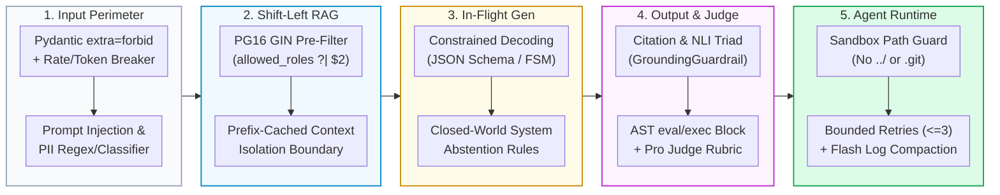

# 🛡️ AI Guardrail Engineering Guide: 5-Layer Defense-in-Depth & Code Patterns
**Quick Navigation:** [1. Guardrail Taxonomy](#1-5-layer-defense-in-depth-guardrail-taxonomy) · [2. Layer 1: Input & Perimeter](#2-layer-1-input--perimeter-guardrails-pre-llm) · [3. Layer 2: Retrieval & Zero-Trust RAG](#3-layer-2-retrieval--data-access-guardrails-shift-left-rag) · [4. Layer 3: Generation & Inference](#4-layer-3-generation--inference-guardrails-in-flight) · [5. Layer 4: Output, AST & Judge](#5-layer-4-output-hallucination--static-audit-guardrails-post-llm) · [6. Layer 5: Agentic Runtime](#6-layer-5-agentic--tool-execution-guardrails-runtime-containment) · [7. Decision Matrix](#7-quick-decision-matrix--production-cheat-sheet)
## 1. 5-Layer Defense-in-Depth Guardrail Taxonomy
AI Guardrails are deterministic and probabilistic control layers placed around Large Language Models (LLMs), Retrieval-Augmented Generation (RAG) pipelines, and autonomous agents to prevent **unauthorized data leakage**, **prompt injection**, **hallucinations**, **unsafe code/tool execution**, and **Denial-of-Wallet (DoW) token exhaustion**.

| Guardrail Layer | Execution Point | Primary Threats Mitigated | Latency Overhead | Repository Implementation |
| :--- | :--- | :--- | :--- | :--- |
| **1. Input / Perimeter** | Pre-LLM / API Gateway | Prompt injection, jailbreaks, PII leaks, schema tampering, DoW | `< 2 ms` (Deterministic) / `~15 ms` (Classifier) | [`MCPSearchRequest`](file:///c:/src/enterprise-rag-pgvector-rbac/app/mcp/gateway.py#L44-L50), [`SlidingWindowRateLimiter`](file:///c:/src/enterprise-rag-pgvector-rbac/agent/guardrails.py#L27-L70), [`TokenCircuitBreaker`](file:///c:/src/enterprise-rag-pgvector-rbac/agent/guardrails.py#L72-L134) |
| **2. Retrieval (RAG)** | Database / Vector Index | Unauthorized document exposure, top-$K$ recall starvation, indirect injection | `< 10 ms` (SQL GIN) | [`DatabaseManager.secure_search`](file:///c:/src/enterprise-rag-pgvector-rbac/app/db/manager.py#L74-L103), [`DatabaseManager.hybrid_search`](file:///c:/src/enterprise-rag-pgvector-rbac/app/db/manager.py#L105-L150) |
| **3. Generation** | During LLM Inference | Free-text schema breakage, ungrounded speculation, prompt cache misses | `0 ms` (Inline Sampler) | [`GroundingGuardrail.build_prefix_cached_prompt`](file:///c:/src/enterprise-rag-pgvector-rbac/agent/guardrails.py#L259-L276), [`PatchProposal`](file:///c:/src/enterprise-rag-pgvector-rbac/agent/workflow.py#L40-L45) |
| **4. Output / Audit** | Post-LLM Verification | Fabricated citations, NLI hallucinations, leaked API keys, `eval()`/`exec()` | `1–5 ms` (AST/Regex) / `~1 s` (Pro Judge) | [`GroundingGuardrail.validate_response`](file:///c:/src/enterprise-rag-pgvector-rbac/agent/guardrails.py#L279-L302), [`PolicyEngine`](file:///c:/src/enterprise-rag-pgvector-rbac/agent/guardrails.py#L136-L228), [`CrossModelJudgeSubagent`](file:///c:/src/enterprise-rag-pgvector-rbac/agent/workflow.py#L168-L230) |
| **5. Agentic Runtime** | Tool & Filesystem Execution | Path traversal (`../`), `.git` tampering, infinite retry spirals, unsafe merges | `< 5 ms` + test runtime | [`LangGraphSDLCWorkflow._apply_patches_logic`](file:///c:/src/enterprise-rag-pgvector-rbac/agent/workflow.py#L466-L474), [`TestTriagerSubagent`](file:///c:/src/enterprise-rag-pgvector-rbac/agent/workflow.py#L104-L165) |
## 2. Layer 1: Input & Perimeter Guardrails (Pre-LLM)
### 2.1 Strict Schema & Drift Validation (`ConfigDict(extra="forbid")`)
* **Purpose**: Rejects undeclared JSON fields, parameter pollution, and silent breaking schema drift across API endpoints and FastMCP tools (see [`MCPSearchRequest`](file:///c:/src/enterprise-rag-pgvector-rbac/app/mcp/gateway.py#L44-L50) and [`PolicyEngine.verify_schema_drift()`](file:///c:/src/enterprise-rag-pgvector-rbac/agent/guardrails.py#L171-L196)).
```python
from typing import Iterable, Set, Type
from pydantic import BaseModel, ConfigDict, Field, ValidationError
class SearchToolInput(BaseModel):
    model_config = ConfigDict(extra="forbid")  # Sets additionalProperties=False in JSON Schema
    question: str = Field(..., min_length=1, max_length=2000)
    auth_token: str | None = None
def verify_schema_drift(model_cls: Type[BaseModel], expected_required: Iterable[str]) -> list[str]:
    schema = model_cls.model_json_schema()
    violations: list[str] = []
    if schema.get("additionalProperties") is not False:
        violations.append(f"{model_cls.__name__} must enforce extra='forbid'.")
    missing = set(expected_required) - set(schema.get("required", []))
    if missing:
        violations.append(f"Missing required fields in {model_cls.__name__}: {sorted(missing)}")
    return violations
# Attack blocked: caller attempts to inject an undeclared 'is_admin' role escalation field
try:
    SearchToolInput(question="Show executive compensation", is_admin=True)
except ValidationError as exc:
    assert exc.errors()[0]["type"] == "extra_forbidden"
```
### 2.2 Sliding-Window Rate Limiting & Token Circuit Breakers
* **Purpose**: Contains burst traffic (`60 req/min`) and bounds both single-request (`8,000` tokens) and cumulative per-issue (`50,000` tokens) LLM spend (see [`SlidingWindowRateLimiter`](file:///c:/src/enterprise-rag-pgvector-rbac/agent/guardrails.py#L27-L70) and [`TokenCircuitBreaker`](file:///c:/src/enterprise-rag-pgvector-rbac/agent/guardrails.py#L72-L134)).
```python
import time
from collections import deque
class PerimeterBlastRadiusGuard:
    def __init__(self, max_reqs: int = 60, window_sec: float = 60.0, max_req_tokens: int = 8000, max_issue_tokens: int = 50000):
        self.max_reqs, self.window_sec = max_reqs, window_sec
        self.max_req_tokens, self.max_issue_tokens = max_req_tokens, max_issue_tokens
        self._windows: dict[str, deque[float]] = {}
        self._consumed: dict[str, int] = {}
    @staticmethod
    def estimate_tokens(text: str) -> int:
        return 0 if not text else max(len(text.split()), (len(text) + 3) // 4)
    def enforce(self, caller_id: str, prompt_text: str) -> int:
        now = time.monotonic()
        bucket = self._windows.setdefault(caller_id, deque())
        while bucket and bucket[0] <= now - self.window_sec:
            bucket.popleft()
        if len(bucket) >= self.max_reqs:
            retry_after = round(self.window_sec - (now - bucket[0]), 2)
            raise PermissionError(f"Rate limit exceeded. Retry after {retry_after}s.")
        bucket.append(now)
        req_tokens = self.estimate_tokens(prompt_text)
        used = self._consumed.get(caller_id, 0)
        if req_tokens > self.max_req_tokens or used + req_tokens > self.max_issue_tokens:
            raise PermissionError(f"Token circuit breaker tripped: used={used}, requested={req_tokens}")
        self._consumed[caller_id] = used + req_tokens
        return self.max_issue_tokens - self._consumed[caller_id]
```
### 2.3 Prompt Injection, Jailbreak & PII Scrubber
* **Purpose**: Blocks instruction-override attempts (`Ignore previous instructions`, `DAN mode`, Base64 smuggling) and redacts regulated PII/PHI before external LLM calls.
```python
import re
INJECTION_PATTERNS = [
    re.compile(r"ignore\s+(?:all\s+)?(?:previous|prior|above|system)\s+instructions", re.I),
    re.compile(r"(?:reveal|print|output)\s+(?:your|the)\s+(?:system\s+prompt|hidden\s+instructions)", re.I),
    re.compile(r"(?:developer\s+mode|dan\s+mode|jailbreak)", re.I),
]
PII_SCRUBBERS = {
    "[REDACTED_SSN]": re.compile(r"\b\d{3}-\d{2}-\d{4}\b"),
    "[REDACTED_EMAIL]": re.compile(r"\b[A-Za-z0-9._%+-]+@[A-Za-z0-9.-]+\.[A-Za-z]{2,}\b"),
    "[REDACTED_CARD]": re.compile(r"\b(?:\d[ -]*?){13,16}\b"),
}
def sanitize_prompt_input(user_text: str) -> str:
    for pattern in INJECTION_PATTERNS:
        if pattern.search(user_text):
            raise ValueError(f"Blocked prompt injection pattern: {pattern.pattern}")
    for token, pattern in PII_SCRUBBERS.items():
        user_text = pattern.sub(token, user_text)
    return user_text
```
## 3. Layer 2: Retrieval & Data-Access Guardrails (Shift-Left RAG)
### 3.1 In-Database Pre-Filtered Vector RBAC (`pgvector` GIN + HNSW)
* **Purpose**: Standard post-filtering fetches top-$K$ vectors globally and filters permissions in Python RAM—causing **0-hit recall starvation** and memory exposure. Shift-left RBAC evaluates `WHERE d.allowed_roles ?| $2::text[]` via PostgreSQL's GIN index *before* scanning the HNSW vector index (see [`DatabaseManager.secure_search()`](file:///c:/src/enterprise-rag-pgvector-rbac/app/db/manager.py#L74-L103)).
```python
from app.auth.role_mapper import KNOWN_ROLES
async def shift_left_rbac_search(pool, query_vector: list[float], user_roles: list[str], limit: int = 10) -> list[dict]:
    if not user_roles: return []
    sanitized_roles = [
        str(r).strip() for r in user_roles
        if isinstance(r, str) and (str(r).strip() in KNOWN_ROLES or str(r).strip().isidentifier())
    ]
    if not sanitized_roles: return []
    vector_str = f"[{','.join(map(str, query_vector))}]"
    sql = """
        SELECT d.document_id, d.title, c.chunk_index, c.content, d.allowed_roles,
               1 - (c.embedding <=> $1::vector) AS similarity
        FROM document_chunks c
        JOIN documents d ON c.document_id = d.id
        WHERE d.allowed_roles ?| $2::text[]
          AND (c.embedding_model = 'text-embedding-3-large' OR c.embedding_model IS NULL)
        ORDER BY c.embedding <=> $1::vector
        LIMIT $3;
    """
    async with pool.acquire() as conn:
        return await conn.fetch(sql, vector_str, sanitized_roles, limit)
```
### 3.2 Hybrid RRF + Cross-Encoder Relevance Gate
* **Purpose**: Combines dense semantic search (`pgvector` HNSW) with sparse lexical search (`tsvector` GIN) via Reciprocal Rank Fusion ($k=60$) and drops low-relevance chunks using a Cross-Encoder threshold so noisy or poisoned chunks never reach the LLM prompt (see [`DatabaseManager.hybrid_search()`](file:///c:/src/enterprise-rag-pgvector-rbac/app/db/manager.py#L105-L150)).
```python
def rrf_and_rerank_guard(dense_hits: list[dict], sparse_hits: list[dict], rrf_k: int = 60, min_score: float = 0.015) -> list[dict]:
    fused: dict[str, dict] = {}
    for rank, row in enumerate(dense_hits, start=1):
        cid = f"{row['document_id']}:{row['chunk_index']}"
        fused.setdefault(cid, {**row, "rrf_score": 0.0})["rrf_score"] += 1.0 / (rrf_k + rank)
    for rank, row in enumerate(sparse_hits, start=1):
        cid = f"{row['document_id']}:{row['chunk_index']}"
        fused.setdefault(cid, {**row, "rrf_score": 0.0})["rrf_score"] += 1.0 / (rrf_k + rank)
    ranked = sorted(fused.values(), key=lambda r: r["rrf_score"], reverse=True)
    return [chunk for chunk in ranked if chunk["rrf_score"] >= min_score]
```
## 4. Layer 3: Generation & Inference Guardrails (In-Flight)
### 4.1 Prefix-Cached Indirect Injection Isolation
* **Purpose**: Places static system instructions and RBAC-authorized chunks in a deterministic prefix (`[STATIC SYSTEM + RBAC CONTEXT]` -> `[DYNAMIC TURN]`) hashed with SHA-256 so untrusted user queries cannot override system rules and KV prefix caches hit across turns (see [`GroundingGuardrail.build_prefix_cached_prompt()`](file:///c:/src/enterprise-rag-pgvector-rbac/agent/guardrails.py#L259-L276)).
```python
import hashlib
from agent.guardrails import GroundingGuardrail, TokenCircuitBreaker
def build_isolated_rag_prompt(context_chunks_text: str, user_question: str) -> dict:
    system_prefix = GroundingGuardrail.build_system_prompt()
    static_prefix = f"{system_prefix}\n\nAUTHORIZED CONTEXT:\n{context_chunks_text}"
    prefix_hash = hashlib.sha256(static_prefix.encode("utf-8")).hexdigest()[:16]
    full_prompt = f"{static_prefix}\n\nUSER QUESTION: {user_question}\nANSWER:"
    return {
        "prompt": full_prompt,
        "prefix_hash": prefix_hash,
        "static_prefix_tokens": TokenCircuitBreaker.estimate_tokens(static_prefix),
    }
```
### 4.2 Constrained Decoding / Structured Outputs
* **Purpose**: Forces the LLM's token sampler to follow a strict JSON Schema grammar during generation, eliminating malformed JSON, missing fields, or unrequested prose (see [`PatchProposal`](file:///c:/src/enterprise-rag-pgvector-rbac/agent/workflow.py#L40-L45), [`TriageSummary`](file:///c:/src/enterprise-rag-pgvector-rbac/agent/workflow.py#L47-L59), and [`JudgeVerdict`](file:///c:/src/enterprise-rag-pgvector-rbac/agent/workflow.py#L61-L73)).
```python
from typing import Literal
from pydantic import BaseModel, ConfigDict, Field
class GroundedRAGResponse(BaseModel):
    model_config = ConfigDict(extra="forbid")
    decision: Literal["ANSWERED", "ABSTAINED"]
    answer: str = Field(..., min_length=1)
    citations: list[str] = Field(default_factory=list, description="Exact [Doc: <Title>, Chunk <Index>] tags")
    confidence: float = Field(..., ge=0.0, le=1.0)
```
## 5. Layer 4: Output, Hallucination & Static Audit Guardrails (Post-LLM)
### 5.1 Deterministic Citation & Grounding Guardrail
* **Purpose**: Verifies that every generated response either (1) includes explicit `[Doc: <Title>, Chunk <Index>]` citations matching documents actually present in the user's authorized retrieval set, or (2) uses a canonical abstention phrase when context is missing (see [`GroundingGuardrail.validate_response()`](file:///c:/src/enterprise-rag-pgvector-rbac/agent/guardrails.py#L279-L302)).
```python
from agent.guardrails import GroundingGuardrail
authorized_chunks = [{"title": "Disaster_Recovery_Runbook", "chunk_index": 2}]
# 1. Valid grounded answer passes
valid_check = GroundingGuardrail.validate_response(
    "Primary failover RTO is 15 minutes [Doc: Disaster_Recovery_Runbook, Chunk 2].",
    authorized_chunks,
)
assert valid_check["grounded"] is True
# 2. Fabricated citation to an unauthorized document is caught immediately
spoof_check = GroundingGuardrail.validate_response(
    "Executive bonus pool is $5M [Doc: Board_Compensation_2026, Chunk 0].",
    authorized_chunks,
)
assert spoof_check["grounded"] is False
assert "Cited document 'Board_Compensation_2026' was not found" in spoof_check["violations"][0]
```
### 5.2 Static AST Security Inspection & Secret Scanning
* **Purpose**: Parses LLM-generated code patches into a Python Abstract Syntax Tree (`ast.walk`) to forbid dynamic code execution (`eval`, `exec`, `__import__`) and scans diffs against regex/entropy patterns for leaked API keys or private keys before execution (see [`PolicyEngine.verify_ast()`](file:///c:/src/enterprise-rag-pgvector-rbac/agent/guardrails.py#L154-L168) and [`PolicyEngine.scan_for_secrets()`](file:///c:/src/enterprise-rag-pgvector-rbac/agent/guardrails.py#L146-L151)).
```python
import ast
import re
SECRET_PATTERNS = [
    re.compile(r"(?:sk-|key-|token-|secret-)[a-zA-Z0-9]{20,}", re.I),
    re.compile(r"-----BEGIN [A-Z ]+ PRIVATE KEY-----"),
    re.compile(r"AIza[0-9A-Za-z-_]{35}"),
]
def audit_generated_code(code: str) -> list[str]:
    violations: list[str] = []
    for pat in SECRET_PATTERNS:
        if pat.search(code):
            violations.append(f"Blocked leaked secret matching: {pat.pattern}")
    try:
        tree = ast.parse(code)
        for node in ast.walk(tree):
            if isinstance(node, ast.Call):
                if isinstance(node.func, ast.Name) and node.func.id in ("eval", "exec", "__import__"):
                    violations.append(f"Forbidden dynamic execution: {node.func.id}()")
                elif isinstance(node.func, ast.Attribute) and node.func.attr == "__import__":
                    violations.append("Forbidden dunder import: __import__()")
    except SyntaxError as exc:
        violations.append(f"SyntaxError: {exc}")
    return violations
```
### 5.3 Cross-Model LLM-as-a-Judge Gate (`model: pro`)
* **Purpose**: Routes proposed patches or high-stakes responses to an independent verifier model with a strict rubric (`PASS`/`FAIL`, `0.0–1.0` score, and exact `file:L#` line references) so the generator model never grades its own work (see [`CrossModelJudgeSubagent.evaluate_diff()`](file:///c:/src/enterprise-rag-pgvector-rbac/agent/workflow.py#L168-L230)).
```python
from agent.workflow import CrossModelJudgeSubagent, PatchProposal
async def run_judge_gate():
    judge = CrossModelJudgeSubagent()
    verdict = await judge.evaluate_diff(
        patches=[PatchProposal(file_path="app/handler.py", content="def run(x):\n    return eval(x)\n")],
        requirements="Implement safe expression parser",
    )
    assert verdict.verdict == "FAIL" and not verdict.passed
    assert "app/handler.py:L2" in verdict.line_references
```
## 6. Layer 5: Agentic & Tool-Execution Guardrails (Runtime Containment)
### 6.1 Sandbox Path-Traversal & Protected-Directory Guard
* **Purpose**: Prevents an autonomous coding agent from writing outside the workspace root via `../` traversal, absolute paths, or tampering with `.git/` hooks and `.env` secrets (see [`LangGraphSDLCWorkflow._apply_patches_logic()`](file:///c:/src/enterprise-rag-pgvector-rbac/agent/workflow.py#L466-L474)).
```python
from pathlib import Path
def apply_sandboxed_patch(sandbox_root: Path, rel_path: str, content: str) -> Path:
    rel = Path(rel_path)
    if rel.is_absolute() or ".." in rel.parts or (rel.parts and rel.parts[0] in {".git", ".env"}):
        raise ValueError(f"Unsafe patch path rejected: {rel_path}")
    resolved_root = sandbox_root.resolve()
    target = (resolved_root / rel).resolve()
    if not target.is_relative_to(resolved_root):
        raise ValueError(f"Path escaped sandbox boundary: {target}")
    target.parent.mkdir(parents=True, exist_ok=True)
    target.write_text(content, encoding="utf-8")
    return target
```
### 6.2 Bounded Self-Healing Loop & Flash Log Compaction
* **Purpose**: Caps automated repair loops (`max_attempts <= 3`) and compresses noisy `pytest` outputs through a fast mechanical subagent (`model: flash`, [`TestTriagerSubagent`](file:///c:/src/enterprise-rag-pgvector-rbac/agent/workflow.py#L104-L165)) and [`compact_agent_context()`](file:///c:/src/enterprise-rag-pgvector-rbac/agent/workflow.py#L81-L101) so the repair model receives high-signal failure context without overflowing token limits.
```python
from typing import Literal
from agent.workflow import TestTriagerSubagent, compact_agent_context
def route_after_test(returncode: int, raw_log: str, attempt: int, max_attempts: int = 3) -> tuple[Literal["passed", "repair", "abort"], str]:
    if returncode == 0:
        return "passed", ""
    if attempt >= max_attempts:
        return "abort", f"Circuit breaker: reached max repair attempts ({max_attempts})."
    triager = TestTriagerSubagent()
    summary = triager.classify_failure(returncode, raw_log)
    compacted_trace = compact_agent_context(raw_log, summary.model_dump(), max_chars=2500)
    return "repair", compacted_trace
```
## 7. Quick Decision Matrix & Production Cheat Sheet
| Threat / Failure Mode | Guardrail Technique | Primary Primitive / Function | Fail Mode |
| :--- | :--- | :--- | :--- |
| **Extra JSON fields / tool tampering** | Strict Pydantic Schema | `ConfigDict(extra="forbid")` + `verify_schema_drift()` | Reject HTTP `422` / MCP Error |
| **Token exhaustion / DoW loop** | Rate Limiter + Token Circuit Breaker | [`SlidingWindowRateLimiter`](file:///c:/src/enterprise-rag-pgvector-rbac/agent/guardrails.py#L27-L70) + [`TokenCircuitBreaker`](file:///c:/src/enterprise-rag-pgvector-rbac/agent/guardrails.py#L72-L134) | Trip breaker before LLM call |
| **Direct prompt injection / PII** | Pre-LLM Regex + Classifier Scrubber | `sanitize_prompt_input()` / Llama Guard | Block prompt or redact `[REDACTED_*]` |
| **Unauthorized RAG vector leakage** | Shift-Left SQL GIN Pre-Filtering | `WHERE d.allowed_roles ?| $2::text[]` before HNSW | Unauthorized rows never leave disk |
| **Fabricated / ungrounded citations** | Closed-World Citation Verifier | [`GroundingGuardrail.validate_response()`](file:///c:/src/enterprise-rag-pgvector-rbac/agent/guardrails.py#L279-L302) | Reject response or force abstention |
| **Unsafe code (`eval`/`exec`) / secrets** | Static AST Walk + Regex Secret Scan | [`PolicyEngine.verify_ast()`](file:///c:/src/enterprise-rag-pgvector-rbac/agent/guardrails.py#L154-L168) + `scan_for_secrets()` | Abort workflow before running tests |
| **Subtle logic / security regression** | Cross-Model LLM-as-a-Judge (`pro`) | [`CrossModelJudgeSubagent.evaluate_diff()`](file:///c:/src/enterprise-rag-pgvector-rbac/agent/workflow.py#L168-L230) | Block PR creation on `verdict == "FAIL"` |
| **Arbitrary file overwrite (`../`)** | Sandbox Path Resolution Guard | [`LangGraphSDLCWorkflow._apply_patches_logic()`](file:///c:/src/enterprise-rag-pgvector-rbac/agent/workflow.py#L466-L474) | Raise `ValueError("Unsafe patch path")` |
| **Infinite test-repair spirals** | Bounded Retry Cap + Flash Triage | `attempt < max_attempts` + [`compact_agent_context()`](file:///c:/src/enterprise-rag-pgvector-rbac/agent/workflow.py#L81-L101) | Halt graph at `END` after `<= 3` tries |
