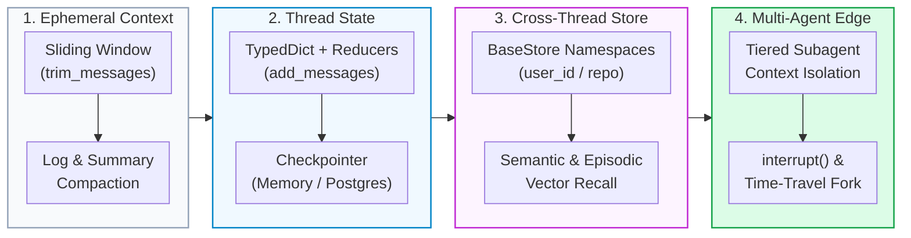
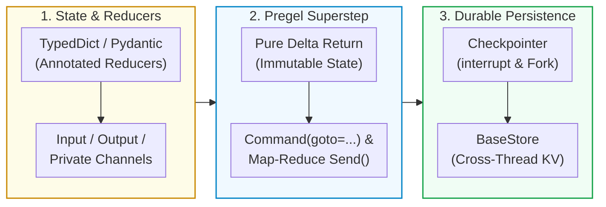

# 🧠 AI State Management: LangChain & LangGraph Engineering Guide
**Quick Navigation:** [1. State Taxonomy](#1-universal-taxonomy-of-ai-state-management) · [2. Ephemeral In-Context State](#2-tier-1-ephemeral-in-context-state-techniques) · [3. LangChain LCEL State](#3-tier-2-langchain-lcel-state-management-runnablewithmessagehistory) · [4. LangGraph State Patterns](#4-tier-3-langgraph-state-management-7-core-techniques) · [5. Decision Matrix](#5-quick-decision-matrix--code-primitives-cheat-sheet)
## 1. Universal Taxonomy of AI State Management
AI state management turns stateless LLMs into coherent, stateful agents capable of multi-turn conversations, cyclic tool loops, human-in-the-loop (HITL) approvals, and cross-session learning.

| State Tier | Scope / Lifetime | Primary Mechanism | Key Problem Solved |
| :--- | :--- | :--- | :--- |
| **1. Ephemeral (In-Context)** | Single LLM turn / active window | `trim_messages`, rolling summaries, deterministic log compaction, prefix caching | Context rot, token overflow (`400 Bad Request`), latency inflation |
| **2. Session / Thread (Short-Term)** | Multi-turn chat or workflow (`thread_id`) | Graph Checkpointers (`MemorySaver`, `AsyncPostgresSaver`), FSM schemas | Crash recovery, cyclic tool loops, time-travel debugging, HITL interrupts |
| **3. Cross-Session (Long-Term)** | User/tenant lifetime (`namespace` / `user_id`) | Document Stores + Vector Indexes (`BaseStore`, `PostgresStore`, `pgvector`) | Remembering user preferences (semantic) and past trajectories (episodic) |
| **4. Distributed / Multi-Agent** | Web workers & subagent boundaries | Signed cookies, Outbox queues (`SKIP LOCKED`), Pydantic subagent contracts | Surviving F5 reloads without sticky sessions, preventing context pollution |
## 2. Tier 1: Ephemeral (In-Context) State Techniques
### 2.1 Sliding Window & Token Trimming (`trim_messages`)
* **Purpose**: Enforces hard token budgets while preserving index-0 `SystemMessage` and valid `HumanMessage` turn boundaries (never leaving an orphaned `ToolMessage` at the start of the window).
```python
from langchain_core.messages import SystemMessage, HumanMessage, AIMessage, ToolMessage, trim_messages
from langchain_openai import ChatOpenAI
llm = ChatOpenAI(model="gpt-4o")
raw_history = [
    SystemMessage(content="You are a Zero-Trust SQL security auditor."),
    HumanMessage(content="Check query 1: SELECT * FROM users"),
    AIMessage(content="Query 1 is safe."),
    HumanMessage(content="Check query 2: SELECT * FROM docs WHERE allowed_roles ?| $1"),
    AIMessage(content="", tool_calls=[{"name": "explain_sql", "args": {"q": "..."}, "id": "call_1"}]),
    ToolMessage(content="Index Cond: (allowed_roles ?| $1::text[])", tool_call_id="call_1"),
    AIMessage(content="Query 2 uses the GIN index pre-filter properly."),
    HumanMessage(content="Now summarize the RBAC posture."),
]
trimmed_context = trim_messages(
    raw_history,
    max_tokens=120,
    strategy="last",           # Keep newest turns
    token_counter=llm,         # Exact tiktoken count for gpt-4o
    include_system=True,       # Always preserve index-0 SystemMessage
    allow_partial=False,       # Never slice a message in half
    start_on="human",          # Never leave an orphaned ToolMessage at top
)
```
### 2.2 Rolling Summary Compaction (`RemoveMessage`)
* **Purpose**: Compresses older turns into a persistent `running_summary` field once message length crosses a threshold, then evicts old messages from the state checkpoint via `RemoveMessage`.
```python
from typing import Literal
from langchain_core.messages import SystemMessage, HumanMessage, RemoveMessage
from langgraph.graph import StateGraph, MessagesState, START, END
class SummarizableState(MessagesState):
    running_summary: str
async def call_model(state: SummarizableState):
    summary = state.get("running_summary", "")
    msgs = [SystemMessage(content=f"Earlier summary:\n{summary}")] + state["messages"] if summary else state["messages"]
    return {"messages": [await llm.ainvoke(msgs)]}
async def summarize_conversation(state: SummarizableState):
    existing = state.get("running_summary", "")
    prompt = f"Extend summary: {existing}" if existing else "Summarize the conversation concisely:"
    resp = await llm.ainvoke(state["messages"] + [HumanMessage(content=prompt)])
    delete_ops = [RemoveMessage(id=m.id) for m in state["messages"][:-2]]
    return {"running_summary": resp.content, "messages": delete_ops}
def should_summarize(state: SummarizableState) -> Literal["summarize", "__end__"]:
    return "summarize" if len(state["messages"]) > 6 else "__end__"
builder = StateGraph(SummarizableState)
builder.add_node("call_model", call_model)
builder.add_node("summarize", summarize_conversation)
builder.add_edge(START, "call_model")
builder.add_conditional_edges("call_model", should_summarize, {"summarize": "summarize", "__end__": END})
builder.add_edge("summarize", END)
```
### 2.3 Deterministic Log Compaction (`agent/workflow.py`)
* **Purpose**: Prevents 50,000-character `pytest` stack traces from overflowing repair prompts by combining a fast subagent triage header with a bounded tail slice (see [`compact_agent_context()`](file:///c:/src/enterprise-rag-pgvector-rbac/agent/workflow.py#L81-L101)).
```python
from typing import Any, Dict, List, Optional
def compact_agent_context(raw_trace: str, triage_summary: Optional[Dict[str, Any]] = None, max_chars: int = 2500) -> str:
    header_parts: List[str] = []
    if triage_summary and triage_summary.get("concise_summary"):
        header_parts.append(f"[Flash Test-Triager Summary]: {triage_summary['concise_summary']}")
        targets = triage_summary.get("failing_targets") or []
        if targets: header_parts.append(f"[Failing Targets]: {', '.join(targets[:5])}")
    tail = (raw_trace or "")[-max_chars:]
    return "\n".join(header_parts) + "\n\n" + tail if header_parts else tail
```
## 3. Tier 2: LangChain LCEL State Management (`RunnableWithMessageHistory`)
* **Evolution**: Legacy `ConversationBufferMemory` is deprecated in LangChain v0.3+. Modern LCEL externalizes state via `RunnableWithMessageHistory` keyed by `(user_id, conversation_id)` backed by Redis or PostgreSQL (`PostgresChatMessageHistory`).
```python
from langchain_core.chat_history import InMemoryChatMessageHistory
from langchain_core.prompts import ChatPromptTemplate, MessagesPlaceholder
from langchain_core.runnables import ConfigurableFieldSpec
from langchain_core.runnables.history import RunnableWithMessageHistory
from langchain_openai import ChatOpenAI
_SESSION_STORE: dict[tuple[str, str], InMemoryChatMessageHistory] = {}
def get_session_history(user_id: str, conversation_id: str) -> InMemoryChatMessageHistory:
    return _SESSION_STORE.setdefault((user_id, conversation_id), InMemoryChatMessageHistory())
prompt = ChatPromptTemplate.from_messages([
    ("system", "You are an assistant for role: {user_role}."),
    MessagesPlaceholder(variable_name="history"),
    ("human", "{question}"),
])
with_message_history = RunnableWithMessageHistory(
    prompt | ChatOpenAI(model="gpt-4o-mini"),
    get_session_history,
    input_messages_key="question",
    history_messages_key="history",
    history_factory_config=[
        ConfigurableFieldSpec(id="user_id", annotation=str, is_shared=True),
        ConfigurableFieldSpec(id="conversation_id", annotation=str, is_shared=True),
    ],
)
cfg = {"configurable": {"user_id": "alice", "conversation_id": "thread-42"}}
resp1 = await with_message_history.ainvoke({"user_role": "finance", "question": "Target is $14.2M."}, config=cfg)
resp2 = await with_message_history.ainvoke({"user_role": "finance", "question": "What was the target?"}, config=cfg)
```
## 4. Tier 3: LangGraph State Management (7 Core Techniques)

### 4.1 Explicit `TypedDict` State & Pure Delta Updates
* **Principle**: Nodes receive an immutable state snapshot and return a pure delta dictionary containing only updated keys (see [`AgentState`](file:///c:/src/enterprise-rag-pgvector-rbac/agent/workflow.py#L290-L304) and [`LangGraphSDLCWorkflow`](file:///c:/src/enterprise-rag-pgvector-rbac/agent/workflow.py#L310-L435)).
```python
from typing import TypedDict, Optional
from langgraph.graph import StateGraph, START, END
class SDLCState(TypedDict):
    issue_id: int
    patch_code: str
    attempt: int
    max_attempts: int
    passed_tests: bool
    error: Optional[str]
def propose_node(state: SDLCState) -> dict:
    return {"patch_code": f"def fix_{state['issue_id']}(): return True", "attempt": state.get("attempt", 0) + 1}
def test_node(state: SDLCState) -> dict:
    ok = "return True" in state["patch_code"]
    return {"passed_tests": ok, "error": None if ok else "AssertionError in test_suite.py"}
def route_after_test(state: SDLCState) -> str:
    if state["passed_tests"] or state["attempt"] >= state["max_attempts"]: return END
    return "propose_node"
builder = StateGraph(SDLCState)
builder.add_node("propose_node", propose_node)
builder.add_node("test_node", test_node)
builder.add_edge(START, "propose_node")
builder.add_edge("propose_node", "test_node")
builder.add_conditional_edges("test_node", route_after_test)
graph = builder.compile()
```
### 4.2 Custom State Reducers (`Annotated`, `operator.add`, Custom Merge Logic)
* **Principle**: Reducers define how parallel or sequential node outputs merge into a state channel without raising `InvalidUpdateError` or clobbering concurrent writes.
```python
import operator
from typing import Annotated, TypedDict
from langgraph.graph import StateGraph, START, END
def merge_unique_violations(existing: list[str], new_items: list[str] | str) -> list[str]:
    if new_items == "__CLEAR__": return []
    combined = list(existing or [])
    for item in new_items:
        if item not in combined: combined.append(item)
    return combined
def min_score_reducer(current: float, incoming: float) -> float:
    return incoming if current == 0.0 else min(current, incoming)
class AuditState(TypedDict):
    code: str
    executed_checks: Annotated[list[str], operator.add]
    violations: Annotated[list[str], merge_unique_violations]
    safety_score: Annotated[float, min_score_reducer]
def ast_scanner(state: AuditState) -> dict:
    bad = "eval(" in state["code"]
    return {"executed_checks": ["ast"], "violations": ["AST-01: eval()"] if bad else [], "safety_score": 0.2 if bad else 1.0}
def secret_scanner(state: AuditState) -> dict:
    bad = "sk-" in state["code"]
    return {"executed_checks": ["sec"], "violations": ["SEC-01: API key"] if bad else [], "safety_score": 0.0 if bad else 0.95}
builder = StateGraph(AuditState)
builder.add_node("ast_scanner", ast_scanner)
builder.add_node("secret_scanner", secret_scanner)
builder.add_edge(START, "ast_scanner")
builder.add_edge(START, "secret_scanner")
builder.add_edge("ast_scanner", END)
builder.add_edge("secret_scanner", END)
audit_graph = builder.compile()
```
### 4.3 Multiple Schemas (Input, Output & Private Node Channels)
* **Principle**: Strips internal scratchpad channels (e.g., cross-encoder logits or raw DB rows) from the public API output via `input_schema` and `output_schema`.
```python
from typing import TypedDict
from langgraph.graph import StateGraph, START, END
class PublicInputState(TypedDict):
    query: str
    user_roles: list[str]
class PublicOutputState(TypedDict):
    answer: str
    citations: list[str]
class OverallRAGState(PublicInputState, PublicOutputState):
    raw_db_rows: list[dict]
class PrivateRerankChannel(TypedDict):
    unfiltered_logits: list[float]
def retrieve_node(state: OverallRAGState) -> PrivateRerankChannel:
    return {"unfiltered_logits": [0.94, 0.81, 0.12]}
def rerank_and_answer(state: PrivateRerankChannel) -> PublicOutputState:
    return {"answer": f"Confidence={max(state['unfiltered_logits'])}", "citations": ["[Doc: Arch, Chunk 0]"]}
builder = StateGraph(OverallRAGState, input_schema=PublicInputState, output_schema=PublicOutputState)
builder.add_node("retrieve", retrieve_node)
builder.add_node("rerank_and_answer", rerank_and_answer)
builder.add_edge(START, "retrieve")
builder.add_edge("retrieve", "rerank_and_answer")
builder.add_edge("rerank_and_answer", END)
rag_graph = builder.compile()
```
### 4.4 Checkpointers, Human-in-the-Loop (`interrupt`), and Time-Travel Forking
* **Principle**: Compiling with `MemorySaver` ([`agent/workflow.py#L325`](file:///c:/src/enterprise-rag-pgvector-rbac/agent/workflow.py#L325)) or `AsyncPostgresSaver` persists every superstep by `thread_id`, enabling zero-CPU HITL pauses (`interrupt`) and historical state branching (`update_state`).
```python
from typing import TypedDict
from langgraph.graph import StateGraph, START, END
from langgraph.checkpoint.memory import MemorySaver
from langgraph.types import interrupt, Command
class DeployState(TypedDict):
    branch: str
    patch_diff: str
    approved: bool
    status: str
def prepare_patch(state: DeployState) -> dict:
    return {"patch_diff": "+ WHERE allowed_roles ?| $2::text[]", "status": "staged"}
def human_approval_gate(state: DeployState) -> dict:
    decision = interrupt({"question": "Approve prod deploy?", "diff": state["patch_diff"]})
    return {"approved": decision == "approve"}
def deploy_to_prod(state: DeployState) -> dict:
    return {"status": "deployed_to_prod" if state["approved"] else "aborted_by_human"}
builder = StateGraph(DeployState)
builder.add_node("prepare_patch", prepare_patch)
builder.add_node("human_approval_gate", human_approval_gate)
builder.add_node("deploy_to_prod", deploy_to_prod)
builder.add_edge(START, "prepare_patch")
builder.add_edge("prepare_patch", "human_approval_gate")
builder.add_edge("human_approval_gate", "deploy_to_prod")
builder.add_edge("deploy_to_prod", END)
app = builder.compile(checkpointer=MemorySaver())
config = {"configurable": {"thread_id": "deploy-issue-101"}}
paused = app.invoke({"branch": "fix/101", "approved": False, "status": "init"}, config=config)
final_state = app.invoke(Command(resume="approve"), config=config)
history = list(app.get_state_history(config))
after_prepare_ckpt = [s for s in history if s.next == ("human_approval_gate",)][0]
forked_config = app.update_state(after_prepare_ckpt.config, {"patch_diff": "+ WHERE 1=1"})
```
### 4.5 Dynamic State + Control Flow (`Command` and Map-Reduce `Send`)
* **Principle**: `Send(node, payload)` fans out dynamic parallel map-reduce workers; `Command(update={...}, goto=...)` combines state mutation and edge routing in a single return object.
```python
import operator
from typing import Annotated, Literal, TypedDict
from langgraph.graph import StateGraph, START, END
from langgraph.types import Command, Send
class RepoAuditState(TypedDict):
    files_to_audit: list[str]
    findings: Annotated[list[str], operator.add]
    verdict: str
class SingleFileArg(TypedDict):
    file_path: str
def fan_out_files(state: RepoAuditState) -> list[Send]:
    return [Send("audit_single_file", {"file_path": f}) for f in state["files_to_audit"]]
def audit_single_file(arg: SingleFileArg) -> dict:
    path = arg["file_path"]
    return {"findings": [f"{path}: missing types" if path.endswith(".py") else f"{path}: clean"]}
def judge_verdict_node(state: RepoAuditState) -> Command[Literal["remediate", "__end__"]]:
    if any("missing" in f for f in state["findings"]):
        return Command(update={"verdict": "FAIL"}, goto="remediate")
    return Command(update={"verdict": "PASS"}, goto=END)
def remediate(state: RepoAuditState) -> dict:
    return {"verdict": "REMEDIATED"}
builder = StateGraph(RepoAuditState)
builder.add_node("audit_single_file", audit_single_file)
builder.add_node("judge_verdict_node", judge_verdict_node)
builder.add_node("remediate", remediate)
builder.add_conditional_edges(START, fan_out_files, ["audit_single_file"])
builder.add_edge("audit_single_file", "judge_verdict_node")
builder.add_edge("remediate", END)
map_reduce_graph = builder.compile()
```
### 4.6 Cross-Thread Long-Term Memory (`BaseStore` / `InMemoryStore` / `PostgresStore`)
* **Principle**: Persists semantic and episodic memories across separate `thread_id` sessions using hierarchical tuple namespaces (`("user_memories", user_id)`).
```python
import uuid
from langchain_core.runnables import RunnableConfig
from langgraph.graph import StateGraph, MessagesState, START, END
from langgraph.checkpoint.memory import MemorySaver
from langgraph.store.memory import InMemoryStore
from langgraph.store.base import BaseStore
long_term_store = InMemoryStore()
async def personalized_agent_node(state: MessagesState, config: RunnableConfig, *, store: BaseStore):
    namespace = ("user_memories", config["configurable"]["user_id"])
    memories = await store.asearch(namespace)
    memory_context = "\n".join(f"- {m.value['fact']}" for m in memories)
    last_msg = state["messages"][-1].content
    if "remember:" in last_msg.lower():
        await store.aput(namespace, key=str(uuid.uuid4()), value={"fact": last_msg})
    return {"messages": [{"role": "assistant", "content": f"Known facts:\n{memory_context}"}]}
builder = StateGraph(MessagesState)
builder.add_node("agent", personalized_agent_node)
builder.add_edge(START, "agent")
builder.add_edge("agent", END)
graph = builder.compile(checkpointer=MemorySaver(), store=long_term_store)
```
### 4.7 Tiered Subagent Context Isolation (`agent/workflow.py`)
* **Principle**: Invokes specialized subagents ([`TestTriagerSubagent`](file:///c:/src/enterprise-rag-pgvector-rbac/agent/workflow.py#L104-L120) on `flash`, [`CrossModelJudgeSubagent`](file:///c:/src/enterprise-rag-pgvector-rbac/agent/workflow.py#L168-L229) on `pro`) behind strict `ConfigDict(extra="forbid")` Pydantic contracts so raw logs never pollute the parent `AgentState`.
```python
from typing import Literal, List, TypedDict
from pydantic import BaseModel, ConfigDict, Field
class TriageSummary(BaseModel):
    model_config = ConfigDict(extra="forbid")
    model_tier: Literal["flash"] = "flash"
    failure_category: Literal["none", "compilation_error", "assertion_failure", "timeout"] = "none"
    failing_targets: List[str] = Field(default_factory=list)
    concise_summary: str = ""
class ParentOrchestratorState(TypedDict):
    raw_pytest_stdout: str
    triage_summary: dict
async def run_tests_and_triage_node(state: ParentOrchestratorState) -> dict:
    raw_out = state["raw_pytest_stdout"]
    summary = (
        TriageSummary(
            failure_category="assertion_failure",
            failing_targets=["tests/test_main.py::test_rbac"],
            concise_summary="RBAC assertion failed in test_main.py (1 target).",
        )
        if "AssertionError" in raw_out
        else TriageSummary(concise_summary="All tests passed.")
    )
    return {"triage_summary": summary.model_dump()}
```
## 5. Quick Decision Matrix & Code Primitives Cheat Sheet
| Engineering Requirement | Exact LangChain / LangGraph Primitive |
| :--- | :--- |
| Linear Q&A chatbot with session history | `RunnableWithMessageHistory(chain, get_session_history)` |
| Trim old messages to fit token budget | `trim_messages(messages, max_tokens=4000, strategy="last", include_system=True)` |
| Delete specific messages by ID from graph state | `return {"messages": [RemoveMessage(id=m.id) for m in old_msgs]}` |
| Cyclic self-healing loop (Propose $\rightarrow$ Test $\rightarrow$ Repair) | `StateGraph(AgentState)` + `add_conditional_edges` ([`LangGraphSDLCWorkflow`](file:///c:/src/enterprise-rag-pgvector-rbac/agent/workflow.py#L328-L357)) |
| Append to a state list across parallel nodes | `items: Annotated[list[str], operator.add]` |
| Pause a graph for human approval | `decision = interrupt({"diff": ...})` + `graph.invoke(Command(resume="approve"), config)` |
| Dynamically spawn $N$ parallel worker nodes | `return [Send("worker_node", {"item": x}) for x in state["items"]]` |
| Update state and route to next node in one return | `return Command(update={"attempt": 2}, goto="repair_patches")` |
| Persist thread checkpoints in PostgreSQL | `AsyncPostgresSaver.from_conn_string(DB_URI)` |
| Share long-term facts across separate `thread_id`s | `graph.compile(checkpointer=cp, store=InMemoryStore())` + `store.asearch(namespace)` |
| Prevent 50K-line test logs from blowing up tokens | Tiered Subagent (`TriageSummary`) + [`compact_agent_context()`](file:///c:/src/enterprise-rag-pgvector-rbac/agent/workflow.py#L81-L101) |
