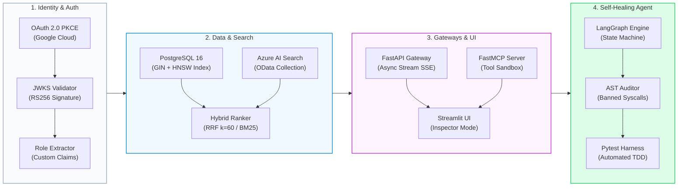
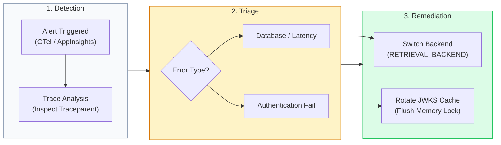

# Enterprise Zero-Trust RAG & Autonomous SDLC: Master Architecture & Operational Playbook

> **Architect:** **[Ken Wong](https://www.linkedin.com/in/kenwong-architect/)**  
> **Repository:** [`enterprise-rag-pgvector-rbac`](file:///c:/src/enterprise-rag-pgvector-rbac/)  
> **Classification:** Confidential Enterprise Reference Architecture  
> **Status:** Production-Ready (102 Automated Tests: 101 Passed, 1 Skipped)

---

## Executive Summary & Core Paradigm Shift

Enterprise Generative AI deployments routinely suffer from critical vulnerabilities and degraded retrieval quality because authorization logic is implemented in the application layer *after* vector retrieval. This master playbook defines the complete architecture, implementation patterns, security guardrails, and operational runbooks for **`enterprise-rag-pgvector-rbac`**.

The platform is engineered around two pioneering design principles:
1. **In-Database Zero-Trust RBAC**: Document permissions are enforced inside the database engine during the index scan—guaranteeing that unauthorized embeddings and text chunks are never loaded into application memory or transferred across network boundaries.
2. **Autonomous Self-Healing SDLC Agent**: A stateful LangGraph agent that proposes code changes, evaluates AST security guardrails, runs deterministic regression tests, and automatically rolls back or repairs anomalies.

```
❌ Standard Post-Filtering (Memory Leaks & Recall Starvation):
[User Query] ──► [Vector DB: Scan Top-K] ──► [Python Reads Restricted Data] ──► [Drop Forbidden Chunks]
                                                       │
                                                       └─► Context Eviction & Memory Leaks

✅ Zero-Trust In-Database RBAC (Shift-Left Security):
[User Query] ──► [Validated JWT] ──► [DB Engine: GIN Role Filter + HNSW Scan] ──► [Authorized Context Only]
                                                       │
                                                       └─► Restricted data never leaves database disk
```

---

## 1. Master System Architecture

The platform spans 8 integrated engineering layers connecting identity providers, vector databases, API gateways, agent frameworks, and distributed telemetry.



---

## 2. The 8 Engineering Layers

### Layer 1: In-Database Zero-Trust Storage & pgvector Indexing
- **Database Engine**: PostgreSQL 16 with `pgvector` extension.
- **Normalized Schema ([`schema.sql`](file:///c:/src/enterprise-rag-pgvector-rbac/schema.sql))**:
  - `documents`: Master table storing document identity (`document_id`), cryptographic hash (`file_hash`), governance metadata, and `allowed_roles` JSONB array.
  - `document_chunks`: Normalized vector table storing individual text slices, sequence positions (`chunk_index`), generated `tsvector` columns, and dense 1536-dimensional embeddings (`vector(1536)`).
- **Dual Indexing Architecture**:
  - **HNSW Vector Index**: Sub-millisecond vector similarity search using `vector_cosine_ops` ($m=16$, $ef\_construction=64$).
  - **GIN JSONB Role Index**: Constant-time role membership pre-filter via `allowed_roles jsonb_path_ops`.
  - **Full-Text GIN Index**: Inverted lexical index on stored `tsv` column for keyword BM25 retrieval.

```sql
-- Zero-Trust Pre-Filtered Vector Retrieval
SELECT 
    d.document_id,
    d.title,
    c.chunk_index,
    c.content,
    d.allowed_roles,
    1 - (c.embedding <=> $1::vector) AS similarity_score
FROM document_chunks c
JOIN documents d ON c.document_id = d.id
WHERE d.allowed_roles ?| $2::text[]
ORDER BY c.embedding <=> $1::vector
LIMIT $3;
```

> [!IMPORTANT]
> The database executes the GIN JSONB index scan `WHERE d.allowed_roles ?| $roles` **before** traversing the HNSW vector graph. Unauthorized documents are never read from disk into the PostgreSQL buffer pool, eliminating memory-level data leakage.

---

### Layer 2: Identity, OAuth 2.0 PKCE & Session Security
- **Authentication Handshake ([`pkce.py`](file:///c:/src/enterprise-rag-pgvector-rbac/app/auth/pkce.py))**:
  - Implements RFC 7636 Proof Key for Code Exchange (PKCE) with cryptographically secure high-entropy `code_verifier` ($[A\text{-}Z, a\text{-}z, 0\text{-}9, \text{-}, \_, ., \sim]$) and Base64URL-encoded SHA-256 `code_challenge`.
- **JWKS Signature Verification ([`jwks.py`](file:///c:/src/enterprise-rag-pgvector-rbac/app/auth/jwks.py))**:
  - Fetches public keys dynamically from Google Identity Discovery (`https://www.googleapis.com/oauth2/v3/certs`).
  - Implements in-memory TTL caching with atomic locks to prevent stampeding cache misses while honoring upstream key rotation.
- **Dynamic Role Extraction ([`role_mapper.py`](file:///c:/src/enterprise-rag-pgvector-rbac/app/auth/role_mapper.py))**:
  - Extracts enterprise security entitlements from custom JWT claims (`roles`, `groups`, `permissions`, or `firebase.sign_in_attributes`).
  - Normalizes identity into canonical system roles: `engineer`, `finance_executive`, `hr_admin`, `legal_counsel`, or `public`.

---

### Layer 3: High-Performance Batch Ingestion Pipeline
- **Ingestion Orchestrator ([`ingest.py`](file:///c:/src/enterprise-rag-pgvector-rbac/scripts/ingest.py))**:
  - Multi-threaded document processing with recursive token-aware chunking (500 tokens target, 50 tokens overlap).
  - Cryptographic duplicate prevention via SHA-256 hashing across source files.
- **Embedding Generation**:
  - Generates 1536-dimensional embeddings with OpenAI `text-embedding-3-large` or 3072-dimensional embeddings for Azure OpenAI deployments.
  - Batched vector calls with exponential backoff retry to prevent rate-limit throttling.
- **Transactional Persistence**:
  - Uses `asyncpg` binary protocol batch inserts with atomic transaction boundaries. If a chunk insertion fails, the entire document batch rolls back cleanly.

---

### Layer 4: Hybrid Search, Re-Ranking & Grounding Guardrails
- **Hybrid Retrieval Fusion ([`manager.py`](file:///c:/src/enterprise-rag-pgvector-rbac/app/db/manager.py))**:
  - Combines dense semantic vector search (`<=>` cosine distance) with sparse lexical keyword matching (`tsvector @@ plainto_tsquery`).
  - Merges disparate ranking distributions using Reciprocal Rank Fusion (RRF with smoothing constant $k=60$):
    $$\text{RRF\_Score}(d) = \sum_{m \in \{\text{vector}, \text{lexical}\}} \frac{1}{k + \text{rank}_m(d)}$$
- **RAG Quality & Anti-Hallucination Guardrails**:
  - Validates the RAG Triad: Context Relevance, Faithfulness, and Answer Relevance.
  - Zero-Trust fallback: If a user possesses no matching roles or the similarity threshold is unmet, the system returns:
    > *"No authorized documentation found matching your security credentials."*

---

### Layer 5: High-Throughput Async Backend & Streamlit UI
- **FastAPI Core ([`main.py`](file:///c:/src/enterprise-rag-pgvector-rbac/app/main.py) & [`rag.py`](file:///c:/src/enterprise-rag-pgvector-rbac/app/api/rag.py))**:
  - Built with non-blocking async architecture utilizing `asyncpg.create_pool` with tuned connection limits (`min_size=5`, `max_size=20`).
  - Server-Sent Events (SSE) streaming API endpoints delivering sub-100ms time-to-first-token (TTFT).
  - Pydantic v2 DTO schemas enforcing strict payload validation.
- **Interactive Streamlit Workspace ([`streamlit_app.py`](file:///c:/src/enterprise-rag-pgvector-rbac/streamlit_app.py))**:
  - Role-switching simulation bar allowing instant security role evaluation (`engineer` vs. `finance_executive`).
  - Live query inspector displaying generated OData/SQL filters and vector similarity scores.

---

### Layer 6: Distributed Tracing & Observability
- **OpenTelemetry Instrumentation ([`observability.py`](file:///c:/src/enterprise-rag-pgvector-rbac/app/observability.py))**:
  - OpenTelemetry SDK instrumentation with automatic tracing across FastAPI routes, database queries, and external LLM calls.
  - W3C `traceparent` context propagation across HTTP boundaries and MCP tools.
- **Jaeger All-In-One & Azure Monitor Telemetry**:
  - Local environment: Persistent Jaeger deployment utilizing Badger LSM-tree storage to prevent container restart trace loss.
  - Cloud environment: Seamless exporter failover to Azure Application Insights via `azure-monitor-opentelemetry`.

---

### Layer 7: FastMCP Agent Gateway
- **Model Context Protocol Server ([`gateway.py`](file:///c:/src/enterprise-rag-pgvector-rbac/app/mcp/gateway.py))**:
  - Native FastMCP server exposing authenticated enterprise tools to external AI agents (e.g., Claude Desktop, Cursor, local agent runners).
  - Implements `@mcp.tool()` endpoints:
    - `search_sdlc_context`: Zero-Trust semantic search with automatic dual-backend routing (Azure Search or PostgreSQL).
    - `verify_authorization`: Entitlement validation tool preventing unauthenticated agent execution.
    - `audit_trace`: Contextual trace inspection for production debugging.

---

### Layer 8: Autonomous Self-Healing SDLC Agent
- **State Machine Orchestrator ([`workflow.py`](file:///c:/src/enterprise-rag-pgvector-rbac/agent/workflow.py))**:
  - Powered by LangGraph state graphs implementing an autonomous cycle:
    $$\text{PROPOSE} \longrightarrow \text{APPLY} \longrightarrow \text{AUDIT} \longrightarrow \text{TEST} \longrightarrow \text{REPAIR / COMMIT}$$
- **AST Policy Guardrails ([`guardrails.py`](file:///c:/src/enterprise-rag-pgvector-rbac/agent/guardrails.py))**:
  - Python Abstract Syntax Tree (AST) analyzer scanning candidate code changes before disk persistence.
  - Rejects dangerous syscalls (`os.system`, `subprocess.Popen`, `eval`, `exec`) and unapproved external network libraries.
- **Secret Scanner & TDD Loop**:
  - Detects hardcoded API keys, private keys, or high-entropy credentials.
  - Invokes automated `pytest` suites. On failure, feeds stack traces back to the agent for self-healing repair attempts (up to 3 iterations) before triggering automatic git reversion.

---

## 3. Dual-Backend Cloud Architecture (PostgreSQL vs. Azure AI)

The platform supports dual-mode operation via a single configuration toggle in [`.env`](file:///c:/src/enterprise-rag-pgvector-rbac/.env), eliminating vendor lock-in.

| Platform Layer | PostgreSQL + Local Stack (`pgvector`) | Microsoft Azure AI Cloud (`azure`) |
| :--- | :--- | :--- |
| **Vector Engine** | PostgreSQL 16 + `pgvector` (HNSW) | **Azure AI Search** (HNSW Vector Profile) |
| **Lexical Engine** | PostgreSQL Full-Text Search (`tsvector`) | **Azure AI Search BM25** Engine |
| **Re-Ranking** | Reciprocal Rank Fusion (RRF $k=60$) | **Bing Semantic Ranker** (`semantic-config`) |
| **RBAC Filter** | SQL `WHERE allowed_roles ?| $roles` | **OData Filter**: `allowed_roles/any(r: r eq '...')` |
| **Embedding Model**| OpenAI `text-embedding-3-large` (1536-d) | **Azure OpenAI** `text-embedding-3-large` (3072-d) |
| **LLM Model** | OpenAI `gpt-4o` | **Azure OpenAI** `gpt-4o` Deployments |
| **Telemetry** | Jaeger Persistent (Badger LSM-tree) | **Azure Application Insights** (Azure Monitor OTel)|

```ini
# Switch runtime backend with zero code changes:
RETRIEVAL_BACKEND="azure" # or "pgvector"
```

> [!NOTE]
> Detailed Azure portal provisioning, ARM/Bicep configurations, and data migration instructions are documented in [`Azure-RAG-Migration.md`](file:///c:/src/enterprise-rag-pgvector-rbac/docs/Azure-RAG-Migration.md).

---

## 4. Threat Model & Security Architecture (STRIDE)

| Threat Category | Potential Attack Vector | Platform Mitigation & Invariant |
| :--- | :--- | :--- |
| **Spoofing** | Forged JWT identity tokens | Cryptographic signature verification via cached JWKS public keys. |
| **Tampering** | In-flight payload manipulation | TLS 1.3 encryption and SHA-256 PKCE code challenges. |
| **Repudiation** | Unaudited data access | OpenTelemetry distributed tracing recording tenant ID and roles for every query. |
| **Information Disclosure** | Vector database memory snooping | **In-database Zero-Trust filtering**: unauthorized records are never loaded into RAM. |
| **Denial of Service** | Expensive unbounded vector scans | Connection pooling, query timeouts (5000ms), and indexed HNSW graphs. |
| **Elevation of Privilege**| LLM prompt injection manipulating roles | Hardened role boundaries extracted exclusively from signed JWT claims. |

---

## 5. Developer Operations & Quickstart Runbook

### Prerequisites
- Python 3.11+
- PostgreSQL 16 with `pgvector`
- Docker Desktop (for Jaeger distributed tracing)

### Step 1: Environment Initialization
```powershell
# Clone repository and enter directory
cd C:\src\enterprise-rag-pgvector-rbac

# Create and activate virtual environment
python -m venv venv
.\venv\Scripts\Activate.ps1

# Install core and Azure dependencies
pip install -r requirements.txt
pip install azure-search-documents azure-identity azure-monitor-opentelemetry
```

### Step 2: Database Provisioning
```powershell
# Initialize PostgreSQL schema, extensions, and mock records
psql -U postgres -d enterprise_rag -f schema.sql
```

### Step 3: Launch Local Infrastructure
```powershell
# Start Jaeger with persistent Badger storage
docker run -d --name jaeger \
  -e SPAN_STORAGE_TYPE=badger \
  -e BADGER_EPHEMERAL=false \
  -e BADGER_DIRECTORY_VALUE=/badger/data \
  -e BADGER_DIRECTORY_KEY=/badger/key \
  -v jaeger_data:/badger \
  -p 16686:16686 -p 4317:4317 -p 4318:4318 \
  jaegertracing/all-in-one:latest
```

### Step 4: Run Application Services
```powershell
# Launch FastAPI backend gateway (Port 8000)
uvicorn app.main:app --host 0.0.0.0 --port 8000 --reload

# Launch FastMCP Agent Gateway (Port 8001 / SSE)
python -m app.mcp

# Launch Interactive Streamlit Frontend (Port 8501)
streamlit run streamlit_app.py
```

---

## 6. Comprehensive Testing & Verification Playbook

The repository includes a comprehensive automated test harness covering security invariants, schema migrations, hybrid search, and multi-cloud routing.

```powershell
# Execute complete regression test suite
python -m pytest -q
# Target Output: 101 passed, 1 skipped in ~22 seconds
```

### Specialized Test Execution Matrix

| Test Suite | Purpose & Coverage | Key Test Classes |
| :--- | :--- | :--- |
| [`test_security_rbac.py`](file:///c:/src/enterprise-rag-pgvector-rbac/tests/test_security_rbac.py) | Verifies GIN role pre-filtering and zero memory leak invariants. | `TestSecurityRbac` |
| [`test_auth.py`](file:///c:/src/enterprise-rag-pgvector-rbac/tests/test_auth.py) | Tests PKCE math, JWKS cache rotation, and role extraction. | `TestJwksTokenValidation`, `TestPkce` |
| [`test_azure_search.py`](file:///c:/src/enterprise-rag-pgvector-rbac/tests/test_azure_search.py) | Tests OData filter expressions and empty-role guards. | `TestAzureSearch` |
| [`test_hybrid_search.py`](file:///c:/src/enterprise-rag-pgvector-rbac/tests/test_hybrid_search.py) | Validates Reciprocal Rank Fusion math and score weighting. | `TestHybridSearch` |
| [`test_mcp_auth.py`](file:///c:/src/enterprise-rag-pgvector-rbac/tests/test_mcp_auth.py) | Asserts FastMCP tool authorization and dual-mode routing. | `TestMcpAuth` |
| [`test_observability_and_health.py`](file:///c:/src/enterprise-rag-pgvector-rbac/tests/test_observability_and_health.py) | Verifies OpenTelemetry span generation and health endpoints. | `TestObservability` |

---

## 7. Solved Engineering Pitfalls & Root Cause Analyses (RCAs)

### RCA 1: Recall Starvation in Post-Retrieval Authorization
- **Symptom**: User receives empty search results even though relevant documents exist.
- **Root Cause**: Vector distance search fetched the top 5 globally similar documents, all belonging to `finance_executive`. Python post-filtering stripped all 5 documents, starving recall for an `engineer`.
- **Solution**: Shifted authorization into PostgreSQL `WHERE d.allowed_roles ?| $roles`. Retrieval candidates are pre-filtered before distance sorting.

### RCA 2: Azure OpenAI Trailing Empty Chunks (`IndexError`)
- **Symptom**: Streamlit streaming abruptly crashes with `IndexError: list index out of range` on final tokens.
- **Root Cause**: Azure OpenAI emits an empty trailing chunk containing only `usage` and `finish_reason` metadata without a `choices` array.
- **Solution**: Added explicit guard in [`llm.py`](file:///c:/src/enterprise-rag-pgvector-rbac/app/db/llm.py):
  ```python
  if not chunk.choices:
      continue
  ```

### RCA 3: FastMCP Connection Refused (`[WinError 1225]`)
- **Symptom**: FastMCP tool queries fail when local PostgreSQL service is paused during cloud evaluations.
- **Root Cause**: Gateway hard-routed to `DatabaseManager.hybrid_search` regardless of `.env` configuration.
- **Solution**: Implemented dynamic backend routing in [`gateway.py`](file:///c:/src/enterprise-rag-pgvector-rbac/app/mcp/gateway.py): dispatches to Azure AI Search when `RETRIEVAL_BACKEND="azure"`, eliminating local database dependency.

---

## 8. Incident Response & Operational Runbook



### Runbook Procedures

#### Scenario A: Database Node Outage or Latency Spike
1. Inspect active spans in Jaeger (`http://localhost:16686`) or Azure Application Insights.
2. Toggle backend to Azure AI Search in [`.env`](file:///c:/src/enterprise-rag-pgvector-rbac/.env):
   ```ini
   RETRIEVAL_BACKEND="azure"
   ```
3. Restart FastAPI worker:
   ```powershell
   uvicorn app.main:app --port 8000 --reload
   ```

#### Scenario B: JWKS Key Rotation Failure
1. Check identity provider reachability (`https://www.googleapis.com/oauth2/v3/certs`).
2. Force-refresh JWKS cache by restarting the auth worker or clearing `JWKSClient._cache`.
3. Validate token validation with test suite:
   ```powershell
   python -m pytest tests/test_auth.py -k "test_jwks" -v
   ```

---

## 9. Master File & Symbol Cross-Reference

| System Layer | File Location | Key Symbols & Responsibilities |
| :--- | :--- | :--- |
| **Database Schema** | [`schema.sql`](file:///c:/src/enterprise-rag-pgvector-rbac/schema.sql) | DDL tables `documents`, `document_chunks`, HNSW/GIN indexes. |
| **PostgreSQL Client** | [`manager.py`](file:///c:/src/enterprise-rag-pgvector-rbac/app/db/manager.py) | `DatabaseManager`, `hybrid_search`, `asyncpg` connection pool. |
| **Azure Search** | [`azure_search.py`](file:///c:/src/enterprise-rag-pgvector-rbac/app/db/azure_search.py) | `azure_hybrid_search`, OData collection role filtering. |
| **Dual LLM Client** | [`llm.py`](file:///c:/src/enterprise-rag-pgvector-rbac/app/db/llm.py) | `get_llm_client`, streaming response generators, guardrails. |
| **Identity & PKCE** | [`pkce.py`](file:///c:/src/enterprise-rag-pgvector-rbac/app/auth/pkce.py) | `generate_code_verifier`, `create_code_challenge`. |
| **JWKS Security** | [`jwks.py`](file:///c:/src/enterprise-rag-pgvector-rbac/app/auth/jwks.py) | `validate_jwt_token`, TTL public key cache manager. |
| **Role Extraction** | [`role_mapper.py`](file:///c:/src/enterprise-rag-pgvector-rbac/app/auth/role_mapper.py) | `extract_roles_from_claims`, `KNOWN_ROLES` entitlement validator. |
| **FastAPI Gateway** | [`main.py`](file:///c:/src/enterprise-rag-pgvector-rbac/app/main.py) | FastAPI lifecycle, dependency injection, SSE streaming endpoints. |
| **FastMCP Server** | [`gateway.py`](file:///c:/src/enterprise-rag-pgvector-rbac/app/mcp/gateway.py) | `search_sdlc_context`, `verify_authorization` MCP tools. |
| **Observability** | [`observability.py`](file:///c:/src/enterprise-rag-pgvector-rbac/app/observability.py) | OpenTelemetry tracer provider, Jaeger and Azure Monitor exporters. |
| **SDLC State Machine**| [`workflow.py`](file:///c:/src/enterprise-rag-pgvector-rbac/agent/workflow.py) | LangGraph autonomous SDLC graph (`propose` ➔ `repair`). |
| **AST Guardrails** | [`guardrails.py`](file:///c:/src/enterprise-rag-pgvector-rbac/agent/guardrails.py) | `ASTSecurityAuditor`, policy checker, secret scanning engine. |
